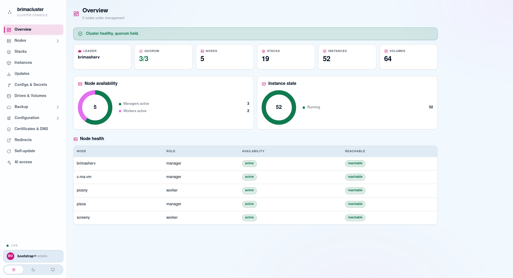
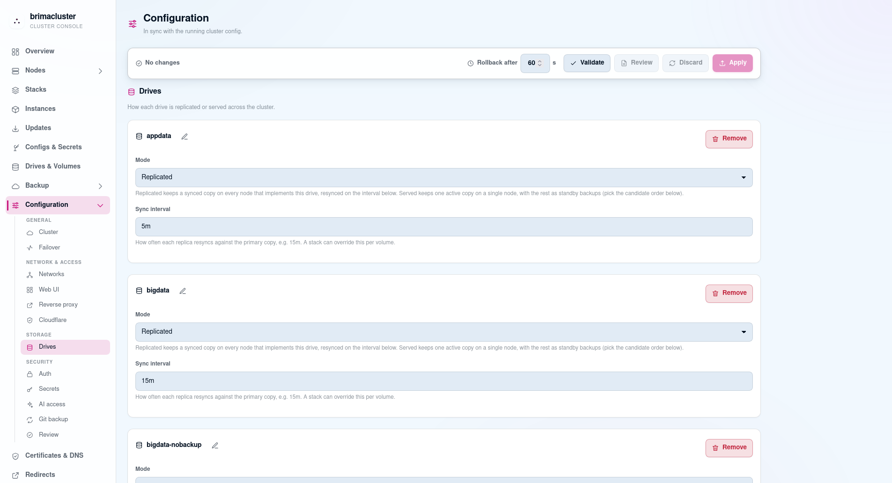
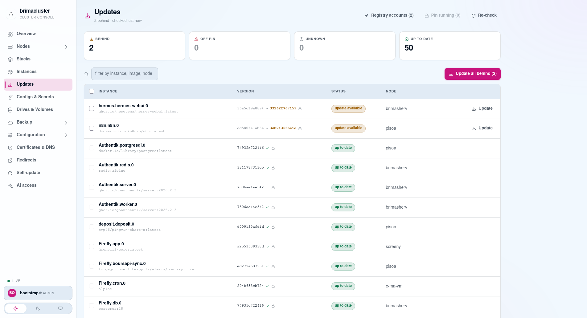
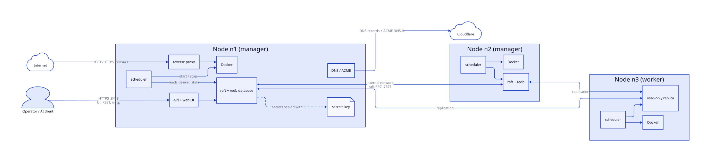
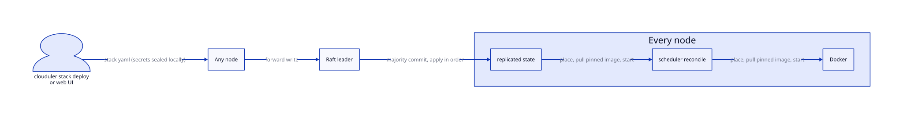
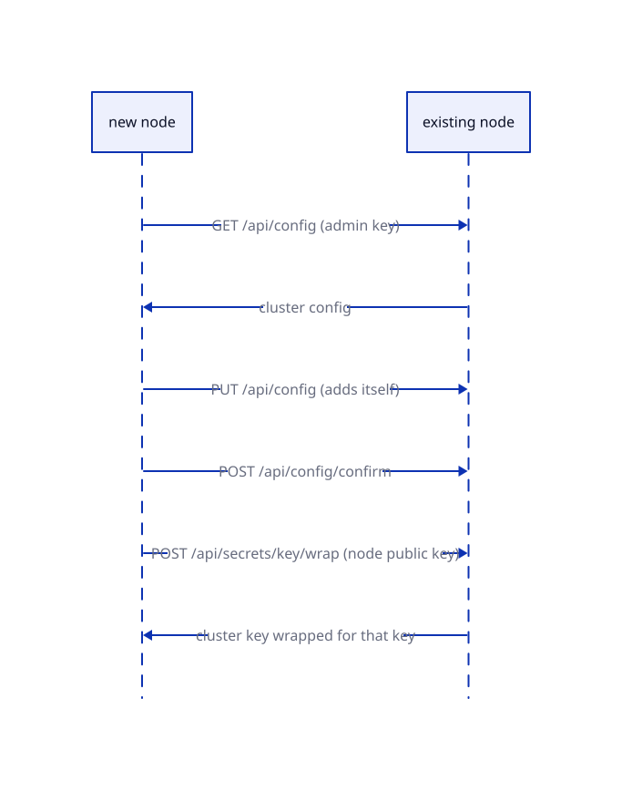
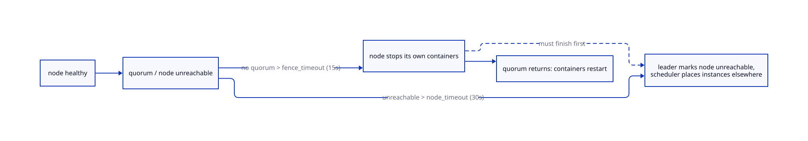

# clouduler

A small container orchestrator for home and small-office clusters. Nodes form a raft cluster, replicate stacks, configs and secrets, and run Docker containers with compose-style stack files. It includes a web UI, an overlay network, a reverse proxy with Let's Encrypt, replicated drives, backups, and an MCP endpoint for AI clients.

It ships as one binary (`clouduler`) with the UI embedded.



> **Security model:** the internal network is expected to be secure. Most traffic between nodes (raft, replication, overlay) is not encrypted, because clouduler is designed to run over an already encrypted VPN such as Tailscale or Headscale. Do not expose the cluster subnet to untrusted networks.

## Quick start (from a release)

Requirements on every node: Linux with systemd, Docker, root access. Optional: `restic` (volume backups). All nodes must reach each other over one trusted internal network (LAN, WireGuard, Tailscale or Headscale). Clouduler does not encrypt that traffic. Every node's internal address must be inside the subnet given to `--subnet` when the cluster is created; a node outside it cannot join.

Release binaries are named `clouduler-x86_64-unknown-linux-gnu` and `clouduler-aarch64-unknown-linux-gnu` and are published by the `release` workflow on every `v*` tag.

1. Install the binary.

```
VERSION=vX.Y.Z   # a release tag
ARCH=$(uname -m)-unknown-linux-gnu
# download clouduler-$ARCH from the release page of the repository, then:
sudo install -m 0755 clouduler-$ARCH /usr/local/bin/clouduler
clouduler --help
```

2. Create the first node. Interactive:

```
sudo clouduler init
```

Or scripted:

```
sudo clouduler init --yes \
  --cluster-name home \
  --subnet 10.10.0.0/24 \
  --internal-domain int.example.com \
  --web-address cloud \
  --drive fast=/srv/clouduler/fast
```

This writes `/etc/clouduler/cluster.yaml`, creates the drive directories, installs and starts `clouduler.service`.

3. Save what is logged on the very first start (shown once). The API key is only needed to sign in to the web UI before OIDC is set up, and as a fallback when OIDC fails:

```
journalctl -u clouduler | grep -i -E "api key|fingerprint"
```

- the generated admin API key (`clk_...`)
- the cluster key fingerprint

4. Back up `/etc/clouduler/secrets.key` right now (see Keys below).

5. Open `https://cloud.int.example.com:8443` and sign in with the API key. The certificate is self-signed until Cloudflare and ACME are set up in the next step.

6. Set up Cloudflare (recommended), in the web UI, before adding other nodes. Put your domain's DNS on Cloudflare and create an API token with `Zone:DNS:Edit` on that zone. In the UI, set the Cloudflare zones and the ACME settings (contact email; start on the staging directory and switch to production once it works), and enter the API token in the Cloudflare settings. Clouduler then gets real certificates through ACME DNS-01, which needs no inbound access, so the UI and API serve a trusted certificate and you never need `--tls-fingerprint` when joining nodes. Config changes apply live, no restart needed. Wait for the certificate before continuing. Without Cloudflare the cluster keeps its self-signed certificate and joins should be pinned by fingerprint.

   

   The file equivalent, in `/etc/clouduler/cluster.yaml` (see `examples/cluster.yaml`):

```
cloudflare:
  zones:
    - example.com
proxy:
  acme:
    enabled: true
    contact_email: ops@example.com
    # start on staging, remove directory_url for production once it works
    directory_url: https://acme-staging-v02.api.letsencrypt.org/directory
```

7. Add more nodes. Open the Nodes page in the web UI and add a node: it generates the exact join command to run on the new machine, so you don't need to write it by hand. The new node's address must be in the cluster subnet. Run the generated command on the machine with the binary installed.

Use at least 3 managers for a fault-tolerant cluster (`--role manager`). The cluster key is handed to the new node automatically, wrapped for its own keypair.

8. Check health: `clouduler check` (parse config), `clouduler status` (live problems, ends with `all clear`).

9. Deploy something: `clouduler stack deploy` with a file like `examples/stacks/simple.yaml`, or use the UI.

The Updates page shows which running images are behind and lets you update or pin them:



## Keys and credentials to set up

| What | Where | Needed for | Notes |
|---|---|---|---|
| Cluster key | `/etc/clouduler/secrets.key` (`secrets.key_file`), base64, mode 0600 | Sealing secrets (XChaCha20-Poly1305) and authenticating node-to-node traffic | Generated on the first node, auto-distributed to joiners. If every copy is lost, all stored secrets are lost. Back it up, or set up git backup. |
| Admin API key | Logged once on first launch; more from the UI | Signing in to the web UI before OIDC is set up, or when OIDC fails; CLI, headless MCP, CI. Not needed for joining nodes (the Nodes page generates the join command) | Sent as `Authorization: Bearer clk_...`. Only a hash is stored. |
| TLS fingerprint | Printed by `init --join` | Verifying the node you join while the cluster still serves a self-signed certificate | Not needed once Cloudflare DNS-01 is set up and a real certificate is issued. |
| OIDC (recommended for people) | `auth.oidc` in config (`issuer`, `client_id`, `admin_claim`, `admin_value`); client secret entered in the UI | Single sign-on; users with `admin_value` in `admin_claim` become admin, others viewers | Keep `auth.api_keys: true` until OIDC is proven to work. |
| Cloudflare API token | Entered in the UI (stored as a cluster secret); zones in the UI or `cloudflare.zones` | Public DNS records and ACME DNS-01 certificates | Set up in the UI after `init`, before adding other nodes. Needed for `proxy.acme.enabled: true`. |
| ACME contact email | `proxy.acme.contact_email` | Let's Encrypt expiry notices | Starts on the staging directory; switch `directory_url` when ready. |
| Git backup: age key + deploy key | age public key in `backup.age_recipient`; deploy key generated by the cluster | Off-cluster backup of config, stacks, configs, secrets | Create the age key with `age-keygen` outside the cluster. Add the displayed public deploy key to the repo with write access. |
| Registry credentials | UI, Registry accounts | Pulling private images | Scoped per registry. |
| MCP | `mcp.enabled: true` | AI clients | Off by default; OAuth consent, read-only or admin. |

Minimal config is in `examples/cluster-minimal.yaml`; every option is in `examples/cluster.yaml`.

## Running over Tailscale or Headscale

Clouduler works over a Tailscale or Headscale tailnet; this is what the author uses. Use the tailnet addresses as the cluster's internal network: pass the tailnet range (for example `100.64.0.0/10`, or a narrower range) as `--subnet`, and make sure every node's tailnet address is inside it. The interface must already be up before clouduler starts (see `docs/networking.md`).

The tailnet is what provides encryption for node-to-node traffic.

With Headscale, the order matters, because Headscale itself can run as a clouduler stack:

1. Deploy the Headscale container first, on a cluster that is reachable some other way (LAN or a temporary network).
2. Connect every other node to the tailnet.
3. Only then add those nodes to the cluster, using their tailnet addresses.

Do not move the cluster onto a tailnet that depends on a Headscale instance the cluster itself has not yet started.

### Recovering when the Headscale container is lost

If Headscale goes down, the nodes lose the tailnet, and with it the quorum the cluster needs to restart Headscale. That is a deadlock, and `clouduler emergency` exists for exactly this case.

1. On one manager that still has its local data, stop the daemon: `sudo systemctl stop clouduler`.
2. Run `sudo clouduler emergency headscale --yes` (the argument is the stack to bring back up; `--node` defaults to the hostname).
3. Start the daemon: `sudo systemctl start clouduler`.

The node becomes the sole voter and starts the Headscale stack from its own local data. Other stacks are held off, not stopped. Once Headscale is back and the other managers reconnect, they are promoted back to voters and emergency mode ends on its own. If the stack's content itself is gone, run `clouduler restore` afterwards from the git backup (see `docs/git-backup.md`).

## How it works

### Architecture

Managers vote in raft and hold the replicated database. Workers keep a read-only replica and only run containers. Every node runs a scheduler that reconciles local Docker against the replicated state, plus the reverse proxy and API.



Source: [docs/.diagrams/architecture.d2](docs/.diagrams/architecture.d2). Details: [database](docs/database.md), [networking](docs/networking.md).

### Deploying a stack

A write can go to any node and is forwarded to the raft leader. Once a majority of managers have it, it is applied identically everywhere, and each node's scheduler starts or stops what belongs on it. Secrets are sealed before they reach the log, so the machine running `stack deploy` needs the cluster key.



See [stacks](docs/stacks.md), [secrets](docs/secrets.md), [drives](docs/drives.md).

### Joining a node

The joiner is not in raft yet, so it goes through the HTTP API with an admin key, confirms the config edit (otherwise it rolls back), and receives the cluster key wrapped for its own public key.



See [setup](docs/setup.md).

### Failover and fencing

Two timers work against each other: an isolated node stops its own containers after `fence_timeout`, and only after `node_timeout` does the leader reschedule them elsewhere. `probe_interval < fence_timeout < node_timeout` is enforced so a volume never has two writers.



See [failover](docs/failover.md). Disaster recovery: `clouduler emergency` restores quorum, `clouduler restore` restores content from [git backup](docs/git-backup.md).

## Documentation

- [setup](docs/setup.md): init, joining, systemd, config replication
- [stacks](docs/stacks.md): stack file format and `x-clouduler` extensions
- [secrets](docs/secrets.md): configs, secrets, cluster key
- [proxy](docs/proxy.md): reverse proxy, DNS, certificates
- [networking](docs/networking.md): overlay, egress networks
- [drives](docs/drives.md), [served drives](docs/served-drives.md), [volume backups](docs/backups.md), [git backup](docs/git-backup.md)
- [failover](docs/failover.md), [live config](docs/live-config.md)
- [api](docs/api.md), [mcp](docs/mcp.md), [ui](docs/ui.md), [testing](docs/testing.md)

## Building from source

```
cd ui && npm ci && npm run build && cd ..
cargo build --release -p clouduler
```

## Regenerating diagrams

```
cd docs/.diagrams && for f in *.d2; do d2 --layout=elk $f ${f%.d2}.svg; done
```
