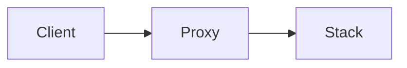

# Docs components demo

This page exercises every docs component. It doubles as a visual test page.

## UiScreen

<UiScreen scenario="lan-3-nodes" route="/stacks" caption="The stacks view, live from the UI mock." alt="Stacks view" />

<UiScreen scenario="lan-3-nodes" route="/nodes" theme="light" chrome={false} height={320} alt="Nodes view, always light" />

## UiCli

<UiCli>
<UiCli.Ui>

Open **Stacks** and press **New stack**.

</UiCli.Ui>
<UiCli.Cli>

```bash
clouduler stack deploy web.yaml
```

</UiCli.Cli>
</UiCli>

## SetupForm and Cmd

<SetupForm fields={[
  {name: 'user', label: 'SSH user', default: 'pi', help: 'The account you log in with.'},
  {name: 'ip', label: 'Node IP', default: '192.168.1.10'},
  {name: 'cluster', label: 'Cluster name'},
  {name: 'distro', label: 'Distribution', type: 'select', default: 'debian', options: [
    {value: 'arch', label: 'Arch Linux'}, {value: 'debian', label: 'Debian'}, {value: 'raspbian', label: 'Raspberry Pi OS'}]},
]} />

<Cmd lang="bash" title="On your laptop">{`ssh {{user}}@{{ip}}
[arch] sudo pacman -S docker
[debian,raspbian] sudo apt install docker.io
clouduler init --name {{cluster}}`}</Cmd>

## DistroTabs

<DistroTabs>
<DistroTabs.Arch>

```bash
sudo pacman -S docker
```

</DistroTabs.Arch>
<DistroTabs.Debian>

```bash
sudo apt install docker.io
```

</DistroTabs.Debian>
<DistroTabs.Raspbian>

```bash
sudo apt install docker.io   # 64-bit image recommended
```

</DistroTabs.Raspbian>
</DistroTabs>

## OptionTable

<OptionTable rows={[
  {key: 'cluster.name', type: 'string', default: '"homelab"', reload: 'restart', required: true, description: 'Name of the cluster.', quirks: 'Cannot change after init.'},
  {key: 'proxy.enabled', type: 'bool', default: 'true', reload: 'live', description: 'Turn the built-in proxy on.'},
  {key: 'proxy.dns_publish', type: 'enum', default: 'all-nodes', reload: 'live', description: 'Which nodes publish DNS records.'},
  {key: 'alerts.discord', type: 'url', reload: 'live', description: 'Discord webhook for alerts.'},
  {key: 'drives.default', type: 'string', reload: 'n/a', description: 'Default drive.'},
  {key: 'a.b', type: 'int', default: '1', reload: 'live', description: 'Filler.'},
  {key: 'a.c', type: 'int', default: '2', reload: 'live', description: 'Filler.'},
  {key: 'a.d', type: 'int', default: '3', reload: 'live', description: 'Filler.'},
  {key: 'a.e', type: 'int', default: '4', reload: 'restart', description: 'Filler (the filter box appears above 8 rows).'},
]} />

## Quirk

<Quirk title="Info severity" severity="info">Something that is good to know.</Quirk>

<Quirk title="Default warn severity">A surprising behaviour with `inline code`.</Quirk>

<Quirk title="Danger severity" severity="danger">Data can be lost if you do this.</Quirk>

## Mermaid



## How screens are produced

`<UiScreen>` does not show hand-made screenshots. It embeds the real web UI, built against an in-memory **mock backend** (`ui/src/mock/`). All network access in the UI goes through one transport seam, and the mock swaps it for fake routes backed by a scenario, so every screen is clickable and always matches the current UI code.

- **Scenarios** (`ui/src/mock/scenarios/`) describe a whole cluster: nodes, networks, stacks, instances. Pick one with the `scenario` prop.
- **Contract tests** (`ui/src/mock/contract.test.ts`) check the mock against the real API client, so the mock cannot silently drift from the backend. An unmocked route logs `[mock]` to the console and answers 501.
- **Fallback images**: if the mock is not served (no JavaScript, or the mock is missing), `<UiScreen>` shows `static/img/ui/<slug>.png`, generated by Playwright from the same mock. Each live screen also has an "Open full screen" link.

### Add a scenario

1. Create `ui/src/mock/scenarios/my-scenario.ts` exporting a function that returns a `MockDb` built with `ScenarioBuilder`.
2. Register it in `ui/src/mock/scenarios/index.ts`.
3. Use it: `<UiScreen scenario="my-scenario" route="/stacks" alt="..." />`.

The contract and render tests pick it up automatically. Use `example.com` domains and documentation IPs only. See `ui/src/mock/README.md` for the builder API.

### Regenerate screenshots

```bash
npm run setup:browsers   # once: installs Playwright chromium
npm run build:ui-mock    # builds the UI against the mock into static/ui-mock/
npm run screenshots      # renders light and dark PNGs for every <UiScreen>
npm run build:full       # all of the above, then the site build
```

`npm run screenshots` scans `content/**/*.mdx`, so a new `<UiScreen>` is picked up without configuration. It skips PNGs newer than both the mock build and the page; pass `-- --force` to redo everything. It exits non-zero if any page throws or logs a `[mock]` error, listing them all. `static/ui-mock/` and `static/img/ui/` are gitignored and must be generated at build time.
