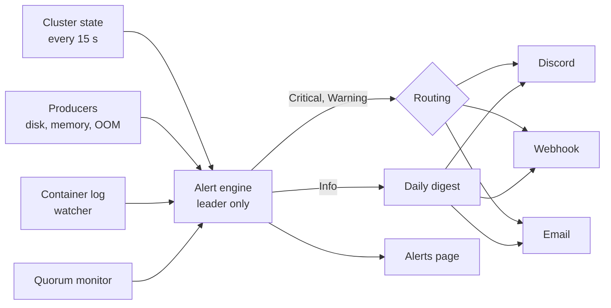

# Alerts

Alerts tell you when something in the cluster needs attention: a node went offline, a disk is nearly full, a container keeps crashing, a certificate is about to expire. They appear on the **Alerts** page and can also be sent to Discord, to any URL that accepts a JSON `POST` (a generic webhook), or by email.

The cluster watches about 38 kinds of event ([catalog below](#events)). Each event has a severity (**Critical**, **Warning** or **Info**), and each destination chooses which severities it wants.

## How it works



Only the raft leader ([glossary](/docs/intro/glossary#leader)) runs the alert engine. Every node can run the log watcher and the disk and memory checks, and they hand their findings to the leader. Alert settings are replicated through raft, so every node sees the same configuration. Every change to an alert is written to raft before a message is sent, so a new leader never re-sends what the old leader already sent. A newly elected leader also takes a silent snapshot first, so it does not re-announce things that already happened.

### Lifecycle of one alert

1. **Opened.** A condition holds. A new **Critical** alert is sent at once. A new **Warning** waits out the debounce window (default 5 minutes) first.
2. **Dropped silently.** A warning that stops holding inside its debounce window is dropped and no message is ever sent. Nobody gets paged by a flapping problem.
3. **Escalated.** A warning that becomes critical is sent again as `Escalated to <severity>: <title>` (setting `renotify_on_escalation`, on by default).
4. **Resolved.** When the condition has been absent for two checks in a row, the alert resolves. A "Resolved" follow-up goes to every destination that heard the opening (setting `notify_resolved`, on by default). Discord can edit the original message instead of posting a new one (`edit_resolved`).
5. **One-shot events.** Some events are announced once and not held open: each OOM kill and each log match, plus leader changes, nodes joining or leaving, finished updates and self-update outcomes, stack deploys and removals, API key creation and revocation, secret rotation, finished volume migrations and backups that succeeded with a warning.

### Severity and routing

- A **Critical** or **Warning** alert goes immediately to every enabled destination whose `severities` list contains that severity (and whose category and stack filters match).
- An **Info** alert is not sent one by one. Destinations with `digest` on collect Info alerts into one **daily digest** at `digest_at` in the settings time zone (default 09:00).
- A per-event **route** overrides all of that: `muted` drops the event, `in_app` records it on the Alerts page without sending, and a list of destinations sends to exactly those destinations, ignoring their severity filters.
- There are no quiet hours. The nearest tools are the digest time (Info only) and muting events.

### Timing

| What | Value |
|---|---|
| Cluster conditions are re-evaluated | every 15 s on the leader |
| Disk free space check | every 60 s |
| Memory check | every 15 s |
| Warning debounce | 5 min (setting `warning_debounce`) |
| Alert absent before it resolves | 2 consecutive checks |
| Quorum lost message | after 60 s without quorum, once per outage |
| Delivery attempt timeout | 10 s (email: 20 s overall) |
| Delivery retries | up to 5 attempts, waiting 10 s, 30 s, 60 s, 120 s |
| Rate limit | 30 messages per destination per 10 min; extra messages are held back |
| History kept | 30 days (`retention`), at most 2000 entries; the Recent tab shows up to 300 |

A message held back by the rate limit is noted as `held back: too many messages to this destination in 10 minutes` and does not count as a delivery failure. A delivery that still fails after 5 attempts is recorded as failed for that destination and appears on the **Destinations** tab.

## Events {#events}

Defaults can be changed per event (severity and route) on the **Events** tab or in the `events` setting. The `test` event used by test messages is not a real alert and is not listed.

| Event key | Category | Default | Raised when |
|---|---|---|---|
| `cluster.quorum_lost` | Cluster | Critical | A manager has had no quorum for 60 s. Sent once per outage; the resolved message follows when quorum returns. |
| `cluster.emergency_mode` | Cluster | Critical | The cluster is in [emergency mode](/docs/features/emergency-mode). |
| `cluster.leader_changed` | Cluster | Info | The raft leader changed. Warning when it changed more than 3 times in 10 minutes ("Check the network between the managers"). |
| `cluster.node_joined` | Cluster | Info | A node joined. |
| `cluster.node_removed` | Cluster | Info | A node was removed. |
| `node.unreachable` | Nodes | Critical | A node is unreachable. Warning instead of Critical for a worker. |
| `node.disk_low` | Nodes | Warning | A drive is at or above `disk_warning_percent` (90). Critical at `disk_critical_percent` (95). Checked every 60 s. A band is entered at or above the threshold and left only when usage drops 2 points below it. |
| `node.memory_pressure` | Nodes | Warning | Memory stays above `memory_percent` (92) for `memory_for` (10 min). |
| `instance.crash_loop` | Workloads | Critical | A container keeps crashing. |
| `instance.oom_killed` | Workloads | Warning | A container was killed for using too much memory. Critical on the third kill of the same instance within one hour. |
| `instance.exited` | Workloads | Warning | A container is not in its desired state (exited or missing). |
| `instance.unhealthy` | Workloads | Warning | A container fails its healthcheck. |
| `instance.unplaceable` | Workloads | Warning | No node can run the container (see [Placement](/docs/features/placement)). |
| `instance.unreachable_by_proxy` | Workloads | Warning | The proxy cannot reach a container. |
| `instance.pin_drift` | Workloads | Info | A container runs on another node than its pin. |
| `log.match` | Workloads | Warning | A [log rule](#log-watcher) matched a line. Severity comes from the rule. |
| `volume.sync_refused` | Storage | Critical | A sync was refused because it would wipe data. |
| `volume.migration_failed` | Storage | Critical | A volume migration failed. |
| `volume.empty` | Storage | Critical | A volume that should hold data is empty. |
| `volume.replica_error` | Storage | Warning | A replica has an error or is behind its primary for at least 30 min. Replicas on draining nodes are ignored. |
| `volume.migration_completed` | Storage | Info | A volume migration completed. |
| `restore.failed` | Backups | Critical | A restore failed. Stays open for 3 days. |
| `backup.failed` | Backups | Warning | A backup failed. Critical once failures have lasted 24 h. |
| `backup.overdue` | Backups | Warning | No backup succeeded within twice its interval (at least 2 h). |
| `backup.succeeded_with_warning` | Backups | Info | A backup succeeded with a warning. |
| `cert.expiring` | Edge | Warning | A certificate expires within `cert_warning_days` (14). Critical within `cert_critical_days` (7). |
| `cert.issuance_failed` | Edge | Warning | Certificate issuance keeps failing. |
| `dns.reconcile_failed` | Edge | Warning | DNS records could not be updated. |
| `self_update.rolled_back` | Deployments | Critical | A node went back to its previous binary (see [Updates](/docs/features/updates#self-update)). |
| `self_update.completed` | Deployments | Info | Clouduler updated on a node (sent after the new binary clears probation). |
| `update.failed` | Deployments | Warning | An image update failed. |
| `update.stuck` | Deployments | Warning | An image update made no progress for over 15 minutes. |
| `update.completed` | Deployments | Info | An image update completed. |
| `stack.deployed` | Deployments | Info | A stack was deployed ("First deploy." or "Redeployed, revision N."). |
| `stack.removed` | Deployments | Info | A stack was removed. |
| `auth.api_key_created` | Security | Info | An API key was created. |
| `auth.api_key_revoked` | Security | Info | An API key was revoked. |
| `secret.rotated` | Security | Info | A user secret was overwritten (reserved `_clouduler_` secrets are not reported). |

## Destinations

A destination is a named place to send alerts. Three kinds exist.

| Kind | UI label | Sends |
|---|---|---|
| `discord` | Discord | A Discord webhook message: a rich embed or one plain line. See [Discord alerts](/docs/guides/discord-alerts). |
| `webhook` | Generic | A `POST` with a JSON body (`version` 1, `cluster`, `type` of `alert`, `digest` or `test`, the alert fields and `ui_url`). Headers: `X-Clouduler-Event`, `X-Clouduler-Severity`, `User-Agent: clouduler/<version>` and an optional `Authorization`. Retried on 408, 429 and 5xx; other 4xx responses are not retried. |
| `email` | Email | A multipart text and HTML message through the SMTP server in `smtp`. See [Email through SMTP](/docs/guides/smtp). |

Email subjects look like `[homelab] CRITICAL: <title>`, `[homelab] Resolved: <title>`, `[homelab] Escalated to <severity>: <title>`, `[homelab] Daily digest: N events` and `[homelab] Test message from Clouduler`.

Webhook and Discord URLs are stored as sealed secrets (`_clouduler_alert_<name>_url`, and `_clouduler_alert_<name>_auth` for a generic webhook's Authorization value), never in the settings. The SMTP password is `_clouduler_alert_smtp_password`. After saving, the UI and API show a URL only as scheme and host (`https://discord.com/…`).

## Tasks

### Add a destination and send a test message

<UiCli>
<UiCli.Ui>

Open **Alerts** (`/alerts`), then the **Destinations** tab, and click **Add destination** (admins only). Choose a type chip: **Discord**, **Generic** or **Email**. Enter a **Name** (it cannot be changed later), the **Webhook URL** (or **URL**, or **Recipients** for email), choose **Send these severities** (**Critical**, **Warning**, **Info, as a daily digest**), and click **Send test message**.

For email, set up the server first in the SMTP panel on the same tab: **Host**, **Port**, **Security**, **Username**, **Password** and **From**, then use **Send a test email to**.

<UiScreen scenario="lan-3-nodes" route="/alerts/destinations" caption="The Destinations tab shows each destination's status and what it receives." alt="Alerts destinations tab" />

Each destination shows a status: **Disabled**, **Failing**, **Working** or **Not used yet**. A banner reads "NAME has failed N deliveries in a row" when sends keep failing.

</UiCli.Ui>
<UiCli.Cli>

There is no CLI command for alerts. Use the web UI or the API (`GET`/`PUT /api/alerts/settings`, `POST /api/alerts/test`, see the [HTTP API](/docs/reference/http-api#alerts)). Only admins can save settings or send tests.

```bash title="Send a test message to a saved destination"
curl -X POST https://cloud.example.com/api/alerts/test \
  -H "Authorization: Bearer $CLOUDULER_API_KEY" \
  -H "Content-Type: application/json" \
  -d '{"name": "ops-discord"}'
```

</UiCli.Cli>
</UiCli>

**How a test works.** A test sends one message with a 10 second limit through the saved destination, or through what you typed if you changed it. Stored credentials only ever go to the address they were saved for: a stored Authorization value is used only when the test URL equals the stored URL, and the stored SMTP password only when host, port and username match the stored server. If you change the URL while testing, enter the Authorization value again.

### Route one event differently

<UiCli>
<UiCli.Ui>

On the **Events** tab, open an event. Set **Severity** (Default, Critical, Warning, Info) and **Goes to** (Default, **In-app only**, **Pick destinations**, **Muted**). **Reset to default** undoes it.

</UiCli.Ui>
<UiCli.Cli>

Settings live in the replicated config `_clouduler_alerts`. As stored (JSON):

```json title="_clouduler_alerts (excerpt)"
{
  "events": {
    "cluster.leader_changed": { "severity": "warning" },
    "node.disk_low": { "route": { "destinations": ["ops-discord"] } },
    "auth.api_key_created": { "route": "in_app" }
  }
}
```

</UiCli.Cli>
</UiCli>

### Change timing and thresholds

<UiCli>
<UiCli.Ui>

On the **Alerts** page, the timing panel has **Warning debounce**, **Daily digest at**, **Time zone**, **Keep history for** and **Public URL**, the toggles **Send notifications**, **Notify again when an alert gets worse**, **Tell me when it is resolved** and **Display warnings during debounce**, and a **Thresholds** panel for disk, memory and certificate numbers. Changes apply on the next pass, no restart needed.

</UiCli.Ui>
<UiCli.Cli>

Edit the same keys through `PUT /api/alerts/settings`. See [Options](#options).

</UiCli.Cli>
</UiCli>

### Read the Recent tab

The **Recent** tab (`/alerts/recent`) shows the metrics **Critical now**, **Warnings now** and **Destinations**, severity filter chips, **Active now** (worst first) and **Earlier** (grouped as Today, Yesterday, Earlier this week, Earlier). Row badges: **Critical**, **Warning**, **Info**, **Resolved**, **Waiting** (a warning still inside its debounce), **Was** followed by the old severity (escalated) and **New** (since you last pressed **Mark all as read**, which is stored in your browser). **Show N log lines** expands a log excerpt.

<UiScreen scenario="node-down-failover" route="/alerts/recent" caption="Recent alerts while boreas is down." alt="Alerts Recent tab" />

## Log watcher {#log-watcher}

Add `logs` rules to a stack's `x-clouduler.alerts` block to raise an alert when a line appears in a container's output. The watcher runs on every node, follows only containers that have rules, and starts at the end of the log (`docker logs --follow` from zero lines), so lines written before it started are never matched.

```yaml title="stack.yaml (excerpt)"
x-clouduler:
  alerts:
    enabled: true
    mute:
      - instance.oom_killed
      - backup.*
    severity:
      instance.exited: critical
    logs:
      - match: "database is shutting down"
        severity: critical
        title: "Database shutting down"
        cooldown: 10m
        stream: both
      - regex: "panic|FATAL"
        ignore_case: true
        severity: warning
        services: [app]
services:
  app:
    image: example/app:1.0
    x-clouduler:
      alerts:
        mute: [log.match]
```

- A rule sets exactly one of `match` (literal text) or `regex`.
- **Cooldown.** After a rule fires for a container it stays quiet for `cooldown` (default 5 minutes). Matches inside the cooldown are counted, and the next message says `It matched N more times in the last …`.
- **Excerpt.** The watcher waits 1 second after a match so nearby lines join the excerpt. It keeps at most 3 lines, each cut to 500 characters. Lines over 8 KB are cut.
- **Caps.** At most 30 log signals per minute per node; the queue holds 64. A flood of matches can silently lose some.
- Rules are only accepted in the stack-level block. A service-level block can set `enabled`, `mute` and `severity`; it is merged over the stack block.
- `mute` accepts event keys or a `prefix.*` pattern that covers a whole category. `enabled: false` mutes every event for the stack, including its log rules.
- The container is only watched when its stack spec contains the text `logs`.

## Options {#options}

### Alert settings (`_clouduler_alerts`)

All settings apply live.

<OptionTable rows={[
  {key: 'enabled', type: 'bool', default: 'true', reload: 'live', description: 'Master switch. When false nothing is recorded or sent.'},
  {key: 'warning_debounce', type: 'duration', default: '5m', reload: 'live', description: 'How long a warning must last before it is sent. Zero is allowed.', quirks: 'A warning that clears inside the window is dropped without any message.'},
  {key: 'digest_at', type: 'HH:MM', default: '09:00', reload: 'live', description: 'Time of the daily digest, in the settings time zone.', quirks: 'Error: use HH:MM, for example 09:00'},
  {key: 'timezone', type: 'IANA name', reload: 'live', description: 'Time zone for the digest time.', quirks: 'Error: not an IANA time zone like Europe/Paris.'},
  {key: 'renotify_on_escalation', type: 'bool', default: 'true', reload: 'live', description: 'Send again when a warning becomes critical.'},
  {key: 'notify_resolved', type: 'bool', default: 'true', reload: 'live', description: 'Send a resolved follow-up to destinations that heard the opening.'},
  {key: 'display_pending_warnings', type: 'bool', default: 'false', reload: 'live', description: 'Show warnings still inside their debounce window in the active list (badge Waiting).'},
  {key: 'retention', type: 'duration', default: '30d', reload: 'live', description: 'How long resolved alerts stay in history. Also capped at 2000 entries.'},
  {key: 'public_url', type: 'URL', reload: 'live', description: 'Base URL for links in messages. Without it links use https://<fqdn> from the cluster config.', quirks: 'Set it if the UI is only reachable through another address, or links will not open.'},
  {key: 'destinations', type: 'list', default: '[]', reload: 'live', description: 'Where alerts go. See the destination tables.'},
  {key: 'smtp', type: 'object or null', reload: 'live', description: 'Email server. Required before an email destination can be added.', quirks: 'Error: set up the email server before adding an email destination'},
  {key: 'events', type: 'map', default: '{}', reload: 'live', description: 'Per-event overrides: severity and route.', quirks: 'Error: unknown event'},
  {key: 'thresholds', type: 'object', reload: 'live', description: 'Numbers behind disk, memory and certificate alerts.'},
]} />

### Destination (each item of `destinations`)

<OptionTable rows={[
  {key: 'name', type: 'string', reload: 'live', required: true, description: '1 to 40 lowercase letters, digits or dashes; unique. Cannot be renamed in the UI.', quirks: 'Errors: use 1 to 40 lowercase letters, digits or dashes; another destination has this name'},
  {key: 'enabled', type: 'bool', default: 'true', reload: 'live', description: 'A disabled destination gets nothing.'},
  {key: 'kind', type: 'webhook | discord | email', reload: 'live', required: true, description: 'Delivery method. The UI calls webhook "Generic".'},
  {key: 'severities', type: 'set', default: 'critical, warning', reload: 'live', description: 'Severities sent immediately. Needs at least one unless digest is on.'},
  {key: 'digest', type: 'bool', default: 'false', reload: 'live', description: 'Receive Info alerts as the daily digest.'},
  {key: 'categories', type: 'list', default: 'all', reload: 'live', description: 'Only alerts of these categories.', quirks: 'Error: unknown category'},
  {key: 'stacks', type: 'list', default: 'all', reload: 'live', description: 'Only alerts for these stacks.'},
  {key: 'URL (secret)', type: 'URL', reload: 'live', required: true, description: 'Webhook or Discord URL, stored as _clouduler_alert_<name>_url and shown masked.', quirks: 'Errors: a URL is required; must be an http or https URL; not a Discord webhook URL (https://discord.com/api/webhooks/...)'},
  {key: 'Authorization (secret)', type: 'string', reload: 'live', description: 'Generic webhook only. Value of the Authorization header, stored as _clouduler_alert_<name>_auth and sent as a sensitive header.'},
  {key: 'style', type: 'embed | short', default: 'embed', reload: 'live', description: 'Discord: rich embed or one plain line.'},
  {key: 'mention', type: 'string', reload: 'live', description: 'Discord: text used for a Ping. One of <@&roleId>, <@userId>, <@!userId>, @here, @everyone (ids are digits only).', quirks: 'A Ping without a mention pings nobody. Normal and Silent messages never mention.'},
  {key: 'notify.critical', type: 'ping | normal | silent', default: 'ping', reload: 'live', description: 'Discord: how a critical alert announces itself.'},
  {key: 'notify.warning', type: 'ping | normal | silent', default: 'normal', reload: 'live', description: 'Discord: how a warning announces itself.'},
  {key: 'notify.info', type: 'ping | normal | silent', default: 'silent', reload: 'live', description: 'Discord: how an info alert announces itself. Digests use this level.'},
  {key: 'notify.resolved', type: 'ping | normal | silent', default: 'silent', reload: 'live', description: 'Discord: how a resolved message announces itself.'},
  {key: 'buttons', type: 'bool', default: 'true', reload: 'live', description: 'Discord: link buttons.', quirks: 'Digests get the "Open alerts" button only when `buttons` is on.'},
  {key: 'edit_resolved', type: 'bool', default: 'false', reload: 'live', description: 'Discord: edit the original message when resolved instead of posting a new one.', quirks: 'Discord drops the username when editing. If the original was deleted, a new message is posted.'},
  {key: 'username', type: 'string', reload: 'live', description: 'Discord: display name the webhook posts under.'},
  {key: 'to', type: 'list of addresses', reload: 'live', required: true, description: 'Email: recipients, at least one.', quirks: 'Errors: add at least one recipient; not an email address'},
]} />

### SMTP server (`smtp`)

<OptionTable rows={[
  {key: 'smtp.host', type: 'string', reload: 'live', required: true, description: 'SMTP server.'},
  {key: 'smtp.port', type: 'integer', default: '587', reload: 'live', description: 'SMTP port, 0 to 65535.', quirks: 'The UI fills 587 for STARTTLS, 465 for TLS and 25 for None. A port typed by hand wins.'},
  {key: 'smtp.security', type: 'starttls | tls | none', default: 'starttls', reload: 'live', description: 'Transport security.'},
  {key: 'smtp.username', type: 'string', reload: 'live', description: 'Login name. Credentials are used only when this is set.'},
  {key: 'smtp.from', type: 'address', reload: 'live', required: true, description: 'Sender address.'},
  {key: 'SMTP password (secret)', type: 'string', reload: 'live', description: 'Stored sealed as _clouduler_alert_smtp_password. Write-only.'},
]} />

### Routing override (`events.<key>`) and thresholds

<OptionTable rows={[
  {key: 'events.<key>.severity', type: 'info | warning | critical', default: 'catalog default', reload: 'live', description: 'Overrides the event severity.'},
  {key: 'events.<key>.route', type: 'muted | in_app | {destinations: [...]}', reload: 'live', description: 'muted drops the event; in_app records it without sending; a list sends to exactly those destinations.', quirks: 'Error: no destination named NAME'},
  {key: 'thresholds.disk_warning_percent', type: 'integer 0-100', default: '90', reload: 'live', description: 'Drive usage that raises node.disk_low as a warning.'},
  {key: 'thresholds.disk_critical_percent', type: 'integer 0-100', default: '95', reload: 'live', description: 'Drive usage that makes it critical.'},
  {key: 'thresholds.memory_percent', type: 'integer 0-100', default: '92', reload: 'live', description: 'Memory use that starts the pressure timer.'},
  {key: 'thresholds.memory_for', type: 'duration', default: '10m', reload: 'live', description: 'How long memory must stay above memory_percent.'},
  {key: 'thresholds.cert_warning_days', type: 'integer', default: '14', reload: 'live', description: 'Days before expiry for cert.expiring as a warning.'},
  {key: 'thresholds.cert_critical_days', type: 'integer', default: '7', reload: 'live', description: 'Days before expiry for cert.expiring as critical.'},
]} />

### Stack alerts (`x-clouduler.alerts`)

Take effect when the stack is deployed. `x-clouduler.alerts: false` turns all alerts off for the stack.

<OptionTable rows={[
  {key: 'enabled', type: 'bool', default: 'true', reload: 'restart', description: 'Alerts on or off for the stack (takes effect on deploy).'},
  {key: 'mute', type: 'list', default: 'empty', reload: 'restart', description: 'Event keys or prefix.* patterns this stack should not raise.', quirks: 'Error: x-clouduler.alerts.<field>: <key> is not an alert event (see docs/alerts.md). The path in that message is out of date.'},
  {key: 'severity', type: 'map', default: 'empty', reload: 'restart', description: 'Per-event severity for this stack. An exact key wins over the longest matching prefix.'},
  {key: 'logs', type: 'list of rules', default: 'empty', reload: 'restart', description: 'Log-line rules, up to 32. Stack-level block only.', quirks: 'Error: at most 32 log rules; only allowed on the stack-level alerts block'},
  {key: 'logs[].match / regex', type: 'string', reload: 'restart', required: true, description: 'Exactly one of the two; up to 512 characters.', quirks: 'Errors: set exactly one of match and regex; the pattern is empty'},
  {key: 'logs[].ignore_case', type: 'bool', default: 'false', reload: 'restart', description: 'Case-insensitive matching.'},
  {key: 'logs[].severity', type: 'info | warning | critical', default: 'warning', reload: 'restart', description: 'Severity of the alert.'},
  {key: 'logs[].title', type: 'string', default: '<service> logged "<pattern>"', reload: 'restart', description: 'Title of the alert.'},
  {key: 'logs[].cooldown', type: 'duration', default: '5m', reload: 'restart', description: 'Minimum time between alerts for one rule and container.', quirks: 'Error: at least 1s'},
  {key: 'logs[].stream', type: 'both | stdout | stderr', default: 'both', reload: 'restart', description: 'Which output stream is watched.'},
  {key: 'logs[].services', type: 'list', default: 'all', reload: 'restart', description: 'Limit the rule to these services.'},
]} />

## Quirks and gotchas

<Quirk title="Only the leader sends">
A node that is cut off from the leader cannot send anything. Alerts from other nodes are fed to the leader, which decides what is open.
</Quirk>

<Quirk title="Info alerts wait for the digest" severity="info">
An Info alert is only delivered in the daily digest, unless the destination lists Info among its severities with `digest` off, or the event is routed to a destination on purpose.
</Quirk>

<Quirk title="Resolved messages follow the opening">
A resolved message goes only to destinations that received the opening. A destination added after an alert opened gets nothing when it resolves.
</Quirk>

<Quirk title="A masked URL means keep">
When the UI sends back `https://discord.com/…` the stored secret is kept. To clear a secret use the Remove action; an empty value fails with `a secret value is empty`. Deleting a destination also deletes its URL and Authorization secrets.
</Quirk>

<Quirk title="Two admins saving at once">
The second save fails with `the alert settings were changed by someone else, reload and try again`.
</Quirk>

<Quirk title="Errors you may see from Discord">
`Discord says the webhook does not exist (HTTP 404); it was probably deleted or the URL is wrong` (also for 401, not retried) and `Discord is rate limiting this webhook` (429, retried). Other messages: `the mail server refused the message: <reason>` (not retried), `could not send the email: <reason>` (retried), `the mail server did not answer in time`, `no email server is configured`, `the destination was removed`, `the destination was disabled`.
</Quirk>

<Quirk title="Disk and memory alerts can linger" severity="info">
Both use hysteresis to avoid flapping, so an alert can stay open a little after the value drops back.
</Quirk>

<Quirk title="Not covered">
A muted event is neither recorded nor sent, so it leaves nothing in the Recent tab. A digest is only sent to a destination that has at least one qualifying event, so there are no empty digests. Alerts cannot be paused at night and are not exposed to the MCP server.
</Quirk>

## Related

- [Discord alerts](/docs/guides/discord-alerts) and [Email through SMTP](/docs/guides/smtp)
- [Updates](/docs/features/updates), [Backups](/docs/features/backups), [Failover](/docs/features/failover)
- [HTTP API: alerts](/docs/reference/http-api#alerts)
- [Glossary](/docs/intro/glossary)
