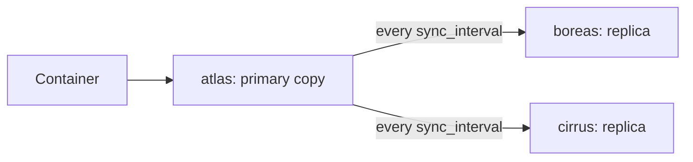

# Drives and volumes

A **drive** is a named storage area for the whole cluster, such as `fast` or `bulk`. Each node that holds a drive maps its name to a folder on its own disk. A **volume** is one folder inside a drive, written `drive/volume`, that a stack mounts into a container. Clouduler keeps volumes in step across nodes, so when a node dies the service can restart on another node with its data.

This page covers **replicated** drives, the default. A replicated drive keeps a full copy of each volume on every node that holds the drive. For one shared copy exported over NFS, see [Served drives](/docs/features/served-drives). For getting existing files in, see [Folder import](/docs/features/folder-import). For off-site copies, see [Backups](/docs/features/backups).

## How it works



1. The cluster config declares the drive (`drives:`), and each node maps it to a local folder (`nodes.<name>.drives:`).
2. The first time a stack mounts `fast/vaultwarden`, the scheduler creates a volume record in the cluster database. One node is its **primary**, normally the node running the container.
3. Every `sync_interval` (default 15 minutes) the primary pushes changes to the other nodes. The sync copies only what changed (block deltas for big files), and also replicates folders, permissions, owners and modification times. Files are written to a temporary name and renamed, so a reader never sees a half-written file.
4. Each volume has a **generation** number. It goes up whenever a node takes over as primary. A replica is "in sync" when its recorded generation equals the volume's generation.
5. When the scheduler starts a container on a different node, it makes that node the primary. It will only choose a node that holds a usable copy. See [Placement](/docs/features/placement).

Because replicas catch up only on the timer, a primary that dies loses the writes made since its last sync. See [Data-loss window](#data-loss-window).

## Declare a drive

<UiCli>
<UiCli.Ui>

Open **Settings**, then **Storage** (`/settings/storage`). Each drive is a card.

- **Storage mode**: **Replicated** or **Served**.
- **Resync every**: how often replicas catch up, for example `15m`. Shown for replicated drives only.
- **Add drive** creates a new card, replicated and `15m` by default.

Map the drive to a folder on each node on the node's page (`/nodes/atlas`): in **Networks and drives**, click **Edit** and use the **Drive** and **Local path** list.

<UiScreen scenario="lan-3-nodes" route="/settings/storage" caption="Settings, Storage: one card per drive." alt="Storage settings page with drive cards for fast and bulk" height={420} />

</UiCli.Ui>
<UiCli.Cli>

Declare the drive once, then map it on each node that should hold it:

```yaml title="cluster.yaml"
drives:
  fast:
    sync_interval: 15m
    mode: replicated

nodes:
  atlas:
    drives:
      fast: /srv/fast
  boreas:
    drives:
      fast: /srv/fast
```

Push the edited file to the cluster:

```bash
clouduler config reload
clouduler drive list
```

`drive list` prints one line per drive with `sync=` and `nodes=`. On a new node, `clouduler init --drive fast=/srv/fast` maps a drive during setup (add `--drive-mode served` for a served drive).

</UiCli.Cli>
</UiCli>

A node drive path must be absolute, and the drive must be declared under `drives:`. Otherwise validation fails with `no drive named ... declared under drives`.

## Use a volume in a stack

Mount `drive/volume:/path/in/container`. Add `:ro` for read-only. The volume is created on first use.

```yaml title="vaultwarden.yaml"
services:
  app:
    image: vaultwarden/server:1.32.0
    volumes:
      - fast/vaultwarden:/data
```

`fast/.` mounts the whole drive. A whole-drive mount must be pinned with `x-clouduler.node` to the drive's single real holder (for a replicated drive, every node that implements it, so in practice only a drive held by one node). See the [stack spec](/docs/reference/stack-spec).

Anonymous volumes (a bare `/path` with no drive) are silently dropped (confirmed in the scheduler's spec conversion).

## Look at drives and volumes

<UiCli>
<UiCli.Ui>

Open **Storage** (`/storage`). The **Volumes** tab shows a card per drive (mode, sync interval, a **Fullest node** meter) and a **Volumes** table with columns Volume, Generation, Primary, Replicas and State.

<UiScreen scenario="lan-3-nodes" route="/storage" caption="Storage, Volumes tab." alt="Storage page with drive cards and a volumes table" />

Click **Open fast** for the drive page (`/storage/drives/fast`): its nodes, an **About** list, its volumes and its backup schedules.

<UiScreen scenario="lan-3-nodes" route="/storage/drives/fast" caption="Drive detail." alt="Drive detail page for fast" height={480} />

State badges: **In sync**, **Syncing**, **Sync refused**, **Frozen**, **Looks empty**.

<UiScreen scenario="node-down-failover" route="/storage" caption="Storage while a node is down: some volumes lag." alt="Storage page with a node down" />

</UiCli.Ui>
<UiCli.Cli>

```bash
clouduler drive list        # drives, sync interval, nodes
clouduler status            # lagging volumes appear in the problem list
```

There is no CLI command to list volumes (`volume` has only `freeze` and `unfreeze`).

</UiCli.Cli>
</UiCli>

### The Sync button does not sync now

**Sync** on a volume row only bumps the generation. The data still moves at the next scheduled sync. To force an immediate push, use `clouduler volume unfreeze` (it pushes this node's copy to the others right away) or [Folder import](/docs/features/folder-import).

## Freeze a volume to edit it by hand

Freezing pauses replication of one volume so you can change its files on this node without a sync overwriting them. If containers on other nodes use the volume, `volume freeze` refuses; add `--force` to stop them. You cannot freeze a served volume.

<UiCli>
<UiCli.Ui>

On the volumes table, click **Freeze** on the row and confirm **Freeze fast/vaultwarden?** ("Containers using it are stopped so you can edit its files by hand. Unfreeze it to resume replication."). The UI does not send `--force`, so freezing a volume that is in use on another node fails from the UI and nothing is stopped. Use the CLI with `--force` in that case.. A **is frozen** banner appears with **Unfreeze**.

</UiCli.Ui>
<UiCli.Cli>

Run on the node whose copy you want to keep:

```bash
clouduler volume freeze fast/vaultwarden            # fails if other nodes run containers using it
clouduler volume freeze fast/vaultwarden --force    # stop those containers instead
# ... edit the files in the local folder ...
clouduler volume unfreeze fast/vaultwarden          # this node's copy becomes the primary, pushed out now
clouduler volume unfreeze fast/vaultwarden --no-start   # leave the containers --force stopped
```

</UiCli.Cli>
</UiCli>

Unfreezing bumps the generation with the frozen node as primary, then waits for the other nodes to catch up before starting containers. The CLI waits up to one hour. The web UI returns immediately and finishes in the background: it waits 120 seconds for replicas, then starts the containers even if some nodes are still behind. If replicas are still behind after the CLI's hour, the CLI prints how many containers it left stopped and exits 0.

## Data-loss window

Replicated sync is periodic. If the primary node dies, the new node starts from the freshest copy it can find, and writes made since the last sync are lost. With the default `sync_interval: 15m` that can be up to 15 minutes. Shorten `sync_interval` for drives that matter, and take [Backups](/docs/features/backups) for protection against more than a node failure.

Syncs also pause while the cluster has no quorum. See [Failover](/docs/features/failover).

## When a sync is refused

Clouduler refuses a sync that would wipe a populated copy: a source that is empty over a populated destination, or a destination of 200 or more files where the source has less than a twentieth of them. The volume row shows **`fast/vaultwarden` refused to sync** with the reason. A volume is marked **Looks empty** only after two consecutive empty scans. The UI deliberately has no "pick the winner" button. Inspect the copies (**Inspect** shows file count, bytes and newest file per node), decide which one is right, and fix it by hand with freeze and unfreeze.

**Delete everywhere** (in the Inspect sheet) removes the volume from every node and cannot be undone; you must type the volume id to confirm.

## Disk space

Each node reports disk use every 60 seconds. The alert `node.disk_low` fires at 90% (warning) and 95% (critical) of the disk holding any drive the node holds data for, replicated drives included (not the mountpoint of a served drive that lives on another node). There are no quotas: nothing limits how much a drive or volume can grow. See [Alerts](/docs/features/alerts).

## Options

<OptionTable rows={[
  {key: 'drives.<name>.sync_interval', type: 'duration', default: '15m', reload: 'live', description: 'How often the primary pushes each replicated volume to the other nodes.', quirks: 'Drive-wide only. A per-volume override in a stack (x-clouduler.volume_sync) is parsed but never applied.'},
  {key: 'drives.<name>.mode', type: 'replicated | served', default: 'replicated', reload: 'live', description: 'Replicated keeps a copy on every holder. Served keeps one active copy exported over NFS.', quirks: 'Lowercase only.'},
  {key: 'drives.<name>.served_by', type: 'list of node names', default: '[]', reload: 'live', description: 'Served drives only: nodes that can be the active server, in priority order.', quirks: 'Each node must implement the drive. Setting it on a replicated drive is an error.'},
  {key: 'nodes.<name>.drives.<drive>', type: 'absolute path', reload: 'live', required: true, description: 'Folder on this node that backs the drive. A node holds a drive only if it maps it.', quirks: 'The drive must be declared under drives:. Reaches the scheduler within one probe interval.'},
  {key: 'fast/vol:/target[:ro|:rw]', type: 'stack volume string', default: 'rw', reload: 'n/a', description: 'Mounts a volume in a service. Takes effect on redeploy.'},
  {key: 'fast/.:/target', type: 'stack volume string', reload: 'n/a', description: 'Mounts the whole drive.', quirks: 'Needs x-clouduler.node pinning to the single holder.'},
  {key: 'volume freeze --force', type: 'flag', default: 'off', reload: 'n/a', description: 'Stop containers on other nodes instead of refusing.'},
  {key: 'volume unfreeze --no-start', type: 'flag', default: 'off', reload: 'n/a', description: 'Do not start containers after the other nodes catch up.'},
  {key: '--via NODE', type: 'node name', reload: 'n/a', description: 'On freeze and unfreeze: send the request through this node.'},
]} />

## Quirks and gotchas

<Quirk title="The Resync every help text over-promises" severity="info">
The settings page says "A stack can override this per volume." That is not true today. `x-clouduler.volume_sync.<vol>.interval` and `.enabled` are accepted by the parser but nothing reads them. Only the drive-level `sync_interval` applies.
</Quirk>

<Quirk title="Placement does not prefer the primary">
A container can start on a node that holds a usable but non-primary copy, for example when every current holder is unreachable. Check the **Placement** tab if a service started somewhere unexpected.
</Quirk>

<Quirk title="Whole-drive mounts are invisible to some tools">
A `fast/.` mount is recorded as a volume named `.`. [Folder import](/docs/features/folder-import) does not see it when checking whether a volume is in use.
</Quirk>

<Quirk title="Stale replicas are not used">
A replica one generation behind is not a candidate unless no reachable node holds a current copy. The scheduler rejects the node with `holds no current copy of volume`; this reason is not shown as a row on the Placement tab.
</Quirk>

## Related

- [Served drives](/docs/features/served-drives), [Folder import](/docs/features/folder-import), [Backups](/docs/features/backups)
- [Failover](/docs/features/failover), [Placement](/docs/features/placement), [Node lifecycle](/docs/features/node-lifecycle)
- [Cluster config reference](/docs/reference/cluster-yaml)
