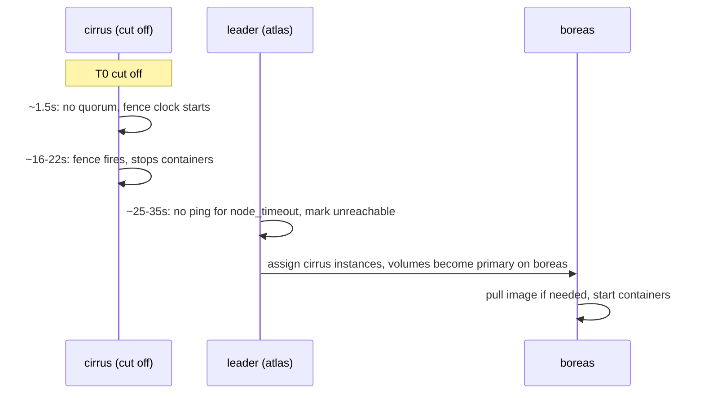

# Failover

When a node dies, Clouduler moves its containers to other nodes. It also makes sure the dead (or cut-off) node stops its own containers first, so one volume never has two writers. This page explains how the cluster decides a node is gone, what happens step by step, and the timers you can tune.

## Raft and quorum in plain words

The cluster's database (stacks, assignments, volumes, config) is kept identical on every node by an algorithm called raft ([glossary](/docs/intro/glossary)). A change is accepted only when a **majority** of the voting nodes has it. Voters are the **managers**. **Workers** receive every change and run containers but never vote. Having a majority is called having **quorum**. Without quorum the cluster pauses changes rather than risk two nodes disagreeing.

Quorum is `managers / 2 + 1`, rounded down:

| Managers | Needed for quorum | Managers that can fail |
|---|---|---|
| 1 | 1 | 0 |
| 2 | 2 | 0 |
| 3 | 2 | 1 |
| 4 | 3 | 1 |
| 5 | 3 | 2 |
| 6 | 4 | 2 |
| 7 | 4 | 3 |

Workers do not change these numbers. Use **three managers** as the minimum for tolerating a failure. Two managers are worse than one: if either dies, the survivor loses quorum and, after the fence timeout, stops all its containers. Nothing warns you about an even number of managers.

## How it works: two halves

- **Fencing** (every node, about itself). A node that has had no quorum for `fence_timeout` stops the containers it runs.
- **Rescheduling** (the raft leader, about other nodes). The leader pings every node each `probe_interval`. A node silent for longer than `node_timeout` is marked **unreachable**, and the scheduler assigns its instances to other eligible nodes.

The timers are set so the fence fires first: the cut-off node gives up its containers before the rest of the cluster starts new copies.

## What happens when a node dies

Assume worker `cirrus` loses power or network. Times use the defaults and are estimates, not measurements.



1. **Quorum lost on cirrus.** Within about 1.5 seconds it notices it cannot hear the leader.
2. **Fence clock starts.** Nothing is stopped yet. A brief blip that recovers resets the clock.
3. **Leader probes fail.** Once no ping has succeeded for `node_timeout` (30s), the leader marks cirrus unreachable (log: `unreachable, rescheduling its containers`).
4. **The scheduler moves the work.** Each instance goes to the least-loaded node that passes every check: schedulable, reachable, holds a usable copy of each replicated volume, has the networks and ports needed. See [Placement](/docs/features/placement).
5. **Volumes follow.** The new node becomes the volume's primary and its generation increases.
6. **The new node starts the containers**, pulling the image first if needed.
7. **Cirrus's fence fires** about 16 to 22 seconds after the cut and stops its containers. A container that stops on SIGTERM is down in a second or two; one that ignores it is killed at its grace period.

Instances stay where they land. When cirrus comes back, nothing moves back automatically. Use [Rebalance](/docs/features/node-lifecycle#rebalance) if you want that.

<UiCli>
<UiCli.Ui>

Open **Nodes** (`/nodes`). A dead node shows **Unreachable** in the **State** column, and a banner says "NAMES is unreachable. Its containers move elsewhere once the failover timeout passes." A node without quorum shows the **No quorum** banner: "This node can reach X of Y voters, so changes are paused. Bring a manager back online."

<UiScreen scenario="node-down-failover" route="/nodes" caption="boreas is down; its containers have moved to atlas and cirrus." alt="Nodes page with boreas unreachable" />

The **Overview** flags the unreachable node and any stack that could not be placed (here machine-learning: "no eligible node: boreas is unreachable and cirrus has too little free memory"), and shows 5 of 9 containers running.

<UiScreen scenario="node-down-failover" route="/" caption="Overview during a failover." alt="Overview with problems after a node failure" />

</UiCli.Ui>
<UiCli.Cli>

```bash
clouduler status                 # leader, quorum, each node "UNREACHABLE" or "up", problems
clouduler stack unhealthy --all  # what is not running as asked
clouduler stack unhealthy --placement   # why instances cannot be placed
```

Placement reasons you may see: `NODE is unreachable`, `NODE is Drain`, `NODE is not the pinned node PIN`, `NODE holds no current copy of volume VOLUME`, `NODE does not implement drive DRIVE`.

</UiCli.Cli>
</UiCli>

### Data you can lose

Replicated volumes reach other nodes only on their sync interval (default 15 minutes). A primary that dies takes its unsynced writes with it, and failover starts the service from the freshest copy that exists. See [Drives and volumes](/docs/features/drives-and-volumes#data-loss-window). Pinned services (`x-clouduler.node`) are not moved and wait for their node. An instance with nowhere to go stays assigned to the dead node and a `cannot place instance` warning is logged.

### Restarts and returning nodes

- A daemon that restarts within `node_timeout` of its last quorum keeps its containers running while it re-establishes quorum (state **Hold**). After a longer gap it starts **Closed**: it stops containers until it sees quorum.
- When a node returns, it removes any container no longer assigned to it (the ones that moved away). Their volume data stays on disk.
- A new leader waits a full `node_timeout` before declaring any node dead.
- A node that was [removed](/docs/features/node-lifecycle#remove-a-node) while down wipes its keys and exits on its next start: `removed from the cluster while down; local secrets wiped, re-provision to rejoin`.

## Tune the timers

<UiCli>
<UiCli.Ui>

Open **Settings**, **General** (`/settings/general`), section **Failover**. Fields: **Declare a node lost after**, **Stop containers without quorum after**, **Check nodes every**, **Container stop grace period** (hint "Applies live."). An alert appears when the margin is too small.

<UiScreen scenario="lan-3-nodes" route="/settings/general" caption="Settings, General: the Failover section." alt="General settings with failover timers" height={520} />

</UiCli.Ui>
<UiCli.Cli>

```yaml title="cluster.yaml"
failover:
  node_timeout: 60s     # leader gives a silent node's work to others after this
  fence_timeout: 15s    # a node without quorum stops its own containers after this
  probe_interval: 5s    # leader probes every node this often
  stop_grace: 30s       # default time a container has to stop before SIGKILL
```

```bash
clouduler config reload
sudo systemctl restart clouduler.service   # needed for the three timers
```

A service can set its own `stop_grace_period: 2m` in the stack file.

</UiCli.Cli>
</UiCli>

Rules: `probe_interval < fence_timeout < node_timeout`, all enforced as errors.

### The fence margin warning

With the shipped defaults the daemon logs this at every start and the UI shows the same alert:

> failover.fence_timeout (15s) plus the default stop grace (30s) reaches node_timeout (30s): a fence may still be stopping containers when the leader reschedules them, giving one volume two writers. Raise node_timeout or lower fence_timeout or the stop grace

It fires when `fence_timeout + stop_grace >= node_timeout`. It is a worst-case warning, not a sign that something is broken: it assumes a container uses its full stop grace. Containers that stop quickly are down long before the reschedule. It matters if a container ignores SIGTERM, because it can still be running (and writing) when the new copy starts. To silence it, raise `node_timeout` (for example `60s`) or lower `fence_timeout` or `stop_grace`. If a service has `stop_grace_period: 2m`, `node_timeout` needs to be at least about 2m15s for the daemon to stay quiet; the daemon checks the longest per-service value too. The warning ignores a further 10 seconds of slack a fence stop may take. A longer `node_timeout` also makes real failover slower.

## Options

<OptionTable rows={[
  {key: 'failover.node_timeout', type: 'duration', default: '30s', reload: 'restart', description: 'How long the leader lets a node stay silent before marking it unreachable and rescheduling its instances.', quirks: 'Must be greater than fence_timeout, else: invalid config at failover.fence_timeout: must be shorter than node_timeout (...), or a container can run on two nodes at once.'},
  {key: 'failover.fence_timeout', type: 'duration', default: '15s', reload: 'restart', description: 'How long a node may lack quorum before it stops its own containers.', quirks: 'Must be greater than probe_interval, else: invalid config at failover.probe_interval: must be shorter than fence_timeout (...), or a node cannot be missed before it fences.'},
  {key: 'failover.probe_interval', type: 'duration', default: '5s', reload: 'restart', description: 'How often the leader probes each node and each node rechecks quorum. Also the per-probe timeout.', quirks: 'Error if zero: must not be zero.'},
  {key: 'failover.stop_grace', type: 'duration', default: '30s', reload: 'live', description: 'Default time a container gets to stop cleanly before it is killed.', quirks: 'Zero is an error (must not be zero). Maximum 600s (must be at most 600s). Sub-second values are truncated to whole seconds. Migrations use this value, not the service stop_grace_period.'},
  {key: 'services.<name>.stop_grace_period', type: 'duration', default: 'failover.stop_grace', reload: 'n/a', description: 'Stack file: per-service stop wait. Counts toward the fence margin.', quirks: 'Applies the next time the instance is stopped. Ignored by moves and rebalance.'},
]} />

The `failover` block rejects unknown keys, so a typo fails config loading with `unknown field`. Fixed internals you cannot change: quorum is re-checked every 500 ms and requires leader contact within 1.5 s; raft heartbeat 500 ms; scheduler sweep 10 s.

## Quirks and gotchas

The failover timers `node_timeout` (30s), `fence_timeout` (15s) and `probe_interval` (5s by default) are read when the daemon starts; `stop_grace` (30s) is live. The leader's failure detector uses a 500 ms heartbeat and a 1.5 s quorum acknowledgement window, and the scheduler sweeps every 10 seconds.

<Quirk title="The default config trips the margin warning">
It is expected with defaults. Raise `node_timeout` to `60s` to quiet it, or accept it if your containers stop quickly.
</Quirk>

<Quirk title="Three timers need a restart" severity="info">
`node_timeout`, `fence_timeout` and `probe_interval` are read once at daemon start; the UI does not say so. Restart the daemons after changing them. `stop_grace` is live.
</Quirk>

<Quirk title="A flapping network keeps containers up; a long outage does not">
The fence clock resets whenever quorum returns. A link that is down for longer than `fence_timeout` in one stretch fences the node. On a flaky network raise `fence_timeout` (and `node_timeout` with it).
</Quirk>

<Quirk title="Fenced nodes are not obvious in the UI">
A fenced node logs `no quorum, stopping local containers`. The leader's view just shows it as unreachable. A fenced worker's own Nodes page shows only a "No quorum" banner.
</Quirk>

<Quirk title="Two managers" severity="danger">
Quorum needs more than half of the voters, so two managers need both. Losing either one stops every container in the cluster after about 15 seconds. Workers never vote. Run three managers.
</Quirk>

## Related

- [Node lifecycle](/docs/features/node-lifecycle), [Emergency mode](/docs/features/emergency-mode), [Placement](/docs/features/placement)
- [Drives and volumes](/docs/features/drives-and-volumes), [Alerts](/docs/features/alerts), [Cluster config reference](/docs/reference/cluster-yaml)
