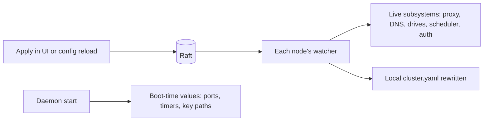

# Live config

Most of Clouduler's configuration takes effect the moment you apply it, with no restart and no downtime. A short list of settings is read once when the daemon starts and needs a restart. This page tells you which is which, and how to apply a change safely from the web UI or the command line.

## How it works

The cluster config ([cluster.yaml](/docs/reference/cluster-yaml)) is stored in the cluster's replicated state (raft). Each node watches that copy. When it changes, the node hands the new config to every running subsystem through an in-memory channel, and each subsystem decides what to do:

- The proxy rebuilds its listeners, certificate issuance and DNS publishing when its settings change.
- The drive subsystem rebuilds only the drives that changed.
- The scheduler re-reads failover grace periods, node labels and similar values on its next pass.
- The sign-in code rebuilds the OIDC client within about 5 seconds.

A few things were wired in at startup and never re-read, for example the TCP ports the daemon binds and the failure-detector timers. Those need `systemctl restart clouduler` on each node.



## What reloads live and what needs a restart

| Setting | Live or restart | Notes |
|---|---|---|
| `cluster.name` | Live | Display and alerts. Raft keeps the name it saw at boot. |
| `networks.*` (type, subnet, domain, publish_dns) | Live | Re-derived on the leader's next pass. Use the rename button to rename. |
| `drives.*` (mode, served_by, sync_interval, failback) | Live | Only the changed drive is rebuilt. `sync_interval` is read on every pass. |
| `nodes.<n>.network`, `drives`, `labels`, `last_resort`, `role` | Live | Reaches the scheduler within one `probe_interval`. |
| `nodes.<n>.rpc_port` | **Restart** | Peers learn the new port live, but the node keeps listening on the old one. |
| `nodes.<n>.data_dir`, `data_dir` | **Restart** | Clouduler does not move your data. |
| `nodes.<n>.generate_secret_key`, `secrets.*` | **Restart** | Read when the key is loaded at boot. `systemctl reload` re-reads the key file and also forces the node to re-sync `cluster.yaml` from the cluster. |
| `nodes.<n>.docker_data_dir` | Neither | Not applied by the daemon. Only `clouduler init` writes `daemon.json`. |
| `web.address` | **Restart** for the direct listener | The proxy route and DNS follow live; the direct HTTPS listener's certificate is built at boot. |
| `web.port`, `web.backend_port` | **Restart** | Bound at boot. A changed `backend_port` leaves the proxy route pointing at a port with nothing bound until restart. |
| `web.network`, `web.through_proxy` | Live | The loopback listener it points at is bound at boot. |
| `failover.node_timeout`, `fence_timeout`, `probe_interval` | **Restart** | The UI does not tell you. |
| `failover.stop_grace` | Live | The UI says "Applies live." |
| `auth.*` (OIDC, session_ttl, api_keys) | Live | The OIDC client is rebuilt on every node within about 5 seconds. Existing sessions keep their expiry. |
| `proxy.enabled`, `http_port`, `https_port` | Live | Listener group is rebuilt live and the daemon binds new ports itself. The systemd socket unit written by `init` still names the install-time ports, so systemd keeps holding those. {/* TODO verify: needs a live cluster; confirm a port change survives a restart cleanly. */} |
| `proxy.acme.*`, `cloudflare.*` | Live | Certificate pass runs about every 5 minutes. |
| `proxy.dns_publish` | Live | Placement change applies on the next scheduler pass. |
| `proxy.dns_server.*` | Live | Client DNS re-reads config every 5 seconds. |
| `proxy.auth.*` | Live | Read on each request. |
| `self_update.*`, `backup.*`, `mcp.enabled` | Live | `mcp.enabled` is read on every request. |
| Alert settings | Live | Stored in raft, not in `cluster.yaml`. |
| Stack changes | On deploy | Not part of `cluster.yaml`. Redeploy the stack. |

The full per-key list is in the **Reload** column of the [cluster.yaml reference](/docs/reference/cluster-yaml).

## Applying a change

<UiCli>
<UiCli.Ui>

1. Open **Settings** and pick the tab that owns the setting (for example **Network** for the reverse proxy).
2. Change the fields. They are staged in a draft, nothing is sent yet.
3. Press **Validate config** under **Changes to apply** if you want to check first.
4. Set **Confirm within (seconds)**. It defaults to 60 and cannot be below 5.
5. Press **Apply changes**.

<UiScreen scenario="lan-3-nodes" route="/settings/network?page=proxy" caption="Settings, Network, Reverse proxy. Edits stay in a draft until you press Apply changes." alt="Reverse proxy settings page" />

If your edit touched `networks`, `nodes`, `web`, `proxy` or `cloudflare`, the UI arms an automatic rollback. A banner **Config change waiting for you** counts down. If you can still reach the dashboard, press **Confirm config**. If you do not, the previous config comes back by itself when the timer ends. **Roll back now** does it immediately.

Everything else (`failover`, `secrets`, `auth`, `drives`, `self_update`, `backup`, `mcp`, `cluster.name`) applies at once with no timer.

For a setting from the restart list, apply it in the UI, then restart each node's daemon over SSH (one node at a time, so you keep quorum):

```bash
sudo systemctl restart clouduler
```

</UiCli.Ui>
<UiCli.Cli>

Edit the file on any manager, validate, then push it into the cluster:

```bash
sudo nano /etc/clouduler/cluster.yaml
clouduler check                  # parse and validate, no network call
clouduler config reload          # push into raft; every node picks it up
```

`config reload` prints `reloaded config into the cluster, generation N`. If the file is invalid it fails before any network call. There is no rollback timer, so keep a copy of the previous file.

Then restart the daemon if you changed a restart-only setting:

```bash
sudo systemctl restart clouduler   # on each node, one at a time
```

`systemctl reload clouduler` (SIGHUP) only re-reads the cluster key file and forces the node to re-sync its file **from** the cluster. It does not apply a file edit.

</UiCli.Cli>
</UiCli>

## Quirks and gotchas

<Quirk title="Hand-editing the file does not apply it" severity="danger">
The replicated copy wins. A hand edit is reverted on the next watcher tick, and a restart does not help: the daemon reads your edit at boot, then the first tick overwrites the file. Use `clouduler config reload` or the web UI. See [cluster.yaml](/docs/reference/cluster-yaml).
</Quirk>

<Quirk title="Saves strip comments, last writer wins" severity="warn">
Every save re-serialises the whole config on every node, so comments disappear. Two admins editing at once overwrite each other with no conflict message.
</Quirk>

<Quirk title="Restart-only changes look applied" severity="warn">
For a restart-only key the UI and `config reload` both report success, and the new value is stored. The running daemon just keeps using the old one until it restarts. If something behaves as before, check whether the key is in the restart rows above.
</Quirk>

<Quirk title="Rollback timer is per node" severity="info">
The countdown lives in memory on the node that took your edit. If that node restarts first, the edit stays. An edit can only be armed on the leader (a `PUT` to a follower is not forwarded; it gets `503`), so the countdown sits on the node that was leader when you edited. A confirm or rollback sent to any other node gets `503` (not the leader). `no config edit is pending` comes only from the leader when no edit is armed.
</Quirk>

<Quirk title="Lockout from sign-in edits" severity="danger">
`auth` edits have no rollback timer. A wrong issuer applies immediately. Keep an API key as a way back in. See [Access and login](/docs/features/access-and-login).
</Quirk>

## Related

- [cluster.yaml reference](/docs/reference/cluster-yaml)
- [Failover](/docs/features/failover)
- [Proxy and TLS](/docs/features/proxy-and-tls)
- [Ports and firewall](/docs/reference/ports-and-firewall)
