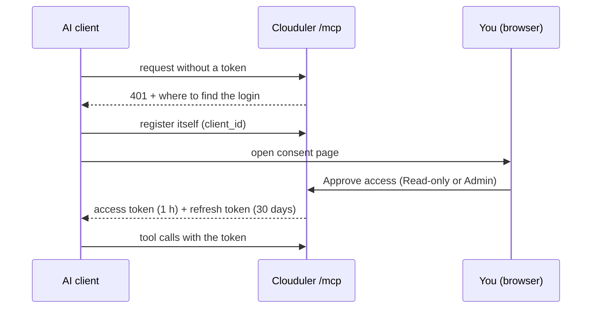

# MCP (AI access)

MCP, the Model Context Protocol, is a standard way for an AI assistant (Claude Code, Claude Desktop, Cursor and others) to call tools that live on another system. Clouduler runs an MCP server, so an assistant you trust can look at your cluster, read logs, validate and deploy stacks, and debug inside containers, without you pasting output back and forth. Every action is limited by what you approve, and secret values are hidden from the assistant.

The endpoint is `https://<your dashboard address>/mcp` (for example `https://cloud.example.com/mcp`). Any node can answer; requests are relayed to the leader.

:::note Off or on
New clusters created by `clouduler init` get `mcp.enabled: false`. A config with no `mcp:` key counts as enabled. When it is off, `/mcp` and every OAuth route answer `404 {"error":"mcp access is disabled"}`, so the cluster looks like it has no MCP server at all. The switch is read live, with no restart.
:::

## How it works



1. The client calls `/mcp` and gets a `401` pointing at `/.well-known/oauth-protected-resource`.
2. It registers itself automatically (`POST /oauth/register`) and sends you to the dashboard.
3. You sign in if needed and see the **Connect an application** page with the client name and where it returns to. Choose **Read-only** or **Admin** and click **Approve access** (or **Deny access**).
4. The client receives an access token that lasts one hour and a refresh token that lasts 30 days, and refreshes by itself. Refresh tokens rotate on each use: a replayed one fails and the client must be approved again.

The two grants:

| Grant | The client can |
|---|---|
| **Read-only** | Use the 17 read tools: inspect nodes, stacks, containers and logs. Secrets stay redacted. The admin tools are not even listed. |
| **Admin** | Use all 27 tools, including deploy, remove, exec and reading files inside containers. Only an admin can grant it. |

A viewer can approve **Read-only** only; asking for admin returns `only an admin can grant admin access`. An admin client keeps its admin grant until you revoke it, even if the person who approved is demoted later. A leader change drops pending approvals and sessions, so the client has to be approved again and focus is lost.

An **API key** also works on `/mcp` and always counts as an admin grant (there is no read-only API key).

## Connect a client

Pick the address your dashboard uses, not an IP, and make sure it has a real certificate. A node serves a self-signed certificate until ACME issues one, and clients that verify TLS will refuse it.

If the dashboard route lives on a private or internal network, the proxy answers `403 "this route is only reachable from its own network"` to peers outside that subnet. Use a public network for the web route, or connect from inside the network. See [Proxy and TLS](/docs/features/proxy-and-tls).

<UiCli>
<UiCli.Ui>

Open **Settings**, then **Access** (`/settings/access`), panel **Connected AI clients**. It shows **MCP URL**, **Claude Code command**, and links **Claude.ai connectors**, **Add to Cursor** and **Add to VS Code**. Connected clients are listed there, and you can revoke one; its tokens stop working immediately.

<UiScreen scenario="lan-3-nodes" route="/settings/access" caption="Connected AI clients on the Access tab." alt="Settings, Access tab" />

</UiCli.Ui>
<UiCli.Cli>

**Claude Code**, with OAuth:

```bash title="Add the server"
claude mcp add --transport http clouduler https://cloud.example.com/mcp
```

Scopes: `local` (default, this project for you), `project` (written to `.mcp.json`, shared), `user` (all projects):

```bash
claude mcp add --transport http clouduler --scope project https://cloud.example.com/mcp
```

Then in Claude Code run `/mcp`, choose `clouduler` and approve in the browser consent page. From a terminal, `claude mcp login clouduler` and `claude mcp logout clouduler` do the same.

**Headless or CI**, with an API key (always admin). A configured `Authorization` header replaces OAuth, so remove it to use OAuth again:

```bash
claude mcp add --transport http clouduler https://cloud.example.com/mcp \
  --header "Authorization: Bearer <API_KEY>"
```

```json title=".mcp.json"
{
  "mcpServers": {
    "clouduler": {
      "type": "http",
      "url": "https://cloud.example.com/mcp",
      "headers": { "Authorization": "Bearer ${CLOUDULER_API_KEY}" }
    }
  }
}
```

Keep the key in its own variable: Claude Code reads some credential variables such as `ANTHROPIC_API_KEY` as empty for remote servers.

**claude.ai**: Settings, then Connectors, add a custom connector with the same URL and let it run the OAuth flow.

**Claude Desktop**: add a custom connector with the URL. {/* TODO verify: a claude_desktop_config.json entry using npx mcp-remote https://cloud.example.com/mcp is a common workaround but was not verified */}

**Cursor and VS Code**: use the install links on the Access page.

</UiCli.Cli>
</UiCli>

Step-by-step walkthroughs are in [Connect AI clients](/docs/guides/mcp-clients).

## The focus model

An assistant works on **one stack at a time**. Call `focus_stack` first. Every write, `exec` and `read_file` only works on the focused stack, and reports such as `list_problems` and `cluster_overview` describe it in detail and only count problems elsewhere.

- Focus belongs to the MCP session (the `Mcp-Session-Id` header) and to the client. Another client with the same session id sees no focus.
- It is kept in memory on the leader, expires after 24 hours idle, and is dropped by a leader change.
- `focus_stack` accepts a name that does not exist yet, so an assistant can create a new stack.
- `freeze_volume` and `unfreeze_volume` are the only writes that do not need a focus.

## Tools

17 read tools (Read-only grant and above):

| Tool | Arguments | What it does |
|---|---|---|
| `focus_stack` | `name` | Sets focus and returns a stack report: revision, images, instances, problems. |
| `get_focus` | none | Reports the focused stack, or that none is focused. |
| `clear_focus` | none | Clears focus. |
| `cluster_overview` | none | Leader, quorum, managers, version, nodes, stack and instance counts, focused stack, problems. |
| `list_problems` | none | Every problem (unhealthy, crash loop, unplaceable, failed updates, volume, backup, certificate, DNS and more), filtered to the focused stack with a count elsewhere. |
| `list_stacks` | none | `name revision=N instances=M` per stack. |
| `get_stack` | `name` (optional) | Spec YAML, revision, requirements, configs and secrets it owns and uses, stack report. |
| `list_instances` | `stack` (optional) | One line per instance: node, desired and actual state, health, image, progress, placement error. |
| `get_instance` | `id` (`stack.service.N`) | One instance with pinned and running digests and problems. |
| `get_logs` | `target`, `tail`, `since_seconds`, `grep` | Log lines, oldest first. `tail` defaults to 200 and is clamped to 1 to 2000. `grep` is case-insensitive and applied after the tail. |
| `list_nodes` | none | Role, availability, reachability, instance count, architecture, drives, networks, labels. |
| `get_cluster_config` | none | The cluster config as YAML. |
| `list_configs` | none | Name, size, revision, owner of each non-reserved config. |
| `get_config` | `name` | Config text (redacted). Binary content is reported, not shown. |
| `list_secrets` | none | Name, revision, owner. Never values. |
| `inspect_secret` | `name` | Facts only: exists, revision, owner, where used, instances running an older revision, length, whitespace and character classes. No hash, prefix or suffix. |
| `validate_stack` | `spec`, `name` (optional) | Validates a stack without deploying: `{valid, errors, requirements, per_service}`. |

10 admin tools (Admin grant only):

| Tool | Arguments | What it does |
|---|---|---|
| `deploy_stack` | `spec`, `configs`, `wait_seconds` | Deploys the focused stack, then polls every 2 s (default wait 20 s, max 120 s) until instances are running and healthy. Has no secrets parameter. Refuses a spec or config that contains a secret's plaintext. |
| `remove_stack` | `confirm` | Removes the focused stack. `confirm` must equal its name. |
| `restart_instance` | `id` | Re-places the instance (it can move node). Must be in the focused stack. |
| `update_instance` | `id` | Pulls the image again and recreates the container. Refuses if an update is already running. |
| `put_config` | `name`, `content` | Stores a config (max 1 MiB). Refuses reserved names, configs owned by another stack, and plaintext secrets. |
| `generate_secret` | `name`, `length`, character options, `overwrite` | Generates and seals a secret on the server and returns only its facts. Refuses an existing secret unless `overwrite=true`. |
| `freeze_volume` | `volume` (`drive/volume`), `node`, `force`, `wait_seconds` | Pauses replication so a volume can be edited on one node. Fails if containers on other nodes use it unless `force=true` stops them. Default wait 120 s, max 600 s. |
| `unfreeze_volume` | `volume`, `start_containers`, `wait_seconds` | Makes the edited copy primary, pushes it to other nodes, restarts the containers freeze stopped. |
| `exec` | `target`, `cmd` (argv array), `user`, `stdin`, `timeout_s` | Runs a command without a shell or tty. Default timeout 30 s, max 300 s. Returns exit code, stdout and stderr. |
| `read_file` | `target`, `path`, `max_bytes` | Reads an absolute path in a container, or lists a directory. Default 64 KiB, max 1 MiB. Refuses `/run/secrets`, `/var/run/secrets` and the stack's secret mounts. |

A tool the grant does not allow returns an error text (`needs an admin grant; this connection is read-only...`) rather than a protocol error. An unknown tool name is a protocol `invalid_params` error. `list_nodes` is described as listing open ports, but its output does not include them.

The server also offers six read-only resources compiled into the binary: `clouduler://docs/stacks`, `clouduler://docs/networking`, `clouduler://docs/secrets`, `clouduler://docs/proxy`, `clouduler://examples/simple.yaml` and `clouduler://examples/gitlab.yaml`.

## Redaction and output caps

Everything the server returns passes through one filter:

1. **Redaction.** Every cluster secret, including internal ones, is decrypted and each value is replaced with `[REDACTED secret:<name>]`. It matches the raw value and its trimmed, line-by-line, base64 (standard and URL-safe), hex, percent-encoded and JSON-escaped forms. If you see that marker it is expected, not a bug.
2. **Cap.** Output is cut to 256 KiB and ends with `[output truncated]`. `exec` caps each stream at 64 KiB and marks it `(truncated)`.
3. **Notes.** A secret that could not be decrypted on this node, or that is shorter than 4 characters, cannot be matched reliably. The result gets a note naming it.

<Quirk title="Redaction is not a sandbox" severity="danger">
`exec` and `read_file` give an admin client real access inside containers. A deliberate transform of a secret (for example reversing it) can escape redaction. Grant Admin only to assistants you trust.
</Quirk>

<Quirk title="A node without the cluster key">
Such a node refuses every tool except `get_focus` and `clear_focus`, because it cannot build the redactor.
</Quirk>

## Options

<OptionTable rows={[
  {key: 'mcp.enabled', type: 'bool', default: 'true (false in clusters written by clouduler init)', reload: 'live', description: 'Serves /mcp, the OAuth endpoints and the consent API. When off they answer 404.'},
]} />

Token lifetimes are fixed: access token 1 hour, refresh token 30 days, authorization code 60 seconds (single use), pending consent 10 minutes. Client registration accepts `https` redirects, `http` only to `localhost`, `127.0.0.1` or `[::1]`, and app schemes such as `cursor://` and `vscode://`. Up to 100 never-approved clients are kept, and unapproved ones expire after 24 hours (more returns 429 `too many unapproved clients registered`).

## Quirks and gotchas

<Quirk title="Deploy never takes secrets" severity="info">
Create a secret with `generate_secret`, then reference it from the stack's `secrets:` list. `generate_secret` with `overwrite=true` only stores the new value: running containers keep the old one until they restart, and data derived from the old value (a database password) is not migrated, so it can break the service. `inspect_secret` lists the instances still running an older revision. Restarting them is left to the operator (the secrets page or `clouduler secret rotate NAME --restart`); there is no MCP tool for it.
</Quirk>

<Quirk title="Revoke instead of demoting">
To remove an admin client's power, revoke the client from **Settings, Access**. Demoting the approving user does nothing to an existing grant.
</Quirk>

<Quirk title="Pending approvals are per node">
`GET /api/oauth/requests` lists only the requests the answering node holds.
</Quirk>

## Related

- [Connect AI clients](/docs/guides/mcp-clients)
- [Access and login](/docs/features/access-and-login), [Configs and secrets](/docs/features/configs-and-secrets)
- [HTTP API: OAuth and MCP](/docs/reference/http-api#oauth-and-mcp)
- [Glossary](/docs/intro/glossary)
