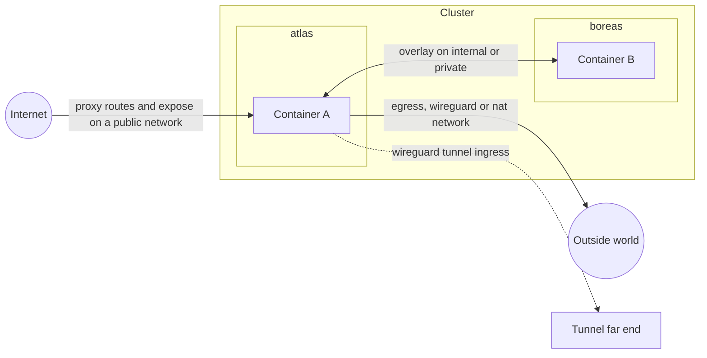

# Networking

Clouduler networking answers three questions: how do your containers talk to each other across machines, how do they reach the outside world, and how does the outside world reach them. You answer them by declaring **networks** in the cluster config and attaching services to them in your stack files.

This page assumes you know what a container is, but not what VXLAN is. New terms are in the [glossary](/docs/intro/glossary).

## How it works

A cluster has a handful of named networks. Each one has a **kind** that says what it is for.



| Kind | In one sentence | Subnet | Domain | Per-node setting |
|---|---|---|---|---|
| `internal` | The one trusted network nodes use for raft, drive sync and the container overlay. Exactly one is required. | required | optional | an IP, on every node |
| `private` | An extra trusted LAN-style network with a subnet. | required | optional | an IP, on nodes that use it |
| `public` | Reachable from the internet. No subnet. Hostnames resolve to each node's public address. | none | needed for web routes and DNS | an `ipv4` / `ipv6` / `domain` block and optional `open_ports` |
| `egress` | Forces a service's outbound traffic out of one named host interface (for example a VPN), with a kill-switch. | none | not allowed | the host interface name |
| `wireguard` | Like egress, but Clouduler creates the WireGuard tunnel from a config you import. | none | not allowed | set by importing a config |
| `nat` | Like egress, but uses the node's normal routing (ordinary masquerade). No setup. | none | not allowed | nothing |

### The container overlay

Containers on different machines reach each other through an **overlay**: a virtual network built on VXLAN (a tunnel that carries ethernet frames over UDP port 4789). You do not set it up. For each stack and each internal, private or public network it uses, every node builds a bridge plus a VXLAN device, with a static list of peers (no multicast). Containers get addresses from a cluster-wide pool, `10.244.0.0/16`, carved into one `/24` per overlay. The gateway is `.1` and is the same on every node.

Containers find each other by name. The cluster DNS answers on the overlay gateway:

| Name | Answer |
|---|---|
| `SERVICE.STACK` | every running instance, round robin |
| `tasks.SERVICE.STACK` | the same set (Swarm style) |
| `NODE` | that node's internal IP |
| a proxy hostname on a public network | this node's internal IP, so containers see the same service the outside sees (not for stacks that use a `nat` network, which get the real public answer) |
| anything else, including a name under the internal domain the cluster has no record for | forwarded to the host's upstream resolvers |

Inside a stack, the bare service name also works (`db`), because each container gets a search list of `STACK.DOMAIN` and `DOMAIN`. Answers have a 5 second TTL.

The overlay MTU is the underlay MTU minus 50 bytes, so `1500` becomes `1450`. This is derived automatically from the link that holds the node's internal IP. Egress bridges always use 1500.

<Quirk title="Containers on the overlay have no route to the internet" severity="info">
Overlay Docker networks are created with masquerade off. A service that must call out to the internet also needs an `egress`, `wireguard` or `nat` network. The simplest choice is `nat`.
</Quirk>

## Declare a network

Networks live in the cluster config, not in a stack. Each node says how it is attached to each network.

<UiCli>
<UiCli.Ui>

Open **Settings**, tab **Network**, page **Networks**, and click **Add network**. Rename the card with the pencil button, then choose **Network type**: Internal, Private, Public, Egress, WireGuard or NAT. Depending on the type you also fill in **Address range** (CIDR), **DNS domain**, and **Publish to DNS provider (Cloudflare)**. Save the page; risky changes ask for confirmation.

Then, in the node settings, a **Network addresses** section has a field for each network the node is on: **Address on NETWORK** for internal and private, **Public IPv4**, **Public IPv6**, **Alias hostname** and **Open ports** for public, and **Interface**, **Use a backup interface**, **Fallback interface**, **Health check address** and **Open ports** for egress. A nat network shows no field at all.

<UiScreen scenario="lan-3-nodes" route="/settings/network" caption="Settings, Network tab." alt="Settings Network tab" />

A read-only overview of each network is at `/networks/NAME`, listing the nodes on it and whether they are reachable.

<UiScreen scenario="lan-3-nodes" route="/networks/lan" caption="Network detail page." alt="Network detail" height={420} />

</UiCli.Ui>
<UiCli.Cli>

Edit `/etc/clouduler/cluster.yaml`, then push it:

```yaml title="cluster.yaml (excerpt)"
networks:
  tailscale:              # internal: node-to-node and the overlay
    type: internal
    subnet: 10.10.0.0/24
    domain: int.example.com
  lan:                    # private: an extra trusted network
    type: private
    subnet: 192.168.1.0/24
    domain: lan.example.com
    publish_dns: false    # keep lan.example.com out of Cloudflare
  wan:                    # public: no subnet
    type: public
    domain: example.com
  vpn:                    # egress: a host interface must exist on the node
    type: egress
  home:                   # nat: ordinary masquerade, no per-node config
    type: nat
  tunnel:                 # wireguard: Clouduler brings the tunnel up
    type: wireguard

nodes:
  atlas:
    role: manager
    network:
      tailscale: 10.10.0.1
      lan: 192.168.1.10
      wan:
        ipv4: 203.0.113.5
        ipv6: "2001:db8::5"
        open_ports: [{port: 25, protocol: tcp}]   # your router forwards 25/tcp here
      vpn: wg0                                    # bare interface name
  boreas:
    role: manager
    network:
      tailscale: 10.10.0.2
      lan: 192.168.1.11
      wan:
        domain: boreas.example.net                # a CNAME instead of an IP
      vpn:
        interface: wg0
        fallback:
          interface: end0
          health_check_ip: 192.0.2.1
```

```bash
clouduler check               # validate the file
clouduler config reload       # push it into the cluster
```

There is no CLI command for networks themselves.

</UiCli.Cli>
</UiCli>

### Network options

<OptionTable rows={[
  {"key": "networks.NAME.type", "type": "enum", "reload": "live", "required": true, "description": "One of internal, private, public, egress, wireguard, nat.", "quirks": "Exactly one internal network is required."},
  {"key": "networks.NAME.subnet", "type": "CIDR", "reload": "live", "description": "Address range for node IPs. Required for internal and private, forbidden for the other kinds.", "quirks": "Every node IP on the network must be inside it. The container overlay skips this range."},
  {"key": "networks.NAME.domain", "type": "DNS name", "reload": "live", "description": "Names under it resolve to node addresses on this network. Required for proxy routes and DNS on a public network. Forbidden for egress, wireguard and nat.", "quirks": "No leading or trailing dot, unique across networks. When Cloudflare is configured the domain must be inside a configured zone: DOMAIN is not covered by any configured cloudflare zone."},
  {"key": "networks.NAME.publish_dns", "type": "bool", "default": "true", "reload": "live", "description": "false keeps the network's hostnames out of Cloudflare; only the cluster DNS server answers them.", "quirks": "Only internal and private networks may set false. A public network always publishes."}
]} />

### Node address options

<OptionTable rows={[
  {"key": "nodes.N.network.NET (internal, private)", "type": "IP", "reload": "live", "description": "The node's address on the network: raft, drive sync and the overlay underlay.", "quirks": "Must be inside the subnet. Internal addresses are unique per node. Every node needs one on the internal network."},
  {"key": "nodes.N.network.NET.ipv4 (public)", "type": "IPv4", "reload": "live", "description": "A record for the public name. Set at least one of ipv4, ipv6, domain.", "quirks": "A bare IP on a public network is an error."},
  {"key": "nodes.N.network.NET.ipv6 (public)", "type": "IPv6", "reload": "live", "description": "AAAA record."},
  {"key": "nodes.N.network.NET.domain (public)", "type": "DNS name", "reload": "live", "description": "CNAME record instead of an IP."},
  {"key": "nodes.N.network.NET.open_ports", "type": "list of {port, protocol}", "default": "[]", "reload": "live", "description": "Ports your router forwards to this node. Gates placement of raw expose ports. protocol defaults to tcp."},
  {"key": "nodes.N.network.NET (egress)", "type": "interface name", "reload": "live", "description": "Host interface a service on the network sends its traffic out of. Letters, digits, _ . - and at most 15 bytes.", "quirks": "A bare YAML IP parses as an IP, not an interface. Clouduler never creates this interface."},
  {"key": "nodes.N.network.NET.interface (egress, map form)", "type": "str", "reload": "live", "required": true, "description": "Same as the bare form, when you also need open_ports or fallback."},
  {"key": "nodes.N.network.NET.fallback.interface", "type": "str", "reload": "live", "description": "Interface to route out of when the primary stops answering. Must differ from the primary."},
  {"key": "nodes.N.network.NET.fallback.health_check_ip", "type": "IP", "reload": "live", "description": "Address pinged out of the primary interface every tick (ping -I, 2 s wait).", "quirks": "Required with fallback. A missing ping binary counts as unreachable, so the fallback is used. Ignored on wireguard."},
  {"key": "nodes.N.network.NET (wireguard)", "type": "set by import", "reload": "live", "description": "The tunnel interface wg-NETWORK (the network name is shortened if needed to fit Linux's 15-byte interface name limit), stored when you import a wg-quick config. open_ports works as for egress.", "quirks": "Set by the import flow. A hand-written bare host interface name is also accepted, the same shape as egress, but use the import."},
  {"key": "nodes.N.network.NET (nat)", "type": "forbidden", "reload": "live", "description": "A nat network takes no node address.", "quirks": "Any entry is rejected."},
  {"key": "nodes.N.rpc_port", "type": "u16", "default": "7373", "reload": "restart", "description": "Raft port. The drive transport uses +1 and the container relay +2."}
]} />

## Use a network from a stack

Declare the networks at the top of the stack file, then list them on each service.

```yaml title="stack.yaml"
networks:
  lan: {}                      # empty is fine: no allowed list means unrestricted
  home: {}                     # a nat network, so the service can reach the internet

services:
  web:
    image: example/web:1
    networks: [lan, home]      # one overlay plus at most one egress, wireguard or nat
```

Clouduler picks the stack's **overlay network** (the one that provides DNS and an overlay address) as the first `internal` or `private` network **in alphabetical order of network name** (not declaration order), otherwise the first `public` network, otherwise none. A stack that only uses egress, wireguard and nat networks has no overlay: no internal DNS, no proxy gating, and Docker's default resolver.

<OptionTable rows={[
  {"key": "networks.NAME", "type": "map or empty", "reload": "n/a", "description": "Declares a cluster network the stack's services may use.", "quirks": "Must exist in the cluster."},
  {"key": "networks.NAME.allowed", "type": "list of str", "default": "unrestricted", "reload": "n/a", "description": "Restricts what the stack's containers can reach.", "quirks": "`host:port` entries are rejected on networks that are not overlay networks."},
  {"key": "services.SVC.networks", "type": "list of names", "default": "overlay only", "reload": "n/a", "description": "Attaches the service to the networks.", "quirks": "At most one egress, wireguard or nat network per service. Each must be implemented by some node (nat excepted)."},
  {"key": "services.SVC.x-clouduler.proxy[].network", "type": "name", "reload": "n/a", "required": true, "description": "Network a route is published on. Decides gating.", "quirks": "Must have a domain."},
  {"key": "services.SVC.x-clouduler.expose[].network", "type": "name", "reload": "n/a", "required": true, "description": "Network whose reachability gates placement.", "quirks": "For public or wireguard, some node must list the port in open_ports."},
  {"key": "services.SVC.x-clouduler.expose[].published", "type": "u16", "reload": "n/a", "required": true, "description": "Port bound on every node.", "quirks": "Unique within a stack. Across stacks the first by name wins and the other is ignored with a warning."},
  {"key": "services.SVC.x-clouduler.expose[].proxy_protocol", "type": "bool", "default": "false", "reload": "n/a", "description": "Send a PROXY v2 header with the real client address. TCP only."}
]} />

Stack networks must exist in the cluster, and some node must implement each one (except nat). Add the node's address first, then deploy. The CLI says `no network named NET declared in the cluster` or `no node implements network NET, this service could never be placed`. The web UI does not check this at deploy time; the same problem shows up on the stack's Placement tab (see [Placement](/docs/features/placement)).

## Publishing a service

There are four ways to let the outside reach a service. Pick by protocol and by whether the outside needs a name.

| Method | Config | What the outside sees | Needs |
|---|---|---|---|
| Proxy route (HTTP/HTTPS) | `x-clouduler.proxy` on a network with a domain | `host.domain` with TLS | the proxy on ports 80/443, and for a public network a public address per node |
| Raw TCP/UDP port | `x-clouduler.expose` | `NODE_IP:published` | on a public network, a node whose router forwards the port (`open_ports`) |
| Port through a WireGuard tunnel | a WireGuard ingress rule | the tunnel's far end forwards to the node | the container publishes `target_port` with `ports:` |
| Docker `ports:` | plain publish | the node's host address and port | nothing managed by Clouduler |

A proxy route on a stack looks like this. A bare `host` gets the network's domain appended:

```yaml title="stack.yaml"
networks:
  wan: {}
services:
  app:
    image: example/app:1
    networks: [wan]
    x-clouduler:
      proxy:
        - host: app              # becomes app.example.com
          network: wan
          port: 8080
```

For HTTP details (middlewares, TLS, authentication) see [Proxy and TLS](/docs/features/proxy-and-tls) and for public DNS records see [DNS publishing](/docs/features/dns-publishing).

**Who can use a route.** A route on a subnetted network (`internal`, `private`) only accepts a client whose connection comes from inside that network's subnet (or a trusted overlay). Anyone else gets `403 this route is only reachable from its own network`. A route on a `public` network has no such gate. To publish externally, use a public network.

**Raw ports with `expose`** are for things like SSH:

```yaml title="stack.yaml"
services:
  git:
    image: example/git:1
    networks: [wan]
    x-clouduler:
      expose:
        - port: 22
          published: 2222
          network: wan
          proxy_protocol: false
```

<Quirk title="expose opens the port on every node, whatever the network" severity="warn">
`expose` binds `0.0.0.0:PUBLISHED` on every node. The `network:` only controls placement and validation. Even for an `internal` or `egress` network the port is open on all of each node's host addresses. Firewall it yourself if it should not be reachable.
{/* TODO verify: code confirms `expose` binds 0.0.0.0 on every node regardless of network; ask the owner whether that is intended. */}
</Quirk>

`expose` forwards in user space, so the backend sees the node's bridge address as the client. Use `proxy_protocol: true` (TCP only) and enable PROXY protocol v2 on the backend first, or the connection breaks. A published port with no running instance stays bound and refuses connections.

### Where DNS and proxy settings live

<OptionTable rows={[
  {"key": "web.network", "type": "name", "reload": "live", "required": true, "description": "Network the dashboard hostname resolves through. Must have a domain."},
  {"key": "proxy.dns_publish", "type": "all-nodes or owning-node", "default": "all-nodes", "reload": "live", "description": "all-nodes publishes every node's address for each proxied hostname. owning-node publishes only nodes running the containers and pins all containers sharing a hostname to one node.", "quirks": "No UI control: set it in cluster.yaml."},
  {"key": "proxy.dns_server.enabled", "type": "bool", "default": "false", "reload": "live", "description": "Run a cluster DNS server on each node's address, answering by the client's network."},
  {"key": "proxy.dns_server.networks", "type": "list of names", "default": "every subnetted network the node is on", "reload": "live", "description": "Networks the DNS server answers for. A public network is only served if listed."},
  {"key": "proxy.dns_server.port", "type": "u16", "default": "53", "reload": "restart", "description": "Port the DNS server listens on."},
  {"key": "proxy.http_port, proxy.https_port", "type": "u16", "default": "80, 443", "reload": "live", "description": "Proxy listener ports. Also the ports containers are allowed to reach on a node."}
]} />

## Allowed hosts and ports

By default a stack's containers can reach whatever their networks let them. An `allowed` list on a network narrows that to a short list.

```yaml title="stack.yaml"
networks:
  lan:
    allowed:
      - auth.example.com          # hostname only: enforced by the proxy
      - "*.example.net"           # wildcard host, no port
      - db.example.com:5432       # host:port, enforced by the firewall
      - 192.0.2.10:9000-9010/udp  # IPv4 literal with a port range and protocol
services:
  app:
    image: example/app:1
    networks: [lan]
```

- Entries are `host`, `*.suffix`, `host:port`, `host:lo-hi`, `host:port/udp`, or an IPv4 literal. `allowed: []` denies everything. A bare `allowed:` with no value is an error.
- **On an overlay network** (internal, private or public), hostname-only entries are enforced by the proxy: a blocked request gets `403 stack STACK may not reach HOST through network NET: it is not in the network's allowed list`. Entries with ports are enforced by the host firewall (`CLDR-ALLOW`).
- **On an egress, wireguard or nat network**, every entry is enforced by the firewall, with hostnames resolved through the stack's DNS. The stack must also declare an internal, private or public network, otherwise you get `network NET has an allowed list ... the stack needs an internal, private or public network as well`.
- A wildcard host cannot take a port on an overlay network: `a wildcard host is checked by the proxy here and cannot take a port`.
- An allowed entry can only narrow what routing already carries. It cannot open a host port the firewall keeps closed.

## WireGuard networks

A `wireguard` network lets Clouduler bring up a tunnel for you on each node, and send a service's traffic through it. It is the easy way to route a service through a VPN provider.

1. Declare the network with `type: wireguard` in the cluster config.
2. For each node that should have a tunnel, import a wg-quick config. The config is stored as a sealed secret and the node's interface is named `wg-NETWORK`.
3. Attach services to the network in the stack.

<UiCli>
<UiCli.Ui>

In the node settings the network appears as a card titled `NETWORK (wireguard)` with **Config source** (**Paste** or **File**), a text area and an import button. After import it reads "Imported. Tunnel interface: wg-NETWORK", with an **Open ports** editor and a **Remove** button. The import applies immediately, like a secret.

To let a port in through the tunnel, open **Proxy**, tab **Ingress rules** (`/proxy/ingress`), click **New ingress rule**, and fill in **Network**, **Port (on the tunnel)**, **Protocol** and **Target port (on this node)**. The target is a host port that a container publishes with `ports:`.

<UiScreen scenario="lan-3-nodes" route="/proxy/ingress" caption="Proxy, Ingress tab: one rule for the vpn network, 51820/udp." alt="Proxy ingress rules" height={420} />

</UiCli.Ui>
<UiCli.Cli>

There is no CLI command for importing configs or ingress rules. Use the web UI or the HTTP API:

```bash
# base64 of a wg-quick file; returns {"interface": "wg-tunnel"}
curl -X PUT https://cloud.example.com:8443/api/wireguard/tunnel/atlas \
  -H "Authorization: Bearer $KEY" -H "Content-Type: application/json" \
  -d "{\"content\": \"$(base64 -w0 wg0.conf)\"}"
```

See the [HTTP API reference](/docs/reference/http-api).

</UiCli.Cli>
</UiCli>

<OptionTable rows={[
  {"key": "PUT /api/wireguard/NETWORK/NODE", "type": "body {content}", "reload": "live", "description": "Import a wg-quick config for one node. content is base64 text. Returns the interface name.", "quirks": "The node must hold the cluster key (otherwise: this node holds no cluster key). Limit 1 MiB."},
  {"key": "DELETE /api/wireguard/NETWORK/NODE", "type": "", "reload": "live", "description": "Remove the config. The tunnel is torn down on the next tick."},
  {"key": "[Interface] PrivateKey, Address", "type": "str", "reload": "live", "required": true, "description": "Required. Address uses the first entry only."},
  {"key": "[Peer] PublicKey", "type": "str", "reload": "live", "required": true, "description": "Required, and at least one [Peer]."},
  {"key": "[Peer] Endpoint, AllowedIPs, PresharedKey, PersistentKeepalive", "type": "", "reload": "live", "description": "Optional peer settings. AllowedIPs must be CIDRs."},
  {"key": "[Interface] ListenPort", "type": "u16", "reload": "live", "description": "Optional local UDP port."},
  {"key": "DNS, MTU, Table, PostUp, PostDown", "type": "", "reload": "live", "description": "Silently ignored: Clouduler does its own routing."},
  {"key": "Ingress rule: network", "type": "name", "reload": "live", "required": true, "description": "Which wireguard network the port comes in on."},
  {"key": "Ingress rule: port", "type": "u16", "reload": "live", "required": true, "description": "Port on the tunnel.", "quirks": "Not checked against open_ports, so a rule can open a port nothing forwards."},
  {"key": "Ingress rule: protocol", "type": "tcp or udp", "default": "tcp", "reload": "live", "description": "Protocol."},
  {"key": "Ingress rule: target_port", "type": "u16", "reload": "live", "required": true, "description": "The host port a container publishes with ports:. A DNAT to this node's internal address is added when it differs from port."}
]} />

Import errors you may see (wrapped as `parsing wireguard config: ...`): `missing PrivateKey in [Interface]`, `missing Address in [Interface]`, `no [Peer] section found`, `a [Peer] section is missing PublicKey`, `invalid AllowedIPs entry ...`, `invalid Address ...`, `malformed line: ...`. Other errors: `NETWORK is not a wireguard network`, `wireguard config must be utf8`.

<Quirk title="WireGuard ingress opens the tunnel only" severity="info">
A rule opens the port on the tunnel interface only, not on the internal network or any other interface. Packets from the tunnel are dropped unless a rule or `open_ports` entry allows them.
</Quirk>

## The firewall chains

Clouduler manages host firewall rules with iptables. It only touches chains with its own names, rebuilds them every 10 seconds (so a hand edit to them is overwritten), and re-checks the jumps so they survive a Docker restart.

| Chain | What it does |
|---|---|
| `CLDR-IN` (filter, `INPUT`) | Stops containers reaching the node's own listeners. From container addresses it accepts only: replies, DNS, the proxy's HTTP and HTTPS ports, every `expose` port, and ping. Everything else, including the API, raft, drive and relay ports, is dropped. Docker `-p` publishes bypass it. |
| `CLDR-OVL-SNAT` (nat, `POSTROUTING`) | Masquerades overlay traffic to another node's proxy ports (and ping), so the remote proxy sees a node address and can apply its network gate. |
| `CLDR-NAT-BRIDGE` (nat) | Masquerades an egress bridge out of its interface. |
| `CLDR-FWD-BRIDGE` (filter) | The egress kill-switch: allow bridge to interface, drop everything else from the bridge. If the interface has no route, the bridge is locked down. |
| `CLDR-WGIN-IFACE` (filter, nat) | Default deny from a WireGuard tunnel, then each ingress rule. Adds a DNAT to the node's internal IP when the target port differs. |
| `CLDR-ALLOW` (filter, `DOCKER-USER`) | Enforces `allowed` entries with ports. Exists only when some stack has an `allowed` list. |
| `CLDR-ALLOW-NAT` (nat, `PREROUTING`) | Sends a restricted stack's proxy traffic to this node's own proxy so the proxy can tell stacks apart. |

In plain words: a container can reach the proxy on any node, the DNS on its gateway, and any `expose` port on any node. It cannot reach anything else on the host, and it cannot reach the internet unless it is on an egress, wireguard or nat network.

For a host process to reach a container on another node, Clouduler uses a relay on the node's `rpc_port + 2` (7375 by default), authenticated with the cluster key. This port must be open between nodes on the internal network.

## Rename a network

Renaming rewrites the network everywhere: the cluster config, node address maps, `web.network`, every deployed stack, redirects, static routes, WireGuard ingress rules and sealed WireGuard secrets. Use the pencil button on the network card in Settings (it calls `POST /api/config/networks/NAME/rename` with `{"new_name": "..."}`). There is no CLI command.

<Quirk title="Rename is not atomic" severity="warn">
The config changes first, then each stack is redeployed, then redirects, routes and ingress rules. If a later step fails, earlier ones are already committed. The error says which stack failed (`renaming network in stack STACK: ...`). Fix it and retry. A rename is refused if the new name exists, if the result does not validate, or if two stacks would end up sharing an overlay name.
</Quirk>

## Quirks and gotchas

<Quirk title="A public network on a single node has no overlay" severity="info">
When only one node implements a public network, Clouduler creates no VXLAN overlay for it.
</Quirk>

<Quirk title="Overlay Docker networks keep their subnet and MTU">
Docker cannot change a network's subnet in place. After changing a network's kind or subnet, remove and redeploy the affected stacks. A VXLAN device whose id, local IP or underlay link no longer matches is recreated, and containers on it lose connectivity briefly.
</Quirk>

<Quirk title="Egress interfaces must already exist">
Clouduler never creates an `egress` interface. If `wg0` is missing on the node, the service on that network stays down behind the kill-switch. `wireguard` differs: Clouduler creates the interface.
</Quirk>

<Quirk title="Name collisions are refused">
Two egress or wireguard networks whose names hash to the same bridge subnet or routing table are refused: pick different names (the message says `rename one of them`). Two networks that derive the same VXLAN id are also refused; the later name in sort order is not brought up. Egress, wireguard and nat bridges derive their subnet from the network name, so renaming such a network recreates the docker network for attached containers.
</Quirk>

<Quirk title="Public addresses">
A bare IP on a public network is an error (`a public network takes an ipv4, ipv6 and/or domain block`), and a map with only `open_ports` is too (`set at least one of ipv4, ipv6 or domain`). Only a second internal network is refused with `only one internal network is allowed`.
</Quirk>

<Quirk title="Fixed ranges" severity="info">
The overlay pool (`10.244.0.0/16`), egress bridges (`10.245.x.0/24`), nat bridges (`10.246.x.0/24`) and the VXLAN port (4789) are fixed in the code. Keep them free on your LAN. They cannot be configured.
</Quirk>

## Related

- [Stacks](/docs/features/stacks)
- [Placement](/docs/features/placement)
- [Proxy and TLS](/docs/features/proxy-and-tls)
- [DNS publishing](/docs/features/dns-publishing)
- [Ports and firewall](/docs/reference/ports-and-firewall)
- [cluster.yaml reference](/docs/reference/cluster-yaml)
