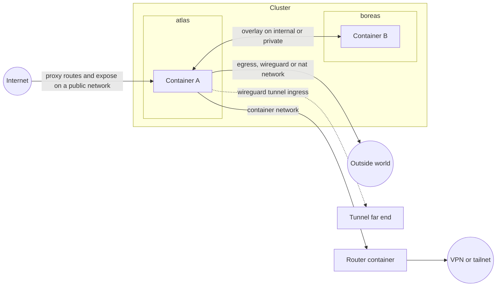

# Networking

Clouduler networking answers three questions: how do your containers talk to each other across machines, how do they reach the outside world, and how does the outside world reach them. You answer them by declaring **networks** in the cluster config and attaching services to them in your stack files.

This page assumes you know what a container is, but not what VXLAN is. New terms are in the [glossary](/docs/intro/glossary).

## How it works

A cluster has a handful of named networks. Each one has a **kind** that says what it is for.



| Kind | In one sentence | Subnet | Domain | Per-node setting |
|---|---|---|---|---|
| `internal` | The one trusted network nodes use for raft, drive sync and the container overlay. Exactly one is required. | required | optional | an IP, on every node |
| `private` | An extra trusted LAN-style network with a subnet. | required | optional | an IP, on nodes that use it |
| `public` | Reachable from the internet. No subnet. Hostnames resolve to each node's public address. | none | needed for web routes and DNS | an `ipv4` / `ipv6` / `domain` block and optional `open_ports` |
| `egress` | Forces a service's outbound traffic out of one named host interface (for example a VPN), with a kill-switch. | none | not allowed | the host interface name |
| `wireguard` | Like egress, but Clouduler creates the WireGuard tunnel from a config you import. **Pending deprecation**, see [WireGuard networks](#wireguard-networks). | none | not allowed | set by importing a config |
| `nat` | Like egress, but uses the node's normal routing (ordinary masquerade). No setup. | none | not allowed | nothing |
| `container` | Sends traffic for an address range (a tailnet, say) through a router container that you run as a stack. See [Container networks](#container-networks). | none (the network's `subnet` is the routed range) | optional, only names for the router side's DNS | nothing |

### The container overlay

Containers on different machines reach each other through an **overlay**: a virtual network built on VXLAN (a tunnel that carries ethernet frames over UDP port 4789). You do not set it up. For each stack and each internal, private or public network it uses, every node builds a bridge plus a VXLAN device, with a static list of peers (no multicast). Containers get addresses from a cluster-wide pool, `10.244.0.0/16`, carved into one `/24` per overlay. The gateway is `.1` and is the same on every node.

To choose the subnet yourself, set `subnet` in the stack's top-level `x-clouduler` block. It applies to the stack's overlay, whichever cluster network hosts it:

```yaml
x-clouduler:
  subnet: 172.30.5.0/24
```

The subnet must be a network address between `/8` and `/29`, must not overlap any subnet in the cluster config, and must not overlap one pinned by another stack (a deploy that would is refused). The automatic pick avoids pinned subnets. It is only used when the overlay is first created, so to change it, remove the stack and redeploy.

Every container also gets `host.docker.internal` and `host-gateway` entries in `/etc/hosts`, both pointing at the overlay gateway, which is the node's own address on the stack's bridge. Use it to reach something listening on the node the container runs on (the firewall still only lets through DNS, the proxy ports and `expose` ports).

Containers find each other by name. The cluster DNS answers on the overlay gateway:

| Name | Answer |
|---|---|
| `SERVICE.STACK` | every running instance, round robin |
| `tasks.SERVICE.STACK` | the same set (Swarm style) |
| `NODE` | that node's internal IP |
| a proxy hostname on a public network | this node's internal IP, so containers see the same service the outside sees (not for stacks that use a `nat` network, which get the real public answer) |
| a name under the internal domain the cluster has no record for | NXDOMAIN (never forwarded: a host resolver may send the domain straight back to the cluster) |
| anything else | forwarded to the host's upstream resolvers |

Inside a stack, the bare service name also works (`db`), because each container gets a search list of `STACK.DOMAIN` and `DOMAIN`. Answers have a 5 second TTL.

The overlay MTU is the underlay MTU minus 50 bytes, so `1500` becomes `1450`. This is derived automatically from the link that holds the node's internal IP. Egress bridges always use 1500.

<Quirk title="Containers on the overlay have no route to the internet" severity="info">
Overlay Docker networks are created with masquerade off. A service that must call out to the internet also needs an `egress`, `wireguard` or `nat` network. The simplest choice is `nat`.
</Quirk>

## Declare a network

Networks live in the cluster config, not in a stack. Each node says how it is attached to each network.

<UiCli>
<UiCli.Ui>

Open **Settings**, tab **Network**, page **Networks**, and click **Add network**. Rename the card with the pencil button, then choose **Network type**: Internal, Private, Public, Egress, WireGuard, NAT or Container. Depending on the type you also fill in **Address range** (CIDR), **DNS domain**, and **Publish to DNS provider (Cloudflare)**. Save the page; risky changes ask for confirmation.

Then, in the node settings, a **Network addresses** section has a field for each network the node is on: **Address on NETWORK** for internal and private, **Public IPv4**, **Public IPv6**, **Alias hostname** and **Open ports** for public, and **Interface**, **Use a backup interface**, **Fallback interface**, **Health check address** and **Open ports** for egress. A nat or container network shows no field at all.

<UiScreen scenario="lan-3-nodes" route="/settings/network" caption="Settings, Network tab." alt="Settings Network tab" />

A read-only overview of each network is at `/networks/NAME`, listing the nodes on it and whether they are reachable.

<UiScreen scenario="lan-3-nodes" route="/networks/lan" caption="Network detail page." alt="Network detail" height={420} />

</UiCli.Ui>
<UiCli.Cli>

Edit `/etc/clouduler/cluster.yaml`, then push it:

```yaml title="cluster.yaml (excerpt)"
networks:
  tailscale:              # internal: node-to-node and the overlay
    type: internal
    subnet: 10.10.0.0/24
    domain: int.example.com
  lan:                    # private: an extra trusted network
    type: private
    subnet: 192.168.1.0/24
    domain: lan.example.com
    publish_dns: false    # keep lan.example.com out of Cloudflare
  wan:                    # public: no subnet
    type: public
    domain: example.com
  vpn:                    # egress: a host interface must exist on the node
    type: egress
  home:                   # nat: ordinary masquerade, no per-node config
    type: nat
  tailnet:                # container: route 100.64.0.0/10 through a router stack
    type: container
    subnet: 100.64.0.0/10
    container:
      stack: wireguard-router
      service: wireguard
  tunnel:                 # wireguard (pending deprecation): Clouduler brings the tunnel up
    type: wireguard

nodes:
  atlas:
    role: manager
    network:
      tailscale: 10.10.0.1
      lan: 192.168.1.10
      wan:
        ipv4: 203.0.113.5
        ipv6: "2001:db8::5"
        open_ports: [{port: 25, protocol: tcp}]   # your router forwards 25/tcp here
      vpn: wg0                                    # bare interface name
  boreas:
    role: manager
    network:
      tailscale: 10.10.0.2
      lan: 192.168.1.11
      wan:
        domain: boreas.example.net                # a CNAME instead of an IP
      vpn:
        interface: wg0
        fallback:
          interface: end0
          health_check_ip: 192.0.2.1
```

```bash
clouduler check               # validate the file
clouduler config reload       # push it into the cluster
```

There is no CLI command for networks themselves.

</UiCli.Cli>
</UiCli>

### Network options

<OptionTable rows={[
  {"key": "networks.NAME.type", "type": "enum", "reload": "live", "required": true, "description": "One of internal, private, public, egress, wireguard, nat, container.", "quirks": "Exactly one internal network is required."},
  {"key": "networks.NAME.subnet", "type": "CIDR", "reload": "live", "description": "Address range for node IPs. Required for internal and private, forbidden for egress, wireguard, nat and public. On a container network it is the address space routed through the router, not a range nodes have addresses in.", "quirks": "Every node IP on the network must be inside it (internal and private). The container overlay skips this range. A container network's range never reserves overlay space."},
  {"key": "networks.NAME.domain", "type": "DNS name", "reload": "live", "description": "Names under it resolve to node addresses on this network. Required for proxy routes and DNS on a public network. Forbidden for egress, wireguard, nat and container.", "quirks": "No leading or trailing dot, unique across networks. When Cloudflare is configured the domain must be inside a configured zone: DOMAIN is not covered by any configured cloudflare zone."},
  {"key": "networks.NAME.publish_dns", "type": "bool", "default": "true", "reload": "live", "description": "false keeps the network's hostnames out of Cloudflare; only the cluster DNS server answers them.", "quirks": "Only internal and private networks may set false. A public network always publishes."},
  {"key": "networks.NAME.container", "type": "map", "reload": "live", "description": "The router, the routed range and what the router side may reach. Required for, and only allowed on, a container network. Options in [Container networks](#container-networks).", "quirks": "A container network takes the routed range in its own `subnet`, and may not declare a node address."}
]} />

### Node address options

<OptionTable rows={[
  {"key": "nodes.N.network.NET (internal, private)", "type": "IP", "reload": "live", "description": "The node's address on the network: raft, drive sync and the overlay underlay.", "quirks": "Must be inside the subnet. Internal addresses are unique per node. Every node needs one on the internal network."},
  {"key": "nodes.N.network.NET.ipv4 (public)", "type": "IPv4", "reload": "live", "description": "A record for the public name. Set at least one of ipv4, ipv6, domain.", "quirks": "A bare IP on a public network is an error."},
  {"key": "nodes.N.network.NET.ipv6 (public)", "type": "IPv6", "reload": "live", "description": "AAAA record."},
  {"key": "nodes.N.network.NET.domain (public)", "type": "DNS name", "reload": "live", "description": "CNAME record instead of an IP."},
  {"key": "nodes.N.network.NET.open_ports", "type": "list of {port, protocol}", "default": "[]", "reload": "live", "description": "Ports your router forwards to this node. Gates placement of raw expose ports. protocol defaults to tcp."},
  {"key": "nodes.N.network.NET (egress)", "type": "interface name", "reload": "live", "description": "Host interface a service on the network sends its traffic out of. Letters, digits, _ . - and at most 15 bytes.", "quirks": "A bare YAML IP parses as an IP, not an interface. Clouduler never creates this interface."},
  {"key": "nodes.N.network.NET.interface (egress, map form)", "type": "str", "reload": "live", "required": true, "description": "Same as the bare form, when you also need open_ports or fallback."},
  {"key": "nodes.N.network.NET.fallback.interface", "type": "str", "reload": "live", "description": "Interface to route out of when the primary stops answering. Must differ from the primary."},
  {"key": "nodes.N.network.NET.fallback.health_check_ip", "type": "IP", "reload": "live", "description": "Address pinged out of the primary interface every tick (ping -I, 2 s wait).", "quirks": "Required with fallback. A missing ping binary counts as unreachable, so the fallback is used. Ignored on wireguard."},
  {"key": "nodes.N.network.NET (wireguard)", "type": "set by import", "reload": "live", "description": "The tunnel interface wg-NETWORK (the network name is shortened if needed to fit Linux's 15-byte interface name limit), stored when you import a wg-quick config. open_ports works as for egress.", "quirks": "Set by the import flow. A hand-written bare host interface name is also accepted, the same shape as egress, but use the import."},
  {"key": "nodes.N.network.NET (nat)", "type": "forbidden", "reload": "live", "description": "A nat network takes no node address.", "quirks": "Any entry is rejected."},
  {"key": "nodes.N.network.NET (container)", "type": "forbidden", "reload": "live", "description": "A container network takes no node address.", "quirks": "Any entry is rejected: a container network takes no node address, list the node under container.hosts to route its traffic through the router."},
  {"key": "nodes.N.rpc_port", "type": "u16", "default": "7373", "reload": "restart", "description": "Raft port. The drive transport uses +1 and the container relay +2."}
]} />

## Use a network from a stack

Declare the networks at the top of the stack file, then list them on each service.

```yaml title="stack.yaml"
networks:
  lan: {}                      # empty is fine: no allowed list means unrestricted
  home: {}                     # a nat network, so the service can reach the internet

services:
  web:
    image: example/web:1
    networks: [lan, home]      # one overlay plus at most one egress, wireguard or nat
    # a container network can be listed as well (see Container networks)
```

Clouduler picks the stack's **overlay network** (the one that provides DNS and an overlay address) as the first `internal` or `private` network **in alphabetical order of network name** (not declaration order), otherwise the first `public` network, otherwise none. A stack that only uses egress, wireguard, nat and container networks has no overlay: no internal DNS, no proxy gating, and Docker's default resolver.

<OptionTable rows={[
  {"key": "networks.NAME", "type": "map or empty", "reload": "n/a", "description": "Declares a cluster network the stack's services may use.", "quirks": "Must exist in the cluster."},
  {"key": "networks.NAME.allowed", "type": "list of str", "default": "unrestricted", "reload": "n/a", "description": "Restricts what the stack's containers can reach.", "quirks": "`host:port` entries are rejected on networks that are not overlay networks. A container network takes no allowed list at all: network NET is a container network, the router container decides what is reachable: remove its allowed list."},
  {"key": "services.SVC.networks", "type": "list of names", "default": "overlay only", "reload": "n/a", "description": "Attaches the service to the networks.", "quirks": "At most one egress, wireguard or nat network per service. A container network whose subnet is 0.0.0.0/0 counts as one of them, because it takes the default route; a container network with a narrower subnet does not. Each must be implemented by some node (nat and container excepted). The router service of a container network must not list that network."},
  {"key": "services.SVC.x-clouduler.proxy[].network", "type": "name", "reload": "n/a", "required": true, "description": "Network a route is published on. Decides gating.", "quirks": "Must have a domain."},
  {"key": "services.SVC.x-clouduler.expose[].network", "type": "name", "reload": "n/a", "required": true, "description": "Network whose reachability gates placement.", "quirks": "For public or wireguard, some node must list the port in open_ports."},
  {"key": "services.SVC.x-clouduler.expose[].published", "type": "u16", "reload": "n/a", "required": true, "description": "Port bound on every node.", "quirks": "Unique within a stack. Across stacks the first by name wins and the other is ignored with a warning."},
  {"key": "services.SVC.x-clouduler.expose[].proxy_protocol", "type": "bool", "default": "false", "reload": "n/a", "description": "Send a PROXY v2 header with the real client address. TCP only."}
]} />

Stack networks must exist in the cluster, and some node must implement each one (except nat and container). Add the node's address first, then deploy. The CLI says `no network named NET declared in the cluster` or `no node implements network NET, this service could never be placed`. The web UI does not check this at deploy time; the same problem shows up on the stack's Placement tab (see [Placement](/docs/features/placement)).

## Publishing a service

There are four ways to let the outside reach a service. Pick by protocol and by whether the outside needs a name.

| Method | Config | What the outside sees | Needs |
|---|---|---|---|
| Proxy route (HTTP/HTTPS) | `x-clouduler.proxy` on a network with a domain | `host.domain` with TLS | the proxy on ports 80/443, and for a public network a public address per node |
| Raw TCP/UDP port | `x-clouduler.expose` | `NODE_IP:published` | on a public network, a node whose router forwards the port (`open_ports`) |
| Port through a WireGuard tunnel | a WireGuard ingress rule | the tunnel's far end forwards to the node | the container publishes `target_port` with `ports:` |
| Docker `ports:` | plain publish | the node's host address and port | nothing managed by Clouduler |

A proxy route on a stack looks like this. A bare `host` gets the network's domain appended:

```yaml title="stack.yaml"
networks:
  wan: {}
services:
  app:
    image: example/app:1
    networks: [wan]
    x-clouduler:
      proxy:
        - host: app              # becomes app.example.com
          network: wan
          port: 8080
```

For HTTP details (middlewares, TLS, authentication) see [Proxy and TLS](/docs/features/proxy-and-tls) and for public DNS records see [DNS publishing](/docs/features/dns-publishing).

**Who can use a route.** A route on a subnetted network (`internal`, `private`) only accepts a client whose connection comes from inside that network's subnet (or a trusted overlay). Anyone else gets `403 this route is only reachable from its own network`. A route on a `public` network has no such gate. To publish externally, use a public network.

**Raw ports with `expose`** are for things like SSH:

```yaml title="stack.yaml"
services:
  git:
    image: example/git:1
    networks: [wan]
    x-clouduler:
      expose:
        - port: 22
          published: 2222
          network: wan
          proxy_protocol: false
```

<Quirk title="expose opens the port on every node, whatever the network" severity="warn">
`expose` binds `0.0.0.0:PUBLISHED` on every node. The `network:` only controls placement and validation. Even for an `internal` or `egress` network the port is open on all of each node's host addresses. Firewall it yourself if it should not be reachable.
{/* TODO verify: code confirms `expose` binds 0.0.0.0 on every node regardless of network; ask the owner whether that is intended. */}
</Quirk>

`expose` forwards in user space, so the backend sees the node's bridge address as the client. Use `proxy_protocol: true` (TCP only) and enable PROXY protocol v2 on the backend first, or the connection breaks. A published port with no running instance stays bound and refuses connections.

### Where DNS and proxy settings live

<OptionTable rows={[
  {"key": "web.network", "type": "name", "reload": "live", "required": true, "description": "Network the dashboard hostname resolves through. Must have a domain."},
  {"key": "proxy.dns_publish", "type": "all-nodes or owning-node", "default": "all-nodes", "reload": "live", "description": "all-nodes publishes every node's address for each proxied hostname. owning-node publishes only nodes running the containers and pins all containers sharing a hostname to one node.", "quirks": "No UI control: set it in cluster.yaml."},
  {"key": "proxy.dns_server.enabled", "type": "bool", "default": "false", "reload": "live", "description": "Run a cluster DNS server on each node's address, answering by the client's network."},
  {"key": "proxy.dns_server.networks", "type": "list of names", "default": "every subnetted network the node is on, and every container network with proxy: true", "reload": "live", "description": "Networks the DNS server answers for. A public network is only served if listed."},
  {"key": "proxy.dns_server.port", "type": "u16", "default": "53", "reload": "restart", "description": "Port the DNS server listens on."},
  {"key": "proxy.dns_server.upstream", "type": "list of IP addresses", "default": "[] (the host's resolvers except Tailscale MagicDNS)", "reload": "live", "description": "Resolvers for names the cluster does not own, tried in order on port 53."},
  {"key": "proxy.http_port, proxy.https_port", "type": "u16", "default": "80, 443", "reload": "live", "description": "Proxy listener ports. Also the ports containers are allowed to reach on a node."}
]} />

## Allowed hosts and ports

By default a stack's containers can reach whatever their networks let them. An `allowed` list on a network narrows that to a short list.

```yaml title="stack.yaml"
networks:
  lan:
    allowed:
      - auth.example.com          # hostname only: enforced by the proxy
      - "*.example.net"           # wildcard host, no port
      - db.example.com:5432       # host:port, enforced by the firewall
      - 192.0.2.10:9000-9010/udp  # IPv4 literal with a port range and protocol
services:
  app:
    image: example/app:1
    networks: [lan]
```

- Entries are `host`, `*.suffix`, `host:port`, `host:lo-hi`, `host:port/udp`, or an IPv4 literal. `allowed: []` denies everything. A bare `allowed:` with no value is an error.
- **On an overlay network** (internal, private or public), hostname-only entries are enforced by the proxy: a blocked request gets `403 stack STACK may not reach HOST through network NET: it is not in the network's allowed list`. Entries with ports are enforced by the host firewall (`CLDR-ALLOW`).
- **On an egress, wireguard or nat network**, every entry is enforced by the firewall, with hostnames resolved through the stack's DNS. The stack must also declare an internal, private or public network, otherwise you get `network NET has an allowed list ... the stack needs an internal, private or public network as well`.
- A wildcard host cannot take a port on an overlay network: `a wildcard host is checked by the proxy here and cannot take a port`.
- An allowed entry can only narrow what routing already carries. It cannot open a host port the firewall keeps closed.
- A `host:port` entry whose host is the `hostname:` of another service that publishes that port with `x-clouduler.expose` resolves, inside the container, to the node's gateway address on the stack bridge (via `/etc/hosts`). The connection reaches this node's expose forwarder, which relays it to wherever the service runs and prepends the PROXY header when the `expose` entry sets `proxy_protocol`. The firewall opens that one port towards the gateway for a restricted stack, whichever list the entry is on. It applies when the stack's containers are next created.

## WireGuard networks

<Quirk title="Pending deprecation: use a container network instead" severity="warn">
The `wireguard` network type is pending deprecation. It will be replaced by [container networks](#container-networks) that run a WireGuard router container, which needs no tunnel code in Clouduler and works with any stock image. It keeps working for now, but do not build new setups on it: follow the [WireGuard router example](/docs/examples/wireguard-router) instead.
</Quirk>

A `wireguard` network lets Clouduler bring up a tunnel for you on each node, and send a service's traffic through it. It is the easy way to route a service through a VPN provider.

1. Declare the network with `type: wireguard` in the cluster config.
2. For each node that should have a tunnel, import a wg-quick config. The config is stored as a sealed secret and the node's interface is named `wg-NETWORK`.
3. Attach services to the network in the stack.

<UiCli>
<UiCli.Ui>

In the node settings the network appears as a card titled `NETWORK (wireguard)` with **Config source** (**Paste** or **File**), a text area and an import button. After import it reads "Imported. Tunnel interface: wg-NETWORK", with an **Open ports** editor and a **Remove** button. The import applies immediately, like a secret.

To let a port in through the tunnel, open **Proxy**, tab **Ingress rules** (`/proxy/ingress`), click **New ingress rule**, and fill in **Network**, **Port (on the tunnel)**, **Protocol** and **Target port (on this node)**. The target is a host port that a container publishes with `ports:`.

<UiScreen scenario="lan-3-nodes" route="/proxy/ingress" caption="Proxy, Ingress tab: one rule for the vpn network, 51820/udp." alt="Proxy ingress rules" height={420} />

</UiCli.Ui>
<UiCli.Cli>

There is no CLI command for importing configs or ingress rules. Use the web UI or the HTTP API:

```bash
# base64 of a wg-quick file; returns {"interface": "wg-tunnel"}
curl -X PUT https://cloud.example.com:8443/api/wireguard/tunnel/atlas \
  -H "Authorization: Bearer $KEY" -H "Content-Type: application/json" \
  -d "{\"content\": \"$(base64 -w0 wg0.conf)\"}"
```

See the [HTTP API reference](/docs/reference/http-api).

</UiCli.Cli>
</UiCli>

<OptionTable rows={[
  {"key": "PUT /api/wireguard/NETWORK/NODE", "type": "body {content}", "reload": "live", "description": "Import a wg-quick config for one node. content is base64 text. Returns the interface name.", "quirks": "The node must hold the cluster key (otherwise: this node holds no cluster key). Limit 1 MiB."},
  {"key": "DELETE /api/wireguard/NETWORK/NODE", "type": "", "reload": "live", "description": "Remove the config. The tunnel is torn down on the next tick."},
  {"key": "[Interface] PrivateKey, Address", "type": "str", "reload": "live", "required": true, "description": "Required. Address uses the first entry only."},
  {"key": "[Peer] PublicKey", "type": "str", "reload": "live", "required": true, "description": "Required, and at least one [Peer]."},
  {"key": "[Peer] Endpoint, AllowedIPs, PresharedKey, PersistentKeepalive", "type": "", "reload": "live", "description": "Optional peer settings. AllowedIPs must be CIDRs."},
  {"key": "[Interface] ListenPort", "type": "u16", "reload": "live", "description": "Optional local UDP port."},
  {"key": "DNS, MTU, Table, PostUp, PostDown", "type": "", "reload": "live", "description": "Silently ignored: Clouduler does its own routing."},
  {"key": "Ingress rule: network", "type": "name", "reload": "live", "required": true, "description": "Which wireguard network the port comes in on."},
  {"key": "Ingress rule: port", "type": "u16", "reload": "live", "required": true, "description": "Port on the tunnel.", "quirks": "Not checked against open_ports, so a rule can open a port nothing forwards."},
  {"key": "Ingress rule: protocol", "type": "tcp or udp", "default": "tcp", "reload": "live", "description": "Protocol."},
  {"key": "Ingress rule: target_port", "type": "u16", "reload": "live", "required": true, "description": "The host port a container publishes with ports:. A DNAT to this node's internal address is added when it differs from port."}
]} />

Import errors you may see (wrapped as `parsing wireguard config: ...`): `missing PrivateKey in [Interface]`, `missing Address in [Interface]`, `no [Peer] section found`, `a [Peer] section is missing PublicKey`, `invalid AllowedIPs entry ...`, `invalid Address ...`, `malformed line: ...`. Other errors: `NETWORK is not a wireguard network`, `wireguard config must be utf8`.

<Quirk title="WireGuard ingress opens the tunnel only" severity="info">
A rule opens the port on the tunnel interface only, not on the internal network or any other interface. Packets from the tunnel are dropped unless a rule or `open_ports` entry allows them.
</Quirk>

## Container networks

A `container` network sends traffic for an address range through a **router container**, a container that you run yourself as an ordinary stack service. The classic router is a VPN client such as WireGuard, Tailscale or a gluetun-style container: it holds the tunnel, and Clouduler makes the right traffic go through it. The routed range can be a tailnet (`100.64.0.0/10`) or everything (`0.0.0.0/0`).

Three things use the network:

- **Stacks that list it** send traffic for the range through the router. Nothing else about the stack changes.
- **Listed hosts** (`container.hosts`) send the host's own traffic for the range, and the traffic of every container on that host, through the router.
- **The router side** (the router container and, through it, the peers behind it) can reach the networks you allow, a few host ports you open, and optionally the reverse proxy on 80 and 443.

Everything is kernel routing, policy rules and iptables, rebuilt every few seconds. No packet is relayed by Clouduler in userspace. A worked example with WireGuard is in [WireGuard router](/docs/examples/wireguard-router).

### Declare it

```yaml title="cluster.yaml (excerpt)"
networks:
  lan:
    type: private
    subnet: 192.168.1.0/24
    domain: lan.example.com
  tailnet:
    type: container
    subnet: 100.64.0.0/10        # the address space behind the router; 0.0.0.0/0 is allowed
    container:
      stack: wireguard-router      # the stack that holds the router
      service: wireguard           # the service inside it (one replica)
      hosts: [atlas]               # nodes whose own traffic to subnet uses the router
      allowed_networks: [lan]      # networks the router side may reach
      open_ports:
        - { port: 2222, protocol: tcp, target_port: 22 }   # target_port defaults to port
      proxy: true                  # the router side may reach the reverse proxy on 80/443
```

<OptionTable rows={[
  {"key": "networks.NAME.container.stack", "type": "str", "reload": "live", "required": true, "description": "Stack that holds the router service.", "quirks": "Not checked against the deployed stacks when the config is saved, because stacks live in the cluster state. A router that is not deployed is reported as the problem container_router_missing."},
  {"key": "networks.NAME.container.service", "type": "str", "reload": "live", "required": true, "description": "Router service. It must run exactly one replica (no global mode, replicas at most 1).", "quirks": "Checked when the router stack is deployed. The router service must not list the container network itself: it is attached automatically."},
  {"key": "networks.NAME.subnet (container)", "type": "IPv4 CIDR", "reload": "live", "required": true, "description": "The address space behind the router, set on the network itself like any other subnet. 0.0.0.0/0 is allowed and makes the network a default route.", "quirks": "IPv4 only. The old `container.subnet` key is no longer accepted." A subnet that lies inside a node network subnet or inside 10.244.0.0/16, 10.245.0.0/16 or 10.246.0.0/16 is refused. A subnet that contains them (0.0.0.0/0, 10.0.0.0/8) is fine, because the more specific routes win."},
  {"key": "networks.NAME.container.hosts", "type": "list of node names", "default": "[]", "reload": "live", "description": "Nodes whose own traffic to subnet, and the traffic of all containers on them, goes through the router.", "quirks": "Each name must be a node. Hosts fail open: while the router is not running, their rules are removed and they use their normal routes."},
  {"key": "networks.NAME.container.allowed_networks", "type": "list of network names", "default": "[]", "reload": "live", "description": "Internal, private and public networks the router side may reach: on each node, its address on the network, and for subnetted networks the whole subnet. Containers of stacks on these networks also reach subnet through the router.", "quirks": "Renaming a network in Settings also rewrites this list."},
  {"key": "networks.NAME.container.open_ports", "type": "list of {port, protocol, target_port}", "default": "[]", "reload": "live", "description": "Host ports the router side may reach. protocol defaults to tcp. target_port is the host port the traffic lands on, default port.", "quirks": "No duplicate port and protocol pair, and no port 0."},
  {"key": "networks.NAME.container.proxy", "type": "bool", "default": "false", "reload": "live", "description": "Let the router side reach the reverse proxy on ports 80 and 443 of every node."}
]} />

<UiCli>
<UiCli.Ui>

In **Settings**, tab **Network**, page **Networks**, choose the type **Container**. The card then shows the router stack and service, the routed subnet, the nodes that route through it, the allowed networks, the open ports and the reverse proxy switch instead of the address range and DNS domain. A container network shows no field in the node settings. The network detail page (`/networks/NAME`) shows the router and the hosts routed through it.

</UiCli.Ui>
<UiCli.Cli>

Edit `cluster.yaml` as above, then `clouduler check` and `clouduler config reload`. Stacks list the network in `networks:` like any other. There is no CLI command for container networks themselves.

</UiCli.Cli>
</UiCli>

### How a stack uses it

List the network on a service, as for any network:

```yaml title="stack.yaml (excerpt)"
networks:
  lan: {}
  tailnet: {}
services:
  app:
    image: example/app:1
    networks: [lan, tailnet]
```

The service gets a second interface on the network's **segment** (see below), with an address that stays the same for the life of the instance. In its own network namespace Clouduler adds:

- `ip route replace SUBNET via ROUTER`, or for `0.0.0.0/0` a `default via ROUTER`. For a default route the proxy node addresses stay pinned to the overlay, so a service can still reach the proxy.
- While the router has no address yet (not deployed, not placed, or its address not allocated), `ip route replace prohibit SUBNET` instead. A client **fails closed**: its packets for the range are refused rather than leaking out of another interface. When the router gets an address, the next reconcile pass swaps the prohibit route for the real one.

The router's address is not part of a client's identity, so the router appearing, restarting or moving to another node never recreates its clients.

Stack rules, all checked when you validate or deploy:

- A container network is implemented by every node. A node pin is fine, and no node needs an address for it.
- A container network with subnet `0.0.0.0/0` takes the default route, so it counts toward the limit of one egress, wireguard or nat network per service: `only one egress network is allowed per service`. A narrower subnet does not count.
- The router service must not list its own network: `SERVICE is the router of container network NET and is attached to it automatically, remove it from networks`. The router service must run one replica: `SERVICE is the router of container network NET and must run exactly one replica (no global mode, replicas at most 1)`.
- An `allowed` list on a container network is refused (see above), since the router decides what is reachable.
- A service may list only a container network. It then has no overlay (no cluster DNS, no proxy gating, Docker's default resolver) and is created directly on the network's segment at its pinned address, not on Docker's default bridge. Docker's default route through the segment gateway is removed, so its only routes out are the one through the router (or `prohibit` while the router is missing) and, with `0.0.0.0/0`, the default route through it. Add an internal, private or public network for names and the proxy. A router keeps Docker's default bridge unless it also lists an egress, wireguard or nat network, so it has its own way out.

### Listed hosts

Nodes in `hosts` route the whole range through the router, for the host process itself and for every container on it (the containers' packets are forwarded by the host). Clouduler installs, on those nodes, a pair of policy rules: a `suppress_prefixlength` rule that hides main-table routes at least as short as the subnet, followed by a lookup of a table whose only route is `SUBNET via ROUTER`. In plain words: **more specific routes still win**. With `subnet: 100.64.0.0/10` the host's LAN, the cluster underlay and every overlay keep their own routes; with `0.0.0.0/0` only the node's default route is replaced, and every specific route (LAN, underlay, container pools) keeps working. An egress network's bridge keeps winning over a container network, because its rules come first.

Two exemptions prevent loops: traffic sourced from the router's own segment address (rule priority 5200), and traffic arriving from the router stack's own overlay bridge (5201), both go to the normal routes.

The suppress and lookup rules come in pairs, one pair per container network, at priorities `5210 + 2r` and `5211 + 2r`, where `r` is the network's rank. Networks are ranked by the prefix length of their `subnet`, longest first (a `/24` before a `/10`), with `0.0.0.0/0` always last and ties broken by name, so a narrower range behind one router wins over a wider one behind another. The reply rule described below sits at priority 5050. Egress rules (priority 5100) come before all of these. Containers of stacks on an allowed network get the same pair with a `from` selector for their overlay subnet instead of the whole host; those rules are not removed when the router stops.

Hosts **fail open**. The rules exist only while the router is running (according to the cluster state). If the router stops, crashes or is being moved, the rules are removed on the next pass and the host goes back to its normal route, so a router outage never cuts a node off from the network. Containers of stacks that list the network fail closed instead, as described above. Pick the behaviour per use: listing a node in `hosts` for a VPN means the VPN is best-effort for that node, listing a service means it is mandatory for that service.

### The segment and the router side

Each container network has a **segment**: a cluster-wide layer 2 network, one bridge and one VXLAN device on every node, using the same machinery as stack overlays. The router and every client are attached to it with a fixed address from the `10.244.0.0/16` pool. Its docker network is called `CTN_NAME` (a name no stack can have), and the host's bridge is `clbr-` plus a shortened `CTN_NAME`. Two kinds of address belong to the host on a segment:

- **The `.1` address.** Every node's bridge holds the same `.1`, with the same MAC, exactly like a stack overlay gateway. For the router it means "this host, whichever node I am on", and it never changes when the router moves. It plays the role of the LAN address (`172.28.0.1`) that router images such as linuxserver/wireguard use in their firewall rules.
- **A per-node address.** Each node also has its own `/32` on a veth pair `clch-NAME` (its peer `clcp-NAME` is plugged into the bridge), with a MAC of its own. That unique MAC is how the router reaches a specific remote node over VXLAN. Host routes towards the router use this interface, so they never go through the shared `.1`.

Clients are isolated from each other on the segment: a frame whose source and destination are both addresses on the segment is dropped, unless one of them is the router or a node address. Packets from a client to the routed range (an address outside the segment) and the router's replies to them are not affected. A client cannot talk to another client through the segment.

**What the router side can reach.** Inside the router container Clouduler maintains routes, re-applied every pass and after a restart:

- for each allowed network and each node, `NODE_ADDRESS/32 via NODE_SEGMENT_ADDRESS`, where the node address is the node's address on an internal or private network, or its public IPv4 on a public one. The packet travels over VXLAN straight to that node, **with its source address kept**, and arrives as a packet *to* the node, filtered by the rules below.
- for each allowed network with a subnet, `SUBNET via LOCAL_NODE_SEGMENT_ADDRESS`, for hosts that are not nodes (a NAS on the LAN, say). Those packets leave through the node the router runs on and are masqueraded there.

**Replies.** A connection that starts at the router side is answered the way it came. On each node, a new connection that arrives from the router (on the bridge from the router's address, or on `clch-NAME`) gets a connection mark; every later packet of it, including the replies a local process sends, is restored to that mark, and a policy rule (priority 5050) sends marked packets through a table whose only route is the router, over the segment. It does not matter what `subnet` is, nor what the host's main table says about the router's peers, so a reply to a tailnet address never leaves through the node's default route. A connection that arrived another way, such as through the private-network DNS shortcut or a host-level VPN interface, is **not marked** and is answered by the main table, on its own path.

**Which ports are open.** Packets from the router side are default deny. On each node:

- established and related traffic is accepted;
- every `open_ports` entry is accepted, matched on the original destination port. When `target_port` differs, a DNAT sends the traffic to the node's internal address and the target port, the same mechanism as WireGuard ingress rules. A container publishing the target with `ports:` is reached this way;
- with `proxy: true` (and the proxy enabled), TCP to the proxy's HTTP and HTTPS ports (80 and 443 unless you changed them) is accepted and DNATed to the node's own segment address, so the [proxy gate](/docs/features/proxy-and-tls) recognises the client by its local address (see the quirks below);
- forwarding to the allowed subnets is accepted;
- everything else is dropped.

**The other direction.** Containers of stacks on an allowed network, and listed hosts, reach `SUBNET` through the router as described above. The packets leave a node through `clch-NAME` and are masqueraded to the node's segment address, so the router replies to the node, which delivers the reply to the right container.

### Where the router runs

The router is a normal service, so it is placed like any other. One soft preference applies: **a router is placed on the node that runs most of its clients**, counting the instances already placed on that node (and those placed in the same scheduling pass). The preference never overrides eligibility, a node pin, resource constraints or `last_resort`. An already running router is not moved just because its clients moved: the preference matters on first placement, failover and drain.

Clients can be anywhere in the cluster, since the segment spans every node. A router near its clients simply keeps the traffic off the VXLAN tunnels.

Router status is shown in the problem list: `container_router_missing` when no instance of the configured stack and service is assigned (not deployed, or not placed yet), `container_router_down` when it is assigned but not running. The daemon logs the same change once, not every pass. While the router is missing or down, clients fail closed and hosts fail open. `GET /api/networks/NAME/status` returns the router's state, node and segment address and each node's segment address; the network detail page shows them.

### What the router image has to do

Clouduler routes packets to the router and back, but the image must do its own part:

- **Forward packets** between its segment interface and its tunnel. Clouduler sets `net.ipv4.ip_forward=1` on the router container, but the image must also **masquerade or route** towards the tunnel, and masquerade towards the segment when it wants replies to be mapped to its tunnel address. A stock WireGuard image does it with `PostUp` iptables rules, as in the [WireGuard router example](/docs/examples/wireguard-router).
- **Capabilities.** Most VPN clients need `cap_add: [NET_ADMIN]` and the device `/dev/net/tun`. Declare them in the service.
- **A stable interface name.** Clouduler asks docker to name the router's segment interface `ctn0` (the `com.docker.network.endpoint.ifname` option, honoured by Docker 28 and later). On older daemons the interface gets an `ethN` name instead. Point the image's "LAN interface" setting at `ctn0`.
- **Its own internet.** The tunnel needs a way out to its coordination server and peers. The segment carries only the specific routes above and no default route, so put the router service on a `nat` or `egress` network as well. That network provides its default route.
- **Port forwards** from the tunnel into the cluster must target the segment's `.1` (or a per-node address), not a container IP.

### Quirks

<Quirk title="0.0.0.0/0 on listed hosts is a big switch" severity="warn">
With `subnet: 0.0.0.0/0` and a node in `hosts`, all of that node's internet traffic, and its containers', goes through the router. More specific routes still win, so the LAN, the underlay and the overlays are unaffected, but anything that relied on the default route (DNS to an upstream resolver, Let's Encrypt, image pulls) now needs the router to work. Hosts fail open, so a dead router puts the default route back instead of cutting the node off. A client service with a default-route container network cannot also use an egress, wireguard or nat network.
</Quirk>

<Quirk title="Clients cannot talk to each other on the segment" severity="info">
The segment drops client-to-client frames. Clients use their normal overlay network to reach each other. The segment exists to carry traffic to and from the router.
</Quirk>

<Quirk title="IPv4 only" severity="info">
A container network's `subnet` is an IPv4 CIDR. IPv6 traffic is not routed through the router.
</Quirk>

<Quirk title="The proxy sees the node's segment address" severity="info">
With `proxy: true`, router-side traffic to 80 and 443 is addressed to the node's own segment address, and a connection to such an address counts as a client of this container network and of its allowed networks, so the router side passes the network gate of a route published on an allowed network (the gate looks at the local address the connection was accepted on, not only at the peer). A route published on the container network itself is reachable only this way: every other client gets 403 `this route is only reachable from its own network`. Without `proxy: true` the ports are closed.
</Quirk>

<Quirk title="Check the router before you rely on it" severity="warn">
A router that is deployed but whose image does not forward or masquerade shows up as running while no traffic passes. Test from a client container before moving anything important behind it. Listed hosts use the router only while it is running, and clients wait on it, so a half-working router breaks clients but not hosts.
</Quirk>

<Quirk title="Name collisions are refused" severity="info">
Two container networks whose names derive the same packet mark or routing table are refused: `networks A and B both derive the packet mark ... from their names; rename one of them`. Two networks that derive the same routing table are refused the same way. Container networks are ranked for rule priority by prefix length (see Listed hosts).
</Quirk>

## The firewall chains

Clouduler manages host firewall rules with iptables. It only touches chains with its own names, rebuilds them every 10 seconds (so a hand edit to them is overwritten), and re-checks the jumps so they survive a Docker restart.

| Chain | What it does |
|---|---|
| `CLDR-IN` (filter, `INPUT`) | Stops containers reaching the node's own listeners. From container addresses it accepts only: replies, DNS, the proxy's HTTP and HTTPS ports, every `expose` port, and ping. Everything else, including the API, raft, drive and relay ports, is dropped. Docker `-p` publishes bypass it. |
| `CLDR-OVL-SNAT` (nat, `POSTROUTING`) | Masquerades overlay traffic to another node's proxy ports (and ping), so the remote proxy sees a node address and can apply its network gate. |
| `CLDR-NAT-BRIDGE` (nat) | Masquerades an egress bridge out of its interface. |
| `CLDR-FWD-BRIDGE` (filter) | The egress kill-switch: allow bridge to interface, drop everything else from the bridge. If the interface has no route, the bridge is locked down. |
| `CLDR-WGIN-IFACE` (filter, nat) | Default deny from a WireGuard tunnel, then each ingress rule. Adds a DNAT to the node's internal IP when the target port differs. |
| `CLDR-ALLOW` (filter, `DOCKER-USER`) | Enforces `allowed` entries with ports. Exists only when some stack has an `allowed` list. |
| `CLDR-ALLOW-NAT` (nat, `PREROUTING`) | Sends a restricted stack's proxy traffic to this node's own proxy so the proxy can tell stacks apart. |
| `CLDR-CTN-NET` (filter, `INPUT`, before `CLDR-IN`) | [Container network](#container-networks), traffic from the router to this node: accepts replies, `open_ports`, and 80/443 with `proxy: true`; drops the rest. |
| `CLDR-CTNF-NET` (filter, `DOCKER-USER`, else `FORWARD`) | The same for traffic the router forwards through the node, plus forwarding to the allowed subnets. |
| `CLDR-CTNL2-BRIDGE` (filter, `DOCKER-USER`, else `FORWARD`) | Client isolation on a container network's segment: bridged frames are accepted only to or from the router and the node addresses. |
| `CLDR-CTNN-NET` (nat, `PREROUTING`) | DNAT of `open_ports` whose `target_port` differs, and of 80/443 to the node's segment address. |
| `CLDR-CTNP-NET` (nat, `POSTROUTING`) | Masquerades traffic leaving through `clch-NET` and router traffic towards allowed subnets. Traffic that leaves through the segment bridge keeps its source address (the rule ahead of the overlay source NAT, which would otherwise replace a router's address with the gateway address). |
| `CLDR-CTNM-NET`, `CLDR-CTNR-NET` (mangle, `PREROUTING`, `OUTPUT`) | Marks new connections that arrive from the router and restores the mark on their packets, so replies go back to the router. |
| `CLDR-CTNX-NET` (mangle, `POSTROUTING`) | Clears that mark on frames leaving through the segment bridge, so the tunnel between nodes is not routed back into the segment. |
| `CLDR-CTNT-NET` (raw, `PREROUTING`) | Skips connection tracking for frames the host sends onto the segment through its host port a second time, so replies to DNAT-ed connections keep their source port. |

Long network names are shortened with a hash so the chain and interface names fit Linux's limits. A container network also adds policy routing rules (priority 5050, and 5200 and above) and two routing tables per network, which Clouduler removes when the network goes away.

In plain words: a container can reach the proxy on any node, the DNS on its gateway, and any `expose` port on any node. It cannot reach anything else on the host, and it cannot reach the internet unless it is on an egress, wireguard or nat network.

For a host process to reach a container on another node, Clouduler uses a relay on the node's `rpc_port + 2` (7375 by default), authenticated with the cluster key. This port must be open between nodes on the internal network.

## Rename a network

Renaming rewrites the network everywhere: the cluster config, node address maps, `web.network`, every deployed stack, redirects, static routes, WireGuard ingress rules, sealed WireGuard secrets and the `allowed_networks` of container networks. Use the pencil button on the network card in Settings (it calls `POST /api/config/networks/NAME/rename` with `{"new_name": "..."}`). There is no CLI command.

<Quirk title="Rename is not atomic" severity="warn">
The config changes first, then each stack is redeployed, then redirects, routes and ingress rules. If a later step fails, earlier ones are already committed. The error says which stack failed (`renaming network in stack STACK: ...`). Fix it and retry. A rename is refused if the new name exists, if the result does not validate, or if two stacks would end up sharing an overlay name.
</Quirk>

## Quirks and gotchas

<Quirk title="A public network on a single node has no overlay" severity="info">
When only one node implements a public network, Clouduler creates no VXLAN overlay for it.
</Quirk>

<Quirk title="Overlay Docker networks keep their subnet and MTU">
Docker cannot change a network's subnet in place. After changing a network's kind or subnet, remove and redeploy the affected stacks. A VXLAN device whose id, local IP or underlay link no longer matches is recreated, and containers on it lose connectivity briefly.
</Quirk>

<Quirk title="Egress interfaces must already exist">
Clouduler never creates an `egress` interface. If `wg0` is missing on the node, the service on that network stays down behind the kill-switch. `wireguard` differs: Clouduler creates the interface.
</Quirk>

<Quirk title="Name collisions are refused">
Two egress or wireguard networks whose names hash to the same bridge subnet or routing table are refused: pick different names (the message says `rename one of them`). Two networks that derive the same VXLAN id are also refused; the later name in sort order is not brought up. Egress, wireguard and nat bridges derive their subnet from the network name, so renaming such a network recreates the docker network for attached containers.
</Quirk>

<Quirk title="Public addresses">
A bare IP on a public network is an error (`a public network takes an ipv4, ipv6 and/or domain block`), and a map with only `open_ports` is too (`set at least one of ipv4, ipv6 or domain`). Only a second internal network is refused with `only one internal network is allowed`.
</Quirk>

<Quirk title="Fixed ranges" severity="info">
The overlay pool (`10.244.0.0/16`, which also holds the segments of container networks), egress bridges (`10.245.x.0/24`), nat bridges (`10.246.x.0/24`) and the VXLAN port (4789) are fixed in the code. Keep them free on your LAN. They cannot be configured.
</Quirk>

## Related

- [Stacks](/docs/features/stacks)
- [Placement](/docs/features/placement)
- [Proxy and TLS](/docs/features/proxy-and-tls)
- [DNS publishing](/docs/features/dns-publishing)
- [WireGuard router example](/docs/examples/wireguard-router)
- [Ports and firewall](/docs/reference/ports-and-firewall)
- [cluster.yaml reference](/docs/reference/cluster-yaml)
