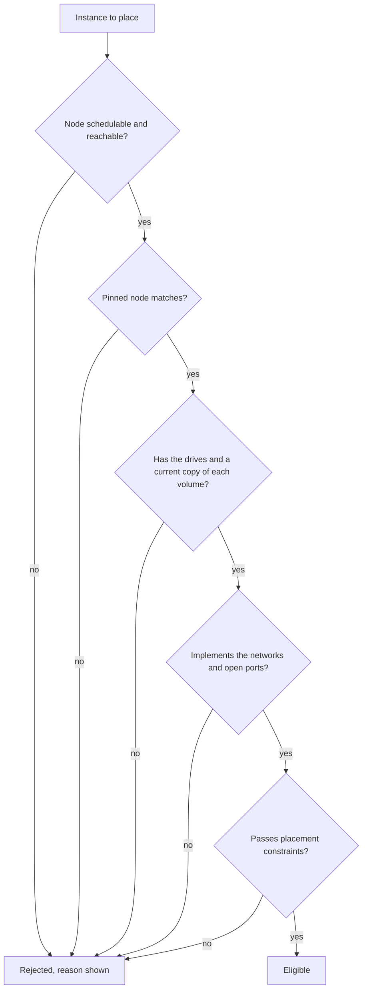

# Placement

Placement is how Clouduler decides which node runs each container. You rarely have to think about it: the scheduler picks any node that can run the service. This page explains what makes a node eligible, how to steer the choice with pins and constraints, and how to read the reasons the UI shows when a service cannot be placed.

## How it works

For every instance of every service, the scheduler tests each node against a list of requirements. A node that fails any test is rejected for that instance, and the first failing test becomes the reason you see. Among the nodes that pass, the scheduler picks one. An instance that already runs on a valid node is not moved just because another node is emptier (use `clouduler rebalance` for that).



The tests, in the order the scheduler applies them:

| Requirement | A node is rejected when | Reason text in the UI |
|---|---|---|
| Availability | the node is drained (or otherwise not schedulable) | the availability, for example `Drain` |
| Reachability | the cluster considers the node unreachable | `unreachable` |
| Node pin | the service is pinned with `x-clouduler.node` to another node | `pinned to NODE` |
| Drives | the node does not implement a drive the service mounts | `no such drive` |
| Volume copy | the node implements the drive but holds no current copy of the volume | scheduler-side only: not shown as a row on the Placement tab, see [drive holders](#drive-holders) |
| Egress network | the service uses an egress or wireguard network the node has no interface for | `not on network` |
| Other networks | the node does not implement a network the service names (nat networks always pass) | `not on network` |
| Open ports | an `x-clouduler.expose` port on a public or wireguard network is not listed in the node's `open_ports` | `port closed` |
| Constraints | the node fails a `deploy.placement.constraints` entry | `NODE fails constraint KEY == VALUE` |
| Configs and secrets | a config or secret the service needs is missing, or the node has no cluster key to open a secret | `missing`, `no cluster key` |

## Where to see it

<UiCli>
<UiCli.Ui>

Open a stack and choose the **Placement** tab. It shows one table per service (pick the service with the chips above it if there are several). Rows are requirements, columns are nodes. A cell is marked when the node fails that row, with a short reason. The last row, **Eligible servers**, says **Eligible** or **Blocked · N** for each node and tags the node that was **Picked**.

<UiScreen scenario="lan-3-nodes" route="/stacks/vaultwarden?tab=placement" caption="Placement tab: every node eligible, one picked." alt="Placement table for vaultwarden" />

The same table appears on the Deploy page under **Where it can run**, before you deploy. Rows that every node passes are folded away so the interesting ones stand out. For a missing config or secret an admin sees a **Create config NAME** or **Create secret NAME** button right in the table.

<UiScreen scenario="node-down-failover" route="/stacks/vaultwarden?tab=placement" caption="When a node is down, its column is blocked with the row reachable failing." alt="Placement table with an unreachable node" />

</UiCli.Ui>
<UiCli.Cli>

```bash
clouduler stack unhealthy --placement
```

For every instance that is waiting for a node, it prints why each node was rejected, using the full sentences below. `clouduler status` includes the same rows.

</UiCli.Cli>
</UiCli>

### The sentences you will see

These are the scheduler's own reasons, one per node. An instance that cannot be placed stays in the state `pending_placement`.

- `NODE is Drain` (or the node's other availability)
- `NODE is unreachable`
- `NODE is not the pinned node PIN`
- `NODE does not implement drive DRIVE`
- `NODE holds no current copy of volume DRIVE/VOLUME`
- `NODE does not implement egress network NET`
- `NODE does not implement network NET`
- `NODE does not have PORT/Tcp open on network NET`
- `NODE fails constraint KEY == VALUE`

If every node is rejected, the instance is not started anywhere. Fix the cause and the scheduler tries again on its next pass; you do not need to redeploy unless the cause is in the spec.

<Quirk title="A typo in the spec shows up here, not at deploy time" severity="warn">
Currently the web UI deploy does not check that the drive, network or node pin you named exists, while the CLI does. An unknown drive, network or pin is accepted by the UI and then rejects every node. In that case every column is blocked with `no such drive`, `not on network` or `pinned to NODE`. Check the name against your cluster, or deploy from the CLI to catch it up front.
</Quirk>

## Steering placement

### Pin a service to a node

Use `x-clouduler.node` when a service must run on one specific machine, for example because that machine has the hardware or the data.

```yaml title="stack.yaml"
services:
  app:
    image: example/app:1
    x-clouduler:
      node: atlas
```

The node must exist in the cluster, and if the service uses an egress network the node must have an interface address on it. You can also set `x-clouduler.node` at the stack level as a default for every service. Be careful: services inherit it, and a whole-drive mount needs the pin to match the drive's only holder.

### Constraints

`deploy.placement.constraints` takes Swarm-style filters. Each entry is `KEY==VALUE` or `KEY!=VALUE`.

| Key | Matches |
|---|---|
| `node.hostname` | the node's name |
| `node.id` | the node's id |
| `node.role` | `manager` or `worker` |
| `node.labels.KEY` | a label set on the node (`clouduler node add --label KEY=VALUE`) |

```yaml title="stack.yaml"
services:
  app:
    image: example/app:1
    deploy:
      placement:
        constraints:
          - node.role==worker
          - node.labels.disk==ssd
```

An unknown key never matches, so a typo in the key rejects every node with `fails constraint`. The CLI checks that `node.hostname==NAME` and `node==NAME` name a real node; other forms are not name-checked.

### Keep services together

`x-clouduler.colocate` pins a group of services to the same node. The relation is transitive.

```yaml title="stack.yaml"
services:
  app:
    image: example/app:1
    x-clouduler:
      colocate: [cache]
  cache:
    image: redis:7
```

### Replicas and global services

`deploy.replicas` sets how many instances run (default 1). `deploy.mode: global` runs one instance on every eligible node and ignores `replicas`. Replicas of one service are placed independently.

## Network placement

Networks narrow the choice of nodes, so adding a network to a service can move it.

- A service on an **egress** or **wireguard** network only lands on nodes that list a host interface (or an imported tunnel) for that network. Clouduler never creates an egress interface; if it is missing the service stays down behind a kill-switch.
- A service on a **public** network needs a node that has a public address on it.
- An `x-clouduler.expose` port on a **public** or **wireguard** network only schedules on nodes whose router forwards that port, declared as `open_ports` in the node's address.
- **nat** networks are available on every node and never narrow the choice.
- With `proxy.dns_publish: owning-node`, all containers behind one proxy hostname are pinned to one node.

See [Networking](/docs/features/networking) for the kinds and how to declare them.

## Drive holders

A volume lives on a drive, and a drive can be implemented by several nodes. Two kinds of drive behave differently.

- **Replicated** drives keep a copy on every node that implements them. A node is only eligible for a service if it holds a copy of each volume at the volume's current generation. A node that never received the volume, or whose copy is behind (it missed syncs), is rejected with `holds no current copy of volume DRIVE/VOLUME`. This protects you: starting the service on a stale copy would make it the primary and sync old data over the good one. The node that holds the primary copy always qualifies, so there is always a candidate while that node is up.
- **Served** drives have one authoritative copy that every node can reach over the internal network, so any node can run the service.

A service that mounts a drive's whole root (`drive/.`) must be pinned to the drive's only holder. The Placement tab shows this as the row `drive: DRIVE (whole mount)` with the reason `held by NODE` or `no sole holder`. See [Drives and volumes](/docs/features/drives-and-volumes).

<Quirk title="A fresh volume has no constraint yet" severity="info">
If there is no record of a volume yet, any node that implements the drive qualifies. The volume is created wherever the service lands.
</Quirk>

## Moving things

- Drain a node (`clouduler node set-availability NAME drain`, or the node page) to keep what it runs but place nothing new on it.
- `clouduler rebalance` moves instances to even out the spread, but never moves pinned instances, ones published on a proxy hostname, ones already migrating, or ones with nowhere else to go.
- If a node fails, the scheduler places its instances elsewhere. See [Failover](/docs/features/failover).
- A service that keeps getting killed is moved to another node instead of restarting forever in the same place.

## Quirks and gotchas

<Quirk title="Constraint forms with spaces are not name-checked">
`node.hostname == n3` works in the scheduler, but the CLI only checks the exact forms `node.hostname==NAME` and `node==NAME`. A typo in the other forms is not caught up front.
</Quirk>

<Quirk title="Placement problems after config changes">
Stacks are stored separately from `cluster.yaml`. Removing a drive or network from the cluster config can make a stored stack unplaceable without any change to the stack. The Placement tab shows it.
</Quirk>

Rows that every node passes are folded behind a toggle labelled `N constraint(s) met on all M servers`; the table then shows the remaining rows with each node marked Eligible, Blocked or Picked.

The rebalancer never moves instances that are pinned, global, anchor/colocate members, on the proxy host, or mid-migration.

## Related

- [Stacks](/docs/features/stacks)
- [Networking](/docs/features/networking)
- [Drives and volumes](/docs/features/drives-and-volumes)
- [Failover](/docs/features/failover)
- [Node lifecycle](/docs/features/node-lifecycle)
- [Stack spec](/docs/reference/stack-spec)
