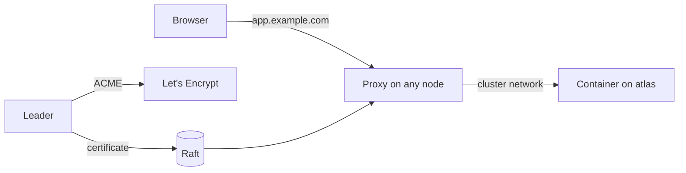

# Proxy and TLS

Clouduler runs a built-in reverse proxy on every node. You publish a web app by adding a route to its stack: a hostname, a network and a container port. Clouduler answers on ports 80 and 443, forwards the request to whichever node runs the container, and gets a Let's Encrypt certificate for the hostname automatically.

This page covers exposing a service, certificates, network gating, allowed hosts and the Proxy views of the web UI. Publishing the hostname in public DNS is covered in [DNS publishing](/docs/features/dns-publishing).

## How it works



- **Every node listens.** Each node runs the HTTP (80) and HTTPS (443) listeners. The routing table is built from the cluster's replicated state, so any node can answer for any hostname and forwards to the node that runs the container. That is why you can point DNS at any of your nodes.
- **Routes come from stacks.** A service declares `x-clouduler.proxy` routes. The table is rebuilt every 5 seconds.
- **Certificates are issued by the leader only.** The current raft leader asks Let's Encrypt for certificates, stores them in raft, and every node serves them. A leader change moves issuance. A certificate is renewed when it has 30 days left. Until one arrives, a node serves a self-signed fallback certificate and the browser shows a warning. The issuance pass runs about every 5 minutes, so a brand new hostname can wait up to that long.
- **Network gating.** A route is published on one of your networks. If that network is a subnetted one (internal or private), the proxy answers `403` unless the connecting machine is inside that subnet. A route on a public network is open to everyone.
- **Matching.** An exact hostname match is tried first, then a one-label wildcard such as `*.example.com`. The longest path prefix wins. With several backends the proxy rotates between them (round-robin). Sticky sessions use the `cl_sticky` cookie.

## Expose a service over HTTPS

<UiCli>
<UiCli.Ui>

Routes are part of a stack, so you add them in the stack editor, then check the result in the Proxy view.

1. Make sure the network you publish on has a **DNS domain** (**Settings > Network > Networks**). A route on a network without a domain fails validation with `network X has no domain, so it cannot serve an HTTP route`.
2. Turn on certificate issuance once: **Settings > Network > Reverse proxy**, switch on **Issue certificates automatically** (needs Cloudflare DNS below), and set a **Contact email**.
3. Add a route to the service in your stack (see the CLI tab for the YAML) and deploy.
4. Open **Proxy** (`/proxy`). The **Routes** tab shows every route the proxy serves right now: host, path, stack, service, port, network, TLS, websockets, expiry and health. The TLS column reads `{n}d left`, `on` or `off`.

<UiScreen scenario="lan-3-nodes" route="/proxy" caption="Proxy, Routes: what the proxy serves right now." alt="Proxy routes tab" />

An empty table says **Nothing is published yet.** A banner reads **n route(s) return a bad gateway** with the hint **Check that the service is running and listening on its port.** when a backend is down. The tag `502 on <node>` names the node that failed.

<UiScreen scenario="lan-3-nodes" route="/settings/network?page=proxy" caption="Settings, Network, Reverse proxy." alt="Reverse proxy settings" />

</UiCli.Ui>
<UiCli.Cli>

Add a route under the service in the stack file. `host` is a bare label, so it gets the network's domain appended:

```yaml title="vaultwarden.yaml"
services:
  vaultwarden:
    image: vaultwarden/server:1.32.0
    networks: [wan]
    x-clouduler:
      proxy:
        - host: vault            # becomes vault.example.com on the wan network
          network: wan           # the network that decides who may connect
          port: 80               # container port
          websockets: true
```

```bash
clouduler stack deploy vaultwarden.yaml
clouduler status               # "certificates & dns" section shows pending or ERROR
```

Turn on issuance in the cluster config:

```yaml title="cluster.yaml"
cloudflare:
  zones:
    - example.com

proxy:
  enabled: true
  acme:
    enabled: true
    directory_url: https://acme-staging-v02.api.letsencrypt.org/directory   # staging while testing
    contact_email: admin@example.com
```

Then `clouduler config reload`. Remove `directory_url` to use the production Let's Encrypt directory once staging works.

The CLI has no command for the Cloudflare token, certificate renewal, DNS reconcile, redirects or static routes. Use the web UI for those.

</UiCli.Cli>
</UiCli>

### Route options

These keys live in each `x-clouduler.proxy` entry. The complete stack file is described in the [stack reference](/docs/reference/stack-spec). A route change applies when you redeploy the stack.

<OptionTable rows={[
  {key: "host", type: "string", reload: "n/a", required: true, description: "Hostname the route answers. Lowercased; a bare label gets the network's domain; @ means the domain itself; a wildcard covers one label (*.example.com).", quirks: "Trailing dot is stripped."},
  {key: "network", type: "string", reload: "n/a", required: true, description: "Declared network the route is published on. Decides the domain and the network gate.", quirks: "The network must exist and have a domain."},
  {key: "port", type: "u16", reload: "n/a", required: true, description: "Container port the proxy forwards to."},
  {key: "path_prefix", type: "string", reload: "n/a", description: "Only requests under this path match the route."},
  {key: "tls", type: "bool", default: "true", reload: "n/a", description: "Use a certificate for the route.", quirks: "A route with tls: false is still served on the HTTPS listener too."},
  {key: "websockets", type: "bool", default: "true", reload: "n/a", description: "Let Upgrade requests through. Set false to refuse them.", quirks: "When refused the proxy answers 400 connection upgrades are not enabled for this route. The research file listed the default as false; the code default is true."},
  {key: "max_body_size", type: "size", default: "no limit", reload: "n/a", description: "Largest request body, for example 10MB. Bigger requests get 413 and never reach the container.", quirks: "Set it on anything exposed to the internet."},
  {key: "response_timeout", type: "duration", default: "30s (no limit when http2 is true)", reload: "n/a", description: "How long the backend may take to return response headers before 504. 0s removes the limit.", quirks: "Error text: ADDR did not respond within LIMIT. It covers connecting plus the response headers only: response bodies and trailers stream with no timer."},
  {key: "http2", type: "bool", default: "false", reload: "n/a", description: "Talk to the container in cleartext HTTP/2 (h2c, prior knowledge) instead of HTTP/1.1. Needed for gRPC.", quirks: "Per route, so path_prefix routes on one host and port can mix h2c and HTTP/1.1. The container must accept h2c on that port. Upgrade requests (websockets) on the route still reach the container over HTTP/1.1."},
  {key: "preserve_host", type: "bool", default: "false", reload: "n/a", description: "Forward the visitor's Host header instead of the backend's address.", quirks: "Turn it on for apps that build absolute URLs."},
  {key: "cloudflare_proxy", type: "bool", default: "false", reload: "n/a", description: "Publish the hostname with Cloudflare's proxy (orange cloud) on.", quirks: "Public networks only. On only if every route behind the host sets it; any route, static backend, redirect or login portal on the same host without it keeps the record DNS-only. Static backends, redirects and the login portal have their own toggle."},
  {key: "sticky", type: "bool", reload: "n/a", description: "Pin a visitor to one backend with the cl_sticky cookie."},
  {key: "middlewares", type: "list", reload: "n/a", description: "Named middlewares: redirect_https, strip_prefix, redirect_regex, headers, cors, authenticated.", quirks: "redirect_https is accepted but redundant: the HTTP listener already redirects (308) to HTTPS."},
]} />

CORS cannot combine `credentials` with a wildcard origin, and header names and values are validated at deploy time.

## Certificates

Clouduler uses ACME (Let's Encrypt by default). There are two ways an ACME server can check that you own a hostname:

| Method | How it proves ownership | Needs |
|---|---|---|
| **HTTP-01** | The CA fetches a token from `http://host/.well-known/acme-challenge/...` on port 80. | The hostname reachable from the internet on port 80. Cannot issue wildcards. |
| **DNS-01** | Clouduler writes a `_acme-challenge` TXT record (TTL 60) through the Cloudflare API and removes it afterwards. | A Cloudflare API token. Works for hosts that are not reachable from the internet, and for wildcards. |

Before asking the CA to validate a DNS-01 challenge, Clouduler waits until the record is visible on the zone's own authoritative nameservers. That check does not use the host's resolver, so a node whose `/etc/resolv.conf` forwards your zone elsewhere (Tailscale MagicDNS pointing at the cluster's DNS server, for example) still works. The nameserver names come from the Cloudflare zone, and their addresses are looked up through the public resolvers 1.1.1.1, 9.9.9.9 and 8.8.8.8, so the node needs outbound DNS to those. A failure there is reported with its real message (for example `no nameservers found for example.com`), not as a propagation timeout; `acme dns-01 challenge did not propagate in time` means the record really never showed up.

Clouduler's validation states that certificate issuance is DNS-01 only: `proxy.acme.enabled` is refused without a `cloudflare` section. Every name inside one of your configured Cloudflare zones is issued with DNS-01. HTTP-01 is an opt-in fallback used only for a route host written with a **trailing dot** (`host: foo.example.net.`) that no zone covers. Ordinary hostnames never use HTTP-01. The trailing dot is otherwise stripped, and `@` means the zone apex. Either way the whole ACME pass needs the Cloudflare zone list and token, even for HTTP-01. Without a token the daemon logs `no cloudflare token yet, ... will not run`.

### Connect Cloudflare

<UiCli>
<UiCli.Ui>

1. Create a token in Cloudflare with **Zone**, **DNS** and **Edit** permissions on your zone. The step-by-step is in the [Cloudflare API token guide](/docs/guides/cloudflare-api-token).
2. Open **Settings > Network** and the **Cloudflare DNS** page. Switch on **Manage DNS with Cloudflare**.
3. Under **DNS zones** list your zone, comma separated (for example `example.com`).
4. Paste the token into **API token** and press **Save token**. Later use **Rotate token**. It is sealed and stored as soon as you press Save.
5. Apply the page. Network domains and the dashboard hostname must all sit inside a listed zone.

The token is saved without being checked: a wrong token is only found when the first Cloudflare call fails with `cloudflare auth failed`.

</UiCli.Ui>
<UiCli.Cli>

The zone list is part of the config. The token is a sealed secret named `_clouduler_cloudflare_token` and has no CLI command; set it in the UI.

```yaml title="cluster.yaml"
cloudflare:
  zones:
    - example.com
```

</UiCli.Cli>
</UiCli>

### Wildcard certificates

A route host such as `*.apps.example.com` matches exactly one label (`a.apps.example.com`, not `a.b.apps.example.com`). Wildcards need DNS-01, which is why the Cloudflare setup is required. A wildcard route host gets one wildcard certificate (not one per concrete hostname), and a request for `a.apps.example.com` is served from it.

### Check and renew certificates

<UiCli>
<UiCli.Ui>

Open **DNS** (`/dns`). The **Certificates** panel lists every hostname with a tag: `pending`, `error: {message}`, `{n} days left`, `expired` or `live`. A banner **n certificates could not be issued** appears when issuance fails. **Reconcile DNS** runs the DNS and certificate passes immediately.

<UiScreen scenario="lan-3-nodes" route="/dns" caption="DNS: certificates, DNS records and the TLS fingerprint." alt="DNS and certificates view" />

To force a new certificate, use the renew action on the row. The dialog titled `Renew <fqdn>?` warns: "The current certificate is removed before a new one is requested, so the host may briefly lack TLS." The self-signed fallback can then be served for up to about 5 minutes.

</UiCli.Ui>
<UiCli.Cli>

`clouduler status` prints pending and failed certificate and DNS work:

```text
  certificate app.example.com: pending
  dns app.example.com: ERROR 2m ago: cloudflare auth failed: ...
```

Renewal and reconcile have no CLI command. They are API calls (`POST /api/certificates/{fqdn}/renew`, `POST /api/dns/reconcile`).

</UiCli.Cli>
</UiCli>

## Network gating: why you get a 403

A route on an **internal** or **private** network is private by design. The proxy compares the real TCP peer address (never `X-Forwarded-For`) with the network's subnet. If the visitor is outside it, the answer is:

```text
403: this route is only reachable from its own network
```

Two other sources also pass: the overlay subnets of stacks published on that route's network, and every nat network's subnet (so a container on the same node reaching the route through the host is not blocked). There is no special case for Tailscale or Headscale; to reach a private route over a VPN, the VPN address must be inside the network's subnet. A stack whose `allowed:` list does not include the host gets `403: stack X may not reach H through network N: it is not in the network's allowed list`. A route on a **public** network is never gated.

To publish a service on the internet, put its route on a `public` network. To keep it LAN-only, use a private network and expect the 403 from outside. See [Networking](/docs/features/networking).

## Allowed hosts

A stack can limit what its containers may reach with `allowed:`. A hostname entry is enforced at the proxy: a blocked request gets `403`. A `host:port` entry is enforced by the firewall instead. See the [stack reference](/docs/reference/stack-spec) and [Networking](/docs/features/networking).

## Headers and websockets

The proxy adds `X-Forwarded-For`, `X-Forwarded-Proto` and `X-Forwarded-Host` to the request and removes hop-by-hop headers. It adds no header naming the logged-in user, even with the `authenticated` middleware (see [Access and login](/docs/features/access-and-login)). Use the route's `headers` middleware to add your own.

Websockets are allowed by default.

## HTTP/2 and gRPC

The HTTPS listener offers both `h2` and `http/1.1` through ALPN, so browsers and gRPC clients can use HTTP/2 to reach the proxy. The plain HTTP listener stays HTTP/1.1. Websockets keep working: a client that upgrades does so over HTTP/1.1 on the same listener.

What the proxy speaks to the *container* is chosen per route. By default it is HTTP/1.1. Set `http2: true` on a route and the proxy talks h2c (cleartext HTTP/2 with prior knowledge) to the container instead, which is what a gRPC server needs. A client using HTTP/1.1 or HTTP/2 can reach either kind of route; the proxy translates.

```yaml
x-clouduler:
  proxy:
    # gRPC paths: h2c to the container, no timeout on the stream
    - host: netbird
      network: wan
      port: 80
      path_prefix: /management.ManagementService
      http2: true
    - host: netbird
      network: wan
      port: 80
      path_prefix: /signalexchange.SignalExchange
      http2: true
    # everything else on the same host and port stays HTTP/1.1 (and websockets)
    - host: netbird
      network: wan
      port: 80
```

On an `http2` route:

- Request and response bodies are streamed in both directions without buffering, and trailers (such as `grpc-status`) are forwarded both ways. `te: trailers` is preserved.
- An unset `response_timeout` means no limit, because a stream may send nothing for a long time and gRPC clients set their own deadlines. A value you set still applies, and still only to the response headers. `0s` removes the limit on any route.
- Idle HTTP/2 connections, to visitors and to containers, are pinged every 30s, so a dead peer is noticed instead of holding a stream open forever.
- `max_body_size` counts the bytes of the whole request stream, so on a long-lived client stream leave it unset or set it high enough for the stream's lifetime.

The proxy's health check still uses HTTP/1.1, so the container must answer HTTP/1.1 on that port as well, or the route will look unhealthy.

## Redirects and static backends

<UiCli>
<UiCli.Ui>

On **Proxy**, the **Redirects** tab sends a hostname to another URL (**New redirect**: host, target, status 301, 302, 307 or 308). **Static backends** publishes something Clouduler does not run, like another box on your LAN (**New static backend**: host and `host:port`). Both apply immediately, with no restart. Both forms have a **Cloudflare proxy (orange cloud)** toggle (`cloudflare_proxy` in the API), shown only when the chosen network is public; saving wakes the DNS reconcile so the record flips within seconds. The login portal has its own switch, see [Access and login](/docs/features/access-and-login). A hostname is proxied only when every stack route, static backend, redirect and portal answering it asks for it, and names are compared fully qualified (`app` and `app.example.com` are one host). The **Ingress rules** tab is for WireGuard ports (see [Networking](/docs/features/networking)).

<UiScreen scenario="lan-3-nodes" route="/proxy/redirects" caption="Proxy, Redirects." alt="Redirect rules" />

<UiScreen scenario="lan-3-nodes" route="/proxy/static" caption="Proxy, Static backends." alt="Static backends" />

</UiCli.Ui>
<UiCli.Cli>

No CLI. Use the web UI or the HTTP API (`/api/redirects`, `/api/redirects/{id}`, `/api/static-routes`, `/api/static-routes/{id}`; all admin CRUD).

</UiCli.Cli>
</UiCli>

Redirect errors you may see: `host must not be empty`, `target must not be empty`, `status must be 301, 302, 307 or 308, got N`, `cloudflare_proxy needs a public network, and X is not one`. Static backend errors: `backend must be host:port`, `N is not a valid port`, `no network named X`, `no node named X`.

## Options

Cluster-level proxy settings in [cluster.yaml](/docs/reference/cluster-yaml).

<OptionTable rows={[
  {"key": "proxy.enabled", "type": "bool", "default": "true", "reload": "live", "description": "Runs the reverse proxy on every node."},
  {"key": "proxy.http_port", "type": "port", "default": "80", "reload": "live", "description": "Plain HTTP listener. Serves tls: false routes, ACME HTTP-01 challenges and redirects everything else to HTTPS. Below 1024 needs root.", "quirks": "Must differ from https_port, web.port and web.backend_port."},
  {"key": "proxy.https_port", "type": "port", "default": "443", "reload": "live", "description": "TLS listener for routes.", "quirks": "Error if equal to the dashboard port: proxy.https_port: web.port already listens on PORT."},
  {"key": "proxy.dns_publish", "type": "enum", "default": "all-nodes", "reload": "live", "description": "all-nodes: every node's address is published for every proxied hostname. owning-node: only the nodes running the containers are published, stale records are deleted and the scheduler co-locates containers that share a hostname.", "quirks": "No UI control; edit the file. See DNS publishing."},
  {"key": "proxy.dns_server.enabled", "type": "bool", "default": "false", "reload": "live", "description": "Turns on the cluster DNS server that answers by the client's network.", "quirks": "Re-read every 5 seconds."},
  {"key": "proxy.dns_server.networks", "type": "list of network names", "default": "[] (every subnetted network the node has an address on)", "reload": "live", "description": "Networks to listen on, at the node's address on each. A public network is served only when listed.", "quirks": "Errors: no network named NAME; NAME has no node address to listen on."},
  {"key": "proxy.dns_server.port", "type": "port", "default": "53", "reload": "live", "description": "UDP and TCP port of the cluster DNS server. Below 1024 needs root.", "quirks": "Must not be 0."},
  {"key": "proxy.dns_server.upstream", "type": "list of IP addresses", "default": "[] (the host's resolvers except Tailscale MagicDNS)", "reload": "live", "description": "Resolvers that names the cluster does not own are forwarded to, tried in order on port 53.", "quirks": "Empty uses /etc/resolv.conf without 100.100.100.100 and fd7a:115c:a1e0::53, which tailnet split DNS can route back to this server and loop; if that leaves none, 1.1.1.1 and 1.0.0.1. Must be IP addresses, not loopback, unspecified or multicast, no duplicates. Changing it restarts the listeners."},
  {"key": "proxy.acme.enabled", "type": "bool", "default": "false", "reload": "live", "description": "Issue and renew certificates through ACME. Issuance is DNS-01 through Cloudflare.", "quirks": "Needs a cloudflare section: proxy.acme.enabled: certificate issuance is DNS-01 only, so it needs a cloudflare section."},
  {"key": "proxy.acme.directory_url", "type": "URL", "default": "Let's Encrypt production", "reload": "live", "description": "ACME directory. Point at staging while testing.", "quirks": "Not validated; a malformed URL is found only when a certificate is requested."},
  {"key": "proxy.acme.contact_email", "type": "string", "default": "none", "reload": "live", "description": "Address registered with the CA for expiry warnings.", "quirks": "Not validated."},
]} />

## Quirks and gotchas

<Quirk title="First certificate takes minutes" severity="info">
Until ACME issues a certificate you get a self-signed one and a browser warning (`no issued certificate yet, serving a self-signed fallback` in the log). The pass runs about every 5 minutes. Check **DNS > Certificates**.
</Quirk>

<Quirk title="Certificates need Cloudflare even for HTTP-01" severity="warn">
The whole ACME pass is gated on the Cloudflare section and token. A hostname outside every listed zone logs `no cloudflare zone covers this name, not issuing` and shows the status `no cloudflare zone covers this hostname`.
</Quirk>

<Quirk title="Backend errors" severity="info">
`bad gateway: {reason}` or `backend {addr} unreachable` means the container is down or listening on another port. `no route matches {host}{path}` means no route fits the request. The backend connect timeout is 5 seconds.
</Quirk>

<Quirk title="Port 80 or 443 already in use" severity="warn">
If another program holds 80 or 443 the proxy cannot listen, but the daemon keeps running. Check `ss -ltnp | grep -E ':(80|443) '` and `journalctl -u clouduler`; the daemon logs `proxy listener stopped` as a warning with the bind error.
</Quirk>

<Quirk title="proxy.enabled and ports: live or restart?" severity="info">
The listeners are rebuilt live when `proxy.enabled` or the ports change, and the daemon binds a new port itself. The systemd socket unit is only written by `clouduler init`, so it keeps naming the install-time ports and systemd keeps holding them. {/* TODO verify: needs a live cluster to see what happens to the old port. */} If a port change does not seem to apply, restart the daemon.
</Quirk>

<Quirk title="Exact host does not always win over a wildcard" severity="info">
If the exact host has no route for the requested path, the proxy falls through to a wildcard route. Older notes say an exact host always wins.
</Quirk>

<Quirk title="Certificate keys sit in raft in plain form" severity="warn">
Certificate private keys are replicated to every node. Do not paste raw raft dumps anywhere.
</Quirk>

## Related

- [DNS publishing](/docs/features/dns-publishing)
- [Access and login](/docs/features/access-and-login) for the `authenticated` middleware
- [Networking](/docs/features/networking)
- [Cloudflare API token](/docs/guides/cloudflare-api-token)
- [Ports and firewall](/docs/reference/ports-and-firewall)
- [cluster.yaml](/docs/reference/cluster-yaml)
