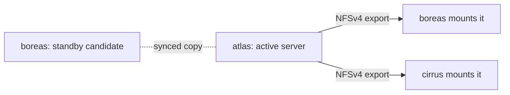

# Served drives

A **served drive** keeps one live copy of its data on one node, the **active server**, and shares it with the other nodes over NFS. Use it when many nodes need the same files at once (a media library, say) or when the data is too big to copy to every node. The trade-off: reads and writes from other nodes cross the network, and if the server's disk dies the live copy is gone.

If you want every node to hold a full copy and failover to restart a service anywhere, use a [replicated drive](/docs/features/drives-and-volumes) instead.

## How it works



1. You list candidate servers in `served_by`, in priority order. Every candidate exports the drive over NFSv4 with the kernel NFS server (`exportfs`), restricted to the internal subnet, read-write with `no_root_squash` (root on a mounting node is root on the exported copy), port 2049.
2. The **active server** is the node holding the drive's current data. Until a failover has happened that is the first candidate in the list that is reachable. After one, the cluster records which node holds the data and that node stays the active server, even when a candidate earlier in the list comes back (see [When the original server comes back](#when-the-original-server-comes-back)). Only the active server's copy is live. The other candidates keep a standby copy, synced from the active server on the drive's `sync_interval`.
3. Nodes that are not candidates mount the active server at `<data_dir>/volume-mounts/<drive>/<volume>` (NFS 4.2 over TCP, soft mount, no file locking). Containers see the volume at the path you mounted.
4. Every 10 seconds each node checks who the active server is. If it changes, the node unmounts and remounts against the new one. Each mount is health-checked every 30 seconds with a 3 second timeout.
5. If the active server becomes unreachable, the first reachable candidate in `served_by` takes over automatically and records itself as the holder. The standby copy it holds is only as fresh as the last sync.

Moving a served volume between nodes on purpose (a manual move or a rebalance) goes through a migration with these phases: stopping, syncing, verifying (both ends are hashed), switching, starting.

## When the original server comes back

A standby that took over is written to while it serves, so its copy is newer than the one on the server that went away. Handing the drive straight back to the first node in `served_by` would serve, and then sync out, the old data. It does not work that way: the node holding the data stays the active server until a handover moves it.

Every candidate remembers a fingerprint of its copy of each volume (paths, sizes, modification times, modes, owners, directories) as of the last time it pushed to or received from its peer, in `<data_dir>/served-sync` on that node. A copy whose files no longer match that fingerprint has been written since. Any change counts, including a touch. Before the active server pushes to a candidate, and before any handover, it asks that candidate for its fingerprint and decides per volume:

| The returning node's copy | The active server's copy | What happens |
|---|---|---|
| Unchanged since they last agreed | Anything | The active server copies its data over it. |
| Written | Unchanged | The returning node is ahead. Nothing is pushed to it, and it can take the drive back without a copy. |
| Written | Written | Conflict. Nothing is copied either way. |
| Holds files but has no recorded history | Anything | Conflict, because nothing says which copy is newer. A drive that has never failed over is exempt, so the first sync after an upgrade is not flagged. |

If no volume is in conflict and `failback` allows it (below), the active server hands the drive back in these steps:

1. It records that a handover to the returning node has begun. From this moment nobody is the active server of the drive. Nodes that mount it drop their mount.
2. It stops exporting the drive over NFS, which cuts off any client still attached, and waits 10 seconds.
3. It copies every volume the returning node is missing or has stale (a final sync), then updates its record of what each side holds.
4. It records the handover as complete. The returning node is now the active server, and the old one exports the drive again as a standby. The new active server syncs back to it from then on.

If anything in steps 2 and 3 fails (the returning node stops answering, a copy errors), the handover is cancelled and the node that was serving serves again. The reason is stored on the drive: the drive page shows it, the problem list shows `served_failback_blocked`, and the alert `drive.failback_blocked` fires. The same node does not try the drive again for a minute, and no automatic handover is attempted for an hour; **Fail back now** on the drive page (or `POST /api/drives/{drive}/failback`) skips the hour's wait.

Set `failback: manual` on the drive to never hand the drive back on its own. The standby then keeps serving until you press **Fail back now**. The drive still goes to the next candidate by itself if the active server drops out, and the check and copy above still apply to a manual handover. `auto` is the default because the handover only happens after the returning node has caught up.

### Both copies were written

This happens when the original server kept taking writes while it was cut off (clients on its own node, say) and the standby was written too, or when it was written after its last sync and then crashed. The cluster does not pick one. It records a conflict on the drive:

- Nothing is copied in either direction, so both copies stay exactly as they are.
- The node that was serving keeps serving. Nothing is handed back.
- The drive page shows a banner (and the problem list shows `served_conflict`, and the alert `drive.served_conflict` fires) naming the two nodes and the volume where the copies differ.

Choose a copy to keep with **Keep NODE** on that banner, or `POST /api/drives/{drive}/resolve` with `{"keep": "NODE"}`. The kept node becomes the active server and its copy replaces the other one on the next sync, once. The other copy is overwritten, so copy anything you want from it first: its files are not kept anywhere else.

## Requirements

- Every node that mounts or serves the drive needs root and the `nfsv4` kernel module. Without them the drive stays unavailable on that node.
- The internal network must allow NFS between nodes. See [Ports and firewall](/docs/reference/ports-and-firewall).
- Candidate nodes must map the drive to a local folder like any other drive.

## Set up a served drive

<UiCli>
<UiCli.Ui>

Open **Settings**, **Storage** (`/settings/storage`). Add a drive (or open an existing card), set **Storage mode** to **Served**, and choose the **Served by** nodes. The order matters: use **move atlas up** and **move atlas down** to set priority. **Resync every** is hidden for served drives in the UI; the config file still accepts `sync_interval` for them.

On the drive page (`/storage/drives/bulk`) the **Nodes** table has a **Priority** column and **About** shows the active server.

<UiScreen scenario="lan-3-nodes" route="/settings/storage" caption="Storage settings. The served drive bulk shows its candidate order (atlas, boreas)." alt="Storage settings with the served drive bulk" height={420} />

</UiCli.Ui>
<UiCli.Cli>

```yaml title="cluster.yaml"
drives:
  media:
    mode: served
    served_by: [atlas, boreas]    # atlas serves; boreas takes over if atlas is unreachable

nodes:
  atlas:
    drives:
      media: /srv/media
  boreas:
    drives:
      media: /srv/media
  cirrus: {}                      # no folder needed: cirrus mounts it over NFS
```

```bash
clouduler config reload
```

When you create a new cluster, `clouduler init --drive media=/srv/media --drive-mode served` declares a served drive with this node as the server.

</UiCli.Cli>
</UiCli>

Validation rules for `served_by`: only served drives can have it (`only a served drive has a serving node, set mode: served`), every name must be a real node (`no node named ...`), listed once (`... is listed more than once`), and must map the drive (`... must map media to the directory holding its copy`).

## Using it

Mount it exactly like a replicated drive: `media/library:/data` in a stack. The scheduler places the container on any node that can mount the drive. To import files into it, see [Folder import](/docs/features/folder-import): it works from the active server or from a node that mounts the drive, and refuses a standby candidate (the next sync from the real server would erase what was written there).

## Options

<OptionTable rows={[
  {key: 'drives.<name>.mode', type: 'replicated | served', default: 'replicated', reload: 'live', description: 'Set to served for an NFS-exported drive.', quirks: 'Changing mode rebuilds only that drive.'},
  {key: 'drives.<name>.served_by', type: 'list of node names', default: '[]', reload: 'live', description: 'Candidate servers in priority order. The first reachable one serves until a failover; after that the node holding the data keeps serving until a handover.', quirks: 'Each node must map the drive. Empty is accepted by validation.'},
  {key: 'drives.<name>.sync_interval', type: 'duration', default: '15m', reload: 'live', description: 'How often the active server pushes to standby candidates.'},
  {key: 'drives.<name>.failback', type: 'auto | manual', default: 'auto', reload: 'live', description: 'Whether the drive goes back to a candidate earlier in served_by after it returns from a failover. Either way it only goes once that node has caught up.', quirks: 'Manual waits for Fail back now. Has no effect on a replicated drive.'},
  {key: 'nodes.<name>.drives.<drive>', type: 'absolute path', reload: 'live', description: 'Folder holding the copy. Required on candidates; not needed on nodes that only mount.'},
]} />

## Quirks and gotchas

<Quirk title="Freeze does not work on served volumes">
`clouduler volume freeze` refuses a served volume. To edit the files, work on the active server directly or stop the services that use it.
</Quirk>

<Quirk title="Failover has no fresh copy to fall back on" severity="danger">
There is no replica set. The standby candidate only holds data as of the last sync. If the active server dies, the next candidate serves its standby copy, and anything written to the dead server since the last sync is not on it. If the dead server comes back with those writes, they are kept and reported as a conflict if the standby was written too. Keep [backups](/docs/features/backups) of served drives too.
</Quirk>

<Quirk title="The old server coming back" severity="info">
It does not take the drive back by returning. The standby keeps serving until a handover that first copies over what was written there (see [above](#when-the-original-server-comes-back)). While the handover runs, clients of the drive are cut off for the length of the final sync plus about 10 seconds.
{/* TODO verify: needs a live cluster; how the kernel NFS clients and the containers on other nodes behave while the export is stopped and the drive has no active server (the logic and the copies are covered by tests, the NFS and container side is not). */}
</Quirk>

<Quirk title="Missing root or nfsv4" severity="info">
A node without root privileges or the `nfsv4` kernel module cannot export or mount. The drive stays unavailable there and containers that need it do not start on that node.
</Quirk>

<Quirk title="Slow or lost mounts" severity="info">
A mount that cannot reach the server for a few seconds returns I/O errors to the container (soft mount, 3 retries) instead of hanging forever. Applications that cannot tolerate that need a replicated drive.
</Quirk>

## Related

- [Drives and volumes](/docs/features/drives-and-volumes), [Folder import](/docs/features/folder-import), [Failover](/docs/features/failover)
- [Ports and firewall](/docs/reference/ports-and-firewall)
