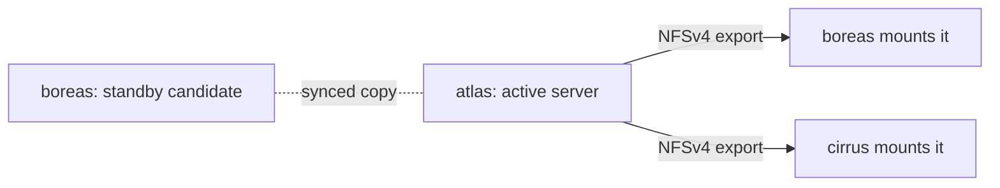

# Served drives

A **served drive** keeps one live copy of its data on one node, the **active server**, and shares it with the other nodes over NFS. Use it when many nodes need the same files at once (a media library, say) or when the data is too big to copy to every node. The trade-off: reads and writes from other nodes cross the network, and if the server's disk dies the live copy is gone.

If you want every node to hold a full copy and failover to restart a service anywhere, use a [replicated drive](/docs/features/drives-and-volumes) instead.

## How it works



1. You list candidate servers in `served_by`, in priority order. Every candidate exports the drive over NFSv4 with the kernel NFS server (`exportfs`), restricted to the internal subnet, read-write, port 2049.
2. The **active server** is the first candidate in the list that is reachable. Only that node's copy is live. The other candidates keep a standby copy, synced from the active server on the drive's `sync_interval`.
3. Nodes that are not candidates mount the active server at `<data_dir>/volume-mounts/<drive>/<volume>` (NFS 4.2 over TCP, soft mount, no file locking). Containers see the volume at the path you mounted.
4. Every 10 seconds each node checks who the active server is. If it changes, the node unmounts and remounts against the new one. Each mount is health-checked every 30 seconds with a 3 second timeout.
5. If the active server becomes unreachable, the next candidate in `served_by` takes over automatically. The standby copy it holds is only as fresh as the last sync.

Moving a served volume between nodes on purpose (a manual move or a rebalance) goes through a migration with these phases: stopping, syncing, verifying (both ends are hashed), switching, starting.

## Requirements

- Every node that mounts or serves the drive needs root and the `nfsv4` kernel module. Without them the drive stays unavailable on that node.
- The internal network must allow NFS between nodes. See [Ports and firewall](/docs/reference/ports-and-firewall).
- Candidate nodes must map the drive to a local folder like any other drive.

## Set up a served drive

<UiCli>
<UiCli.Ui>

Open **Settings**, **Storage** (`/settings/storage`). Add a drive (or open an existing card), set **Storage mode** to **Served**, and choose the **Served by** nodes. The order matters: use **move atlas up** and **move atlas down** to set priority. **Resync every** is hidden for served drives in the UI. {/* TODO verify: UI hides "Resync every" for served drives (R8 says shown for replicated only) while the config still accepts sync_interval */}

On the drive page (`/storage/drives/media`) the **Nodes** table has a **Priority** column and **About** shows the active server.

<UiScreen scenario="lan-3-nodes" route="/settings/storage" caption="Storage settings. A served drive shows its candidate order." alt="Storage settings with drive cards" height={420} />

</UiCli.Ui>
<UiCli.Cli>

```yaml title="cluster.yaml"
drives:
  media:
    mode: served
    served_by: [atlas, boreas]    # atlas serves; boreas takes over if atlas is unreachable

nodes:
  atlas:
    drives:
      media: /srv/media
  boreas:
    drives:
      media: /srv/media
  cirrus: {}                      # no folder needed: cirrus mounts it over NFS
```

```bash
clouduler config reload
```

When you create a new cluster, `clouduler init --drive media=/srv/media --drive-mode served` declares a served drive with this node as the server.

</UiCli.Cli>
</UiCli>

Validation rules for `served_by`: only served drives can have it (`only a served drive has a serving node, set mode: served`), every name must be a real node (`no node named ...`), listed once (`... is listed more than once`), and must map the drive (`... must map media to the directory holding its copy`).

## Using it

Mount it exactly like a replicated drive: `media/library:/data` in a stack. The scheduler places the container on any node that can mount the drive. To import files into it, see [Folder import](/docs/features/folder-import): it works from the active server or from a node that mounts the drive, and refuses a standby candidate (the next sync from the real server would erase what was written there).

## Options

<OptionTable rows={[
  {key: 'drives.<name>.mode', type: 'replicated | served', default: 'replicated', reload: 'live', description: 'Set to served for an NFS-exported drive.', quirks: 'Changing mode rebuilds only that drive.'},
  {key: 'drives.<name>.served_by', type: 'list of node names', default: '[]', reload: 'live', description: 'Candidate servers in priority order. The first reachable one is the active server.', quirks: 'Each node must map the drive. Empty is accepted by validation.'},
  {key: 'drives.<name>.sync_interval', type: 'duration', default: '15m', reload: 'live', description: 'How often the active server pushes to standby candidates.'},
  {key: 'nodes.<name>.drives.<drive>', type: 'absolute path', reload: 'live', description: 'Folder holding the copy. Required on candidates; not needed on nodes that only mount.'},
]} />

## Quirks and gotchas

<Quirk title="Freeze does not work on served volumes">
`clouduler volume freeze` refuses a served volume. To edit the files, work on the active server directly or stop the services that use it.
</Quirk>

<Quirk title="Failover has no fresh copy to fall back on" severity="danger">
There is no replica set. The standby candidate only holds data as of the last sync. If the active server dies, the next candidate serves its standby copy, and anything written since is lost. Keep [backups](/docs/features/backups) of served drives too.
</Quirk>

<Quirk title="The old server coming back">
When the original active server returns, it becomes the active server again because it is first in `served_by`. {/* TODO verify: whether the reclaim path can overwrite data written on the standby while it was serving (open question in R8, not covered by a test) */} Avoid writing to the standby for long periods without checking `served_by` order.
</Quirk>

<Quirk title="Missing root or nfsv4" severity="info">
A node without root privileges or the `nfsv4` kernel module cannot export or mount. The drive stays unavailable there and containers that need it do not start on that node.
</Quirk>

<Quirk title="Slow or lost mounts" severity="info">
A mount that cannot reach the server for a few seconds returns I/O errors to the container (soft mount, 3 retries) instead of hanging forever. Applications that cannot tolerate that need a replicated drive.
</Quirk>

## Related

- [Drives and volumes](/docs/features/drives-and-volumes), [Folder import](/docs/features/folder-import), [Failover](/docs/features/failover)
- [Ports and firewall](/docs/reference/ports-and-firewall)
