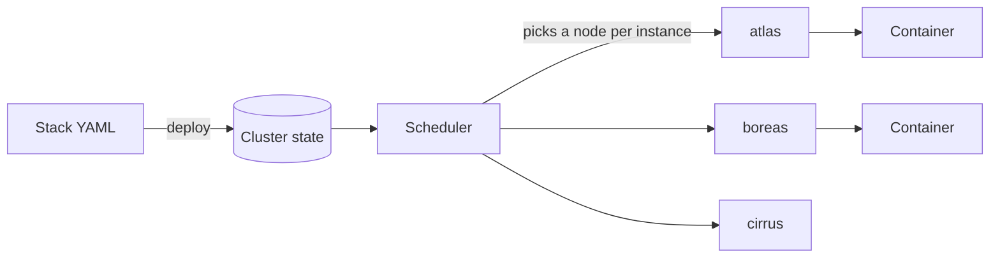

# Stacks

A stack is one YAML file that describes a group of containers you want to run together, for example a web app and its database. You hand the file to Clouduler once. From then on the cluster keeps those containers running, puts them on nodes that can run them, and moves them if a node fails.

If you know Docker Compose, a stack file looks familiar on purpose: it is a subset of Compose v3 with an `x-clouduler` block for Clouduler-only features such as proxy routes and drive-backed volumes. Every field is listed in the [stack spec reference](/docs/reference/stack-spec).

## How it works



1. **Deploy** stores the YAML in the cluster and bumps the stack's **revision**. Config and secret files the stack references are bundled with it.
2. The **scheduler** turns each service into one or more **instances** (named `STACK.SERVICE.INDEX`, for example `vaultwarden.app.0`) and picks a node for each. See [Placement](/docs/features/placement).
3. The node's daemon creates the container and keeps it running. If the node dies, the instance is placed somewhere else. See [Failover](/docs/features/failover).

You can deploy from the web UI or the CLI. Both do the same thing; the difference is how much they check first (see [validation](#validation-differs-between-the-ui-and-the-cli)).

## Deploy a stack

<UiCli>
<UiCli.Ui>

Open **Stacks**. If you have none yet, the page shows an empty state with a **Deploy stack** button (admins only).

<UiScreen scenario="fresh-single-node" route="/stacks" caption="The empty Stacks page on a new cluster." alt="Stacks view with no stacks and a Deploy stack button" height={360} />

1. Click **Deploy stack** (or go to `/stacks/new`).
2. Type the **Stack name**. Lowercase letters, numbers and dashes are safe.
3. Type or paste your YAML into the **Spec** editor, or use **Load from file**. The editor autocompletes keys and your cluster's real network, drive and node names.
4. Watch the panels fill in as you type:
   - **Validation** shows `Spec is valid` or a list of problems to fix.
   - **What it needs** lists the networks, drives, configs and secrets the spec uses.
   - **Bundled files** appears if the spec references configs or secrets with `file:`. Load each file or type its content here.
   - **Environment file for SERVICE** appears for every service that sets `env_file`. See [Import an env_file](#import-an-env_file).
   - **Where it can run** shows, per service, which nodes can host it.
5. Click **Deploy NAME**. The button stays disabled until the spec is valid. You land on the stack page.

If a step fails you see a red **Not deployed** banner: `The deploy failed while STEP: MESSAGE`.

### Import an env_file

A stack file cannot use `env_file`, because the daemon never sees the file. The deploy editor (new stack and redeploy) converts it for you. For each service that sets `env_file`, an **Environment file for SERVICE** panel names the service and the listed paths and has one text box per service. If the service lists several files, paste them one after the other in the listed order. A key defined twice is reported and the last value wins.

1. Paste the contents of the file and click **Review N variables**. The parser reads `KEY=value`, `export KEY=value`, `#` comment lines, single-quoted values (literal), double-quoted values (`\n`, `\r`, `\t`, `\\`, `\"` escapes, may span lines), and strips a trailing ` # comment` from unquoted values. Variables such as `${OTHER}` are not expanded. A line it cannot read, such as a bare `KEY` without `=` or an unterminated quote, is listed with its line number and is not imported.
2. For each variable choose **Plain** or **Secret**. Names containing PASSWORD, PASSWD, PASS, SECRET, TOKEN, KEY, PRIVATE, CREDENTIAL, SALT, AUTH, CERT or DSN start as Secret, except a few identifier-like names such as `PUBLIC_KEY` or `KEY_ID`. Values are masked until you click **Show values**. An empty value can only be Plain.
3. A secret gets a name, by default `SERVICE-key-in-lowercase` with `_` turned into `-`. Names may contain letters, digits, dot, dash and underscore and must not start with a dot. If the name is already declared in the spec or already exists as a cluster secret, you must tick the overwrite box or pick another name. Overwriting a cluster secret changes it for every stack that uses it and can break a running service.
4. Click **Apply to the spec**. The editor text is rewritten in place, keeping your comments and layout:
   - the service's `env_file` is removed;
   - Plain variables are added to its `environment`, in the existing map or list form, or a new map if there is none. A variable the service already sets in `environment` (or as a secret with `env:`) is skipped and keeps its explicit value, and a toast names it;
   - each Secret is added as a top-level `secrets: NAME: {file: ./secrets/NAME}` entry and as `- source: NAME` with `env: KEY` on the service, and its value is filled in under **Bundled files**, with no newline added.

You can still edit the spec and the bundled values before you click **Deploy**. The pasted text and values exist only in the page while you work. They are not logged, put in a URL or saved in the browser, and the pasted text is cleared when you apply or discard. The secret values are sent when you deploy, like any bundled secret.

The CLI does not do this conversion. `clouduler stack deploy` with an `env_file` fails with the validation error.

<UiScreen scenario="lan-3-nodes" route="/stacks" caption="A cluster with three stacks running." alt="Stacks view listing vaultwarden, nextcloud and immich" />

</UiCli.Ui>
<UiCli.Cli>

Save the file, then deploy it. The stack name is the file name without its extension unless you pass `--name`.

```bash
clouduler stack deploy ./vaultwarden.yaml
# deployed vaultwarden revision 1, 1 services, 0 bundled files
```

Files referenced with `file:` are read relative to the stack file's directory and bundled. Secrets are sealed with the cluster key on the machine you run the command on, so that machine needs the key file.

</UiCli.Cli>
</UiCli>

A minimal stack:

```yaml title="vaultwarden.yaml"
networks:
  lan: {}

services:
  app:
    image: vaultwarden/server:1.32.0
    restart: always
    networks: [lan]
    volumes:
      - fast/vaultwarden:/data          # drive/volume:/container/path
    x-clouduler:
      proxy:
        - host: vault                   # becomes vault.<domain of the lan network>
          network: lan
          port: 80
```

### Validation is the same in the UI and the CLI

The web UI, the HTTP API, the MCP tools and `clouduler stack deploy` all run the syntax checks and then the cluster checks. A typo like `fats/vaultwarden:/data` is refused with a message such as `drive fats is not defined in cluster.yaml`, both by **Validate** and on **Deploy**, before anything is stored.

## Look at a running stack

<UiCli>
<UiCli.Ui>

Click a stack in **Stacks** to open its page. The header shows the revision, number of services and nodes, and when it was deployed.

<UiScreen scenario="lan-3-nodes" route="/stacks/vaultwarden" caption="The stack page. Tabs: Containers, Placement, Spec, Settings." alt="Stack detail for vaultwarden" />

- **Containers**: each instance with its state and node, plus recent log lines.
- **Placement**: why each node can or cannot run each service.
- **Spec**: the stored YAML and **Changes since last deploy**.
- **Settings**: configs and secrets the stack uses, the update webhook, and **Remove stack**.

</UiCli.Ui>
<UiCli.Cli>

```bash
clouduler stack list
# vaultwarden	revision=1	configs=0	secrets=0	instances=1

clouduler stack show vaultwarden          # the stored YAML
clouduler stack unhealthy --all           # anything not matching what you asked for
clouduler status                          # whole cluster at a glance
```

</UiCli.Cli>
</UiCli>

## Update (redeploy)

Changing a stack means deploying a new revision of the same name. Clouduler stores the previous spec so you can see what changed.

<UiCli>
<UiCli.Ui>

Open the stack and click **Redeploy NAME** (admins). The Deploy page opens pre-filled with the running spec and the name field disabled. Edit, check **Changes to deploy**, then click **Deploy NAME**. The revision goes up by one.

</UiCli.Ui>
<UiCli.Cli>

```bash
clouduler stack source vaultwarden > vaultwarden.yaml
$EDITOR vaultwarden.yaml
clouduler stack source vaultwarden set vaultwarden.yaml    # the stack must already exist
```

Or run `clouduler stack deploy vaultwarden.yaml` again.

</UiCli.Cli>
</UiCli>

An identical redeploy still bumps the revision. To pull newer container images without changing the spec, use the Updates page or `clouduler update`; see [Updates](/docs/features/updates).

## Stop, start, restart

<UiCli>
<UiCli.Ui>

The UI controls individual containers. Open the **Containers** tab, or click an instance to open `/instances/vaultwarden.app.0`, and use the **Restart**, **Stop** and **Start** buttons there (each label includes the instance id, for example `Restart vaultwarden.app.0`). Stopping asks for confirmation and the container stays stopped until you start it again.

<UiScreen scenario="lan-3-nodes" route="/instances/vaultwarden.app.0" caption="One instance: state, logs and actions." alt="Instance detail for vaultwarden.app.0" />

The stack page (tabs Containers, Placement, Spec, Settings) has no stack-wide stop or start button. To stop every instance at once, use `clouduler stack stop NAME` on the CLI.

</UiCli.Ui>
<UiCli.Cli>

```bash
clouduler stack stop vaultwarden       # every instance goes to stopped, assignments are kept
clouduler stack start vaultwarden      # same instances come back, no redeploy needed
clouduler stack restart vaultwarden    # rebuilds each instance's container where it already runs
```

</UiCli.Cli>
</UiCli>

<Quirk title="Restart rebuilds the container">
`stack restart` keeps each instance on its current node: the node removes the container and rebuilds it from the same assignment, so placement, volume primaries and any `stack update` image pin are kept. It is a rebuild rather than a `docker restart`, so a changed config or image tag takes effect. It does not change the desired state, so a stopped stack stays stopped. (The UI's per-instance **Restart** is different: it re-rolls placement.)
</Quirk>

## Remove

<UiCli>
<UiCli.Ui>

Open the stack, go to **Settings**, find the **Remove stack** panel and click **Remove NAME**. You must type the stack name to confirm. It stops every container of the stack and deletes the stack.

</UiCli.Ui>
<UiCli.Cli>

```bash
clouduler stack remove vaultwarden
# removed vaultwarden
```

There is no confirmation prompt on the CLI.

</UiCli.Cli>
</UiCli>

Removing a stack keeps its volumes on the drives, but it also deletes the stack's configs and secrets that no other stack uses. The remove dialog does not mention volumes; it asks you to type the stack name.

## Logs

<UiCli>
<UiCli.Ui>

The **Containers** tab of a stack shows recent lines for each instance. For the full stream open the instance and go to its logs section (`/instances/NAME#logs`).

</UiCli.Ui>
<UiCli.Cli>

```bash
clouduler stack logs vaultwarden -f -n 100   # all instances, merged and ordered by time
clouduler logs vaultwarden.app.0 -f          # one instance, exactly as the container wrote it
```

`-n` is the number of lines from the end of each container's log (default 200).

</UiCli.Cli>
</UiCli>

## Exec and shell

Running a command inside a container is a CLI feature: the web UI does not offer a shell.

```bash
clouduler exec vaultwarden.app.0                       # tries bash, falls back to sh
clouduler exec vaultwarden.app.0 -- ls -la /data       # use -- before a command with flags
clouduler exec -u 1000:1000 vaultwarden.app.0 -- id
```

It works from any machine that holds the cluster key, wherever the container runs. To debug connectivity, `clouduler capture vaultwarden.app.0 -- port 80` runs `tcpdump` on the right node. See the [CLI reference](/docs/reference/cli#instances).

## Health

A stack is healthy when every instance runs as asked. Clouduler looks at the container state, the Docker healthcheck from your spec (`healthcheck:`), and the proxy's active check for routed services.

- In the UI, open the stack page. A failing instance shows a tag such as `Restart 3 of 5` or a placement problem,.
- On the CLI, `clouduler stack unhealthy` lists instances that are restarting, exited when they should run, failing a health check, stopped by `stack stop`, or waiting for placement. Add `--placement` for the reason (the `reason=` part of the line below only appears with that flag) and `--logs 10` for the last lines. `stack stop`, `start`, `restart` and `logs` on a stack with no running instances fail with `stack NAME has no running instances`.

```text
vaultwarden	1 unhealthy instance(s)
  vaultwarden.app.0	state=pending_placement	health=none	reason=...
```

If a service has `depends_on`, its instance waits until each dependency has an instance running somewhere. A `healthcheck` block without `test:` is silently ignored.

## Placement basics

Every instance runs on one node. The scheduler picks a node that can hold everything the service needs: the drives it mounts, the networks it uses, any ports it exposes, and any pin or constraint you wrote. If no node qualifies, the instance waits as `pending_placement` and the **Placement** tab says why for each node. The full list of reasons is on the [Placement](/docs/features/placement) page.

## Quirks and gotchas

<Quirk title="Fields that do nothing today" severity="info">
`deploy.restart_policy`, `deploy.update_config` and `deploy.resources.reservations` are accepted but currently not acted on. Use the service-level `restart:` key. See the [stack spec](/docs/reference/stack-spec#deploy).
</Quirk>

<Quirk title="Published ports follow the container, but only on its own node">
A `ports:` entry binds on the node that runs the container. If the container moves, so does the port. For a port that is open on every node and forwards over the overlay, use `x-clouduler.expose`. See [Networking](/docs/features/networking#publishing-a-service).
</Quirk>

<Quirk title="Stack names">
A stack name is 1 to 63 characters from `a-z`, `0-9`, `-` and `_`, starting and ending with a letter or digit. Names cannot be changed on redeploy. A stack name never contains a dot, because `STACK.SERVICE.INDEX` is split on dots.
</Quirk>

<Quirk title="Deploying secrets needs a node with the cluster key" severity="warn">
The CLI says `this stack has secrets, so the cluster key at PATH is needed. Deploy from a node that holds it, or use the web ui`. The web UI seals with the key of the node it is connected to; if that node has none you get `this node holds no cluster key`.
</Quirk>

## Related

- [Stack spec reference](/docs/reference/stack-spec)
- [Placement](/docs/features/placement)
- [Networking](/docs/features/networking)
- [Configs and secrets](/docs/features/configs-and-secrets)
- [Drives and volumes](/docs/features/drives-and-volumes)
- [Updates](/docs/features/updates)
- [CLI reference](/docs/reference/cli)
