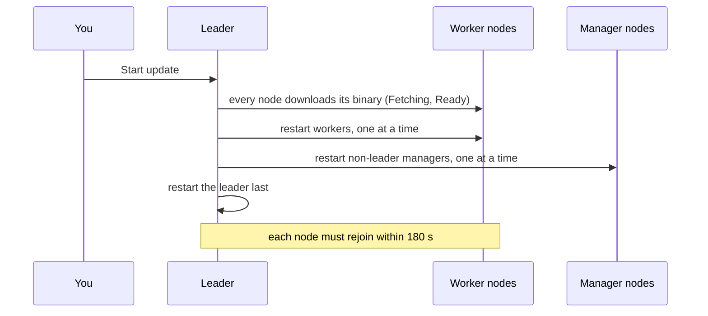

# Updates

Clouduler has two separate kinds of update, and they never mix:

1. **[Cluster self-update](#self-update)** replaces the Clouduler program itself on every node.
2. **[Container image updates](#image-updates)** replace the image a running container uses (for example `nginx:1.25`).

:::info Nothing updates by itself
Clouduler never installs anything automatically. The cluster can check for a newer Clouduler release and tell you, but an operator starts the rollout. Container images are only updated when you click **Update** (or run `clouduler update`). The stack key `auto_update` is accepted by the parser but nothing acts on it (see [Quirks](#quirks)).
:::

## Part 1: cluster self-update {#self-update}

You point the cluster at a GitHub repository that publishes Clouduler releases. Each node downloads its own prebuilt binary straight from GitHub. When every node is ready, the leader restarts the nodes one at a time. A node that does not come back on the new version in time fails the run, and the new binary also rolls itself back if it keeps crashing.

### How it works



1. **Release source.** `self_update.release_url` in `cluster.yaml` is either `https://github.com/OWNER/REPO` (follow the latest release) or `https://github.com/OWNER/REPO/releases/tag/TAG` (pin one release). The release must contain one asset per architecture named `clouduler-<arch>-unknown-linux-gnu` (`x86_64` and `aarch64` are checked).
2. **Check.** If `check_updates` is on, the leader looks up the latest release every `check_interval` (default 24 hours) and records the tag. Settings shows "newer". A check never starts a rollout.
3. **Start.** An admin clicks **Start update**. Only nodes whose availability is Active take part. Drained nodes, and nodes that join later, are left on their current version.
4. **Download.** Every node downloads its asset and records a blake3 hash. Releases publish no checksum, so the only integrity check is that all nodes of one architecture must get identical bytes.
5. **Restart in a fixed order.** Workers (sorted by name), then non-leader managers, then the leader last. One node at a time. Before replacing anything, the node runs the new binary with `--version` (10 seconds) and refuses it if that fails. The old binary is kept as `<name>.old`.
6. **Wait.** A node is Done once it is reachable and reports the new hash. If it does not come back within 180 seconds the run fails.
7. **Local rollback.** After a restart the node is on probation. If the new binary starts more than 3 times without rejoining the cluster, or has not rejoined after 150 seconds, the node puts the previous binary back and exits. The next start logs `the last update was rolled back, this is the previous version`.

If a run fails or is cancelled, nodes that already restarted stay on the new version, so the cluster can end up on mixed versions.

### Tasks

<UiCli>
<UiCli.Ui>

Open **Settings**, then the **Updates** tab (`/settings/self-update`).

- **Release source** panel: enter the **Repository** and click **Save release**. This works once. After that the field is read-only and the file is the only way to change it. Optionally paste a **GitHub token** and click **Save token** (or **Replace token**) for a private repo or to avoid GitHub's anonymous rate limit.
- **Automatic checks** panel: shows **on** or **off**, the last check, **Check every** with **Save interval**, and **Turn on** / **Turn off**. It says "Nothing is installed automatically."
- **Update** panel: **Running**, **Available** (with a `newer` tag) and **Rolling out**, with each node's architecture and phase (`idle`, `fetching`, `ready`, `restarting`, `done`, or the failure).

Click **Start update** (or **Start update to TAG**). The dialog `Update to TAG?` says "Nodes download the release, then restart one at a time once all are ready." While a run is active the button becomes **Cancel update** ("Nodes that already restarted stay on the new version."). A failed run shows **The update stopped** with the reason. When current, the page says `Already on the latest version.`

<UiScreen scenario="lan-3-nodes" route="/settings/self-update" caption="A finished run: every node is done." alt="Settings, Updates tab" />

</UiCli.Ui>
<UiCli.Cli>

Enable it in `cluster.yaml` (edit through `clouduler config`, see [cluster.yaml](/docs/reference/cluster-yaml)):

```yaml title="cluster.yaml"
self_update:
  release_url: https://github.com/LiteApplication/clouduler   # follow the latest release of Clouduler itself
  # release_url: https://github.com/OWNER/REPO/releases/tag/v0.9.10   # or pin one
  check_updates: true
  check_interval: 24h
```

To track the official Clouduler releases, set the repository to `https://github.com/LiteApplication/clouduler`. The CLI has no command to start a rollout. Use the web UI or the API:

```bash title="Self-update through the API"
KEY=clk_...   # an API key
curl -H "Authorization: Bearer $KEY" https://cloud.example.com/api/self-update/latest
curl -X POST -H "Authorization: Bearer $KEY" https://cloud.example.com/api/self-update/run
curl -H "Authorization: Bearer $KEY" https://cloud.example.com/api/self-update/run   # until finished_at is set
curl -X POST -H "Authorization: Bearer $KEY" https://cloud.example.com/api/self-update/cancel
```

Other routes: `PUT /api/self-update/repo` (write-once), `PUT /api/self-update/check` with `{"enabled": true, "interval": "24h"}`, and `PUT /api/self-update/github-token` with `{"token": "..."}`. See the [HTTP API](/docs/reference/http-api#self-update).

</UiCli.Cli>
</UiCli>

### Options

<OptionTable rows={[
  {key: 'self_update', type: 'object', default: 'absent (feature off)', reload: 'live', description: 'Enables the feature. Unknown fields are rejected.', quirks: 'Without it, Start update is refused with: no self-update release is configured'},
  {key: 'self_update.release_url', type: 'string', reload: 'live', required: true, description: 'https://github.com/OWNER/REPO follows the latest release; https://github.com/OWNER/REPO/releases/tag/TAG pins one.', quirks: 'The web UI can set it once and then refuses changes: a self-update release is already configured; edit the config file to change it'},
  {key: 'self_update.check_updates', type: 'bool', default: 'true', reload: 'live', description: 'Whether the leader periodically looks up the latest release. Nothing is installed automatically.'},
  {key: 'self_update.check_interval', type: 'duration', default: '24h', reload: 'live', description: 'How often the leader checks.', quirks: 'The web route refuses less than 1h (interval must be at least 1h; GitHub rate-limits unauthenticated requests). The config file does not enforce the minimum.'},
  {key: '_clouduler_self_update_github_token', type: 'sealed secret', reload: 'live', description: 'Optional GitHub token for private repos or higher rate limits. Write-only.', quirks: 'Errors: the token is empty; this node holds no cluster key'},
]} />

### Errors you may see

| Message | Meaning |
|---|---|
| `resolving the release: ...` | GitHub could not be reached or the release was not found. |
| `release <tag> has no clouduler-*-unknown-linux-gnu assets` | The release does not publish the binaries Clouduler needs. |
| `no asset published for arch <arch>` | One node's architecture has no asset. |
| `downloaded binary hash <hash> differs from the <other> other nodes of this architecture got` | Nodes of one architecture downloaded different bytes. |
| `<name> did not come back in time after restart` | A node was not reachable on the new version within 180 seconds. |
| `<name> left the cluster mid-restart` | A node dropped out of the cluster during its restart. |
| `the downloaded binary did not answer --version` | The staged binary cannot run on that node (10 second limit). |
| `a self-update run is already in progress` | A run is active. |
| `cancelled by operator` | You pressed **Cancel update**. |
| `the new binary did not rejoin the cluster in time` | Local rollback after 150 seconds. The daemon exits with `rolled back to the previous binary: <reason>`. |

Manual rollback on a node that kept its `.old` file: `mv /usr/local/bin/clouduler.old /usr/local/bin/clouduler && systemctl restart clouduler` (adjust the path to where you installed the binary). Only one previous version is kept; a second update removes the first rollback point.

## Part 2: container image updates {#image-updates}

The **Updates** page compares what each container runs with what its registry serves now for the image your stack file names. You can update one container, all that are behind, or pin what is running so it cannot drift.

### How it works

Three different digests (the fingerprint of an exact image build) are involved:

- **Pin.** A digest the cluster has locked the container to. Recreated containers use it.
- **Running.** The digest behind the image the container actually runs.
- **Latest.** What the registry serves now for the declared tag.

A container is **behind** only when both Running and Latest are known and differ. A locally built image, or a registry that did not answer, is shown as **Unknown**, never as behind. A container whose running digest differs from its pin is **Not on its pin**; fix that by redeploying, not by pulling.

Applying an update:

1. The request is accepted at once (`202`) and each instance is queued. The work continues in the background.
2. The owning node pulls the declared image with the matching registry login. The old container keeps serving.
3. If the instance had no pin, the running digest is pinned first, so a failed update can return to it. Then the new digest is pinned.
4. The old container is stopped (using the stack's `failover.stop_grace`) and **removed**. It is removed rather than restarted, because a restart would reuse the old image. The scheduler then creates a new container from the pinned digest.
5. The batch waits for the container to start, up to 10 minutes per instance.

Rules for a batch: each node does one download and one restart at a time; nodes work in parallel; two instances of the same service never restart together. The first failure halts the batch: that container is rolled back to its previous pin, and the instances not yet started are marked `cancelled: the update of <instance> failed, so the rolling update stopped`.

### Tasks

<UiCli>
<UiCli.Ui>

Open **Updates** (`/updates`, page title **Image updates**).

- **Check again** refreshes the registry lookups. The page refreshes lookups only on request, but it polls the instance list every 3 s while a freshly started instance has not yet reported healthy.
- **Update all behind (N)** updates every container marked behind. A row's **Update** button updates one; it reads **Retry** after a failure.
- **Pin digests (N)** records what each unpinned container runs as its pin, so it cannot drift on a later restart. Containers that are already pinned are never re-pinned.
- Filter chips: **All**, **Behind**, **Off pin**, **Unknown**, **Up to date**, plus a text filter.
- Table columns: **Container**, **Node**, **Status**, **Running to latest** and **Action**. Status shows **Update available**, **Not on its pin** ("Redeploy to apply the pin"), **Unknown** (with the registry error and an **Add registry login** link when it looks like authentication) or **Up to date**. During an update it shows `Queued`, `Downloading`, `Stopping the old one`, `Starting the new one`, `Started` or `Waiting for the health check`, with `step N of 4`.
- While updating, a panel reads `Updating N of M`. It is safe to leave the page. A failure banner `N update(s) failed` offers **Retry failed**.
- **Manage registry accounts** stores logins for private registries. See [Private registries](/docs/guides/private-registries).

<UiScreen scenario="lan-3-nodes" route="/updates" caption="The Image updates page." alt="Image updates page" />

</UiCli.Ui>
<UiCli.Cli>

```bash
clouduler update                          # every instance with an update available
clouduler update media.web.0              # one instance, stack.service.index
clouduler update media.web.0 media.db.0   # several
clouduler update --via boreas             # ask a specific node
```

The command prints `updating N instance(s):` and the accepted ids, or `nothing to update`. It returns when the work is accepted and does not report success or failure; watch the Updates page.

API:

```bash title="Image updates through the API"
curl -H "Authorization: Bearer $KEY" https://cloud.example.com/api/updates
curl -X POST -H "Authorization: Bearer $KEY" -H "Content-Type: application/json" \
  -d '{"instances": []}' https://cloud.example.com/api/updates/apply
```

An empty `instances` list means every instance that is behind (apply) or unpinned (`POST /api/updates/pin`). `POST /api/instances/{id}/update` updates one instance and answers 409 `an update of <id> is already in progress` when one is running. A per-stack update webhook also exists; see [Git webhooks](/docs/guides/git-webhooks) and the [HTTP API](/docs/reference/http-api#updates).

</UiCli.Cli>
</UiCli>

### Options

<OptionTable rows={[
  {key: 'services.<name>.image', type: 'string', reload: 'restart', required: true, description: 'The declared tag or digest reference that scans and pulls ask the registry about. A digest reference never shows as behind.', quirks: 'Takes effect on redeploy.'},
  {key: 'x-clouduler.auto_update', type: 'bool', default: 'false', reload: 'n/a', description: 'Parsed at stack level and per service, but no code reads it. Nothing happens automatically.', quirks: 'Do not rely on it.'},
  {key: 'failover.stop_grace', type: 'duration', reload: 'live', description: 'How long the old container may take to stop during an update before it is killed.'},
  {key: '_clouduler_registry_<server>', type: 'sealed secret', reload: 'live', description: 'Registry login (server, username, password). Verified against the registry before it is saved, and offered only to images from that registry.'},
]} />

## Quirks and gotchas {#quirks}

<Quirk title="auto_update does nothing" severity="danger">
`x-clouduler.auto_update` is accepted by the config parser and listed in the editor schema, but no code acts on it (nothing in the code says whether it is planned). A stack that sets it gets no behaviour. Update containers yourself.
</Quirk>

<Quirk title="Self-update and image updates are unrelated">
A cluster rollout and a container batch can run at the same time; no lock between them exists: the rollout state is kept separately and the container update code never reads it.
</Quirk>

<Quirk title="A failed self-update leaves a mixed-version cluster">
Cancelling or failing a run does not roll back nodes that already restarted. Only the node that failed to rejoin rolls itself back.
</Quirk>

<Quirk title="Pinned containers do not follow new tags" severity="info">
A pin is a digest. The registry is asked about the image declared in your stack file, not the pinned one, so a pinned container can show as behind and updating it moves the pin.
</Quirk>

<Quirk title="Update available needs both digests" severity="info">
A container built locally, or whose registry answer is missing, never shows as behind. Use the **Unknown** filter. Public registries rate-limit, so lookups run four at a time and back off on HTTP 429. A node that cannot be scanned in 25 seconds shows its containers as Unknown until the next check.
</Quirk>

<Quirk title="The batch stops at the first failure">
Later instances are marked cancelled. Restarts already running on other nodes finish or fail on their own. Progress records disappear 15 minutes after finishing. A record stuck queued for 15 minutes fails with `stalled: queued but never started`, one stuck in another phase for an hour fails with `stalled: no progress for an hour`, one left over from before a daemon restart fails with `interrupted: the daemon restarted mid-update`, and one whose node left the cluster, is unreachable, or no longer hosts the instance fails with `interrupted: the node running this update left the cluster`, `... is unreachable` or `interrupted: the instance moved to another node`. After 15 minutes without progress the instance also shows as a problem: `update is <phase> on <node> and has made no progress for <n>s`.
</Quirk>

<Quirk title="Redeploy shares the progress record" severity="info">
A redeploy and an image update both write the same progress record, so one can show in the other's place.
</Quirk>

## Related

- [Alerts](/docs/features/alerts): `self_update.rolled_back`, `self_update.completed`, `update.failed`, `update.stuck`, `update.completed`
- [Stacks](/docs/features/stacks), [Private registries](/docs/guides/private-registries), [Git webhooks](/docs/guides/git-webhooks)
- [Glossary](/docs/intro/glossary)
