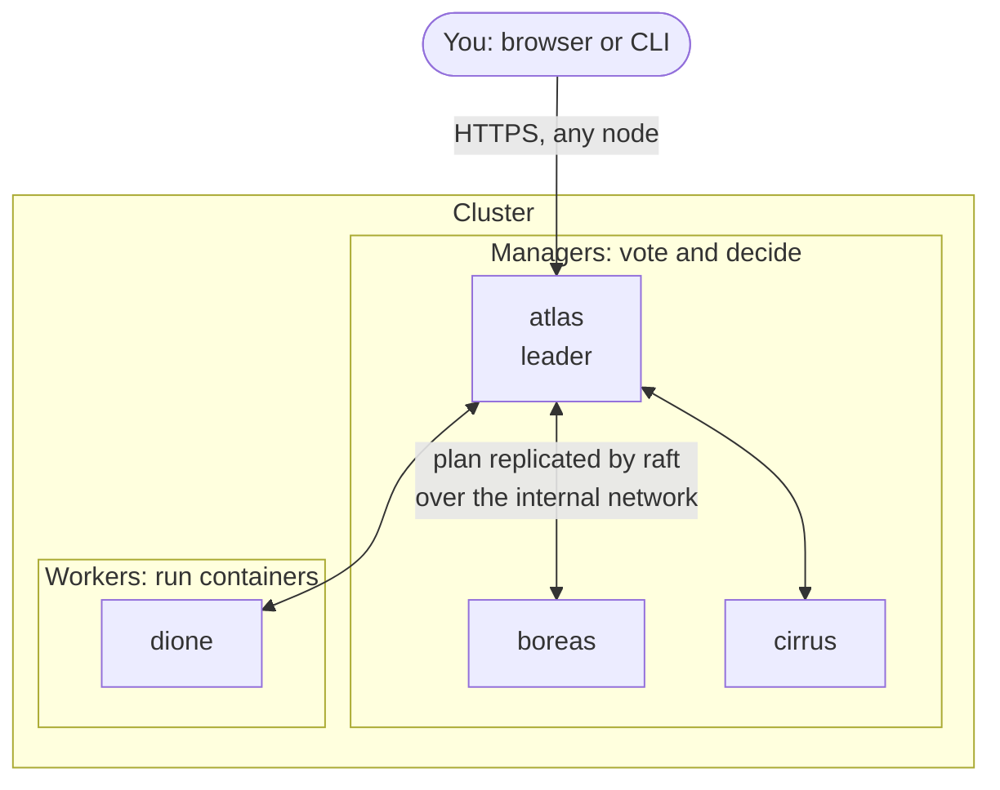
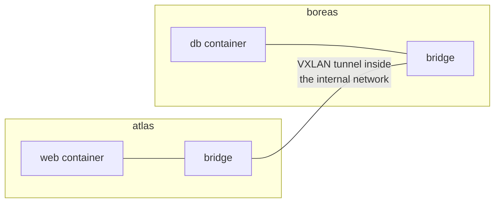
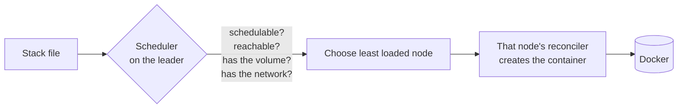

# How it works

This page explains the parts of Clouduler at a beginner level, so the rest of the documentation makes sense. You do not need it to follow a quick start, but it helps when something surprises you. Unfamiliar words are in the [glossary](/docs/intro/glossary).

## The big picture

A cluster is a set of **nodes**: ordinary Linux machines that each run the same `clouduler` daemon. Every node knows the whole plan (which stacks exist, where each container should run) because the plan is copied to all of them. Each node then does its own share of the work: starting containers, syncing storage, and answering web requests.

## Raft: how the nodes agree

If three machines each held their own copy of the plan, they could disagree: one thinks a container runs on `atlas`, another thinks it runs on `boreas`. Clouduler uses an algorithm called **raft** to avoid that. Think of a committee that only passes a motion when most of its members raise their hands.

- The committee members are the **managers**. They vote and hold the database.
- One manager is elected the **leader**. Changes go through the leader, which asks the others to confirm.
- A change counts once a **majority** has recorded it. That majority is called **quorum**.
- If the leader disappears, the remaining managers elect a new one.

**Workers** receive every change and run containers, but never vote. So with three managers the cluster survives losing one; with five it survives two. One or two managers give you no failure tolerance at all (two is actually worse than one). See [Failover](/docs/features/failover) for the numbers.

You can talk to any node. A follower relays your changes to the leader and answers reads from its own copy.

## The internal network and the overlay

Nodes need a private path to talk to each other for raft, storage sync and container traffic. You declare it once in the cluster config as the single `internal` network, and each node says which address it has there. It can be your home LAN, or a VPN such as Tailscale. See [Networking](/docs/features/networking).

Containers of a stack on different nodes still need to reach each other by name. Clouduler builds an **overlay network** for that, using **VXLAN**, a standard way of wrapping Ethernet frames inside ordinary packets so that two machines look like they share one switch.

Containers get addresses from a cluster-wide pool and can find each other as `<service>.<stack>`. By default an overlay container has no route to the internet. A service that must reach the outside also joins an egress-type network (for example one that sends its traffic out a chosen interface, or through a WireGuard tunnel).

Networks have a *kind*: `internal`, `private`, `public`, `egress`, `wireguard`. It decides who can reach what, and it also decides who may open a route. See [Networking](/docs/features/networking).

## Stacks, and the scheduler that places them

You deploy a **stack**: a Compose-style file with one or more **services**. Each service has one or more **instances** (the actual containers), named like `notes.web.0`.

The **scheduler** is the part that decides which node runs each instance. It is run by the leader, repeatedly, and it only starts instances where every check passes. A node qualifies when it is schedulable and reachable, holds a usable copy of each replicated volume the service needs, has the networks and ports it asks for, and satisfies any pin you wrote. Among qualifying nodes it picks the least loaded one. If none qualify, the instance stays *pending* and the UI tells you which check failed. See [Placement](/docs/features/placement).

Each node runs a **reconciler** that compares what should run on it with what Docker is actually running, and fixes the difference. That is why a crashed container comes back and a removed one disappears.

## Replicated drives

A **drive** is a named storage area. Each node that offers it maps the name to a directory on its own disk. A **volume** is a folder inside a drive, mounted into a container.

For a replicated drive, one node holds the **primary** copy of a volume, and other nodes keep **replicas**. The primary is pushed to the replicas on a timer (every 15 minutes by default). A **holder** is a node that has a usable copy. When the scheduler moves an instance, it only considers nodes that hold a copy, and the chosen node becomes the new primary. You can also run a **served** drive, which keeps one active copy on one node and shares it with the others over NFS. See [Drives and volumes](/docs/features/drives-and-volumes) and [Served drives](/docs/features/served-drives).

Because replicas lag the primary, a failover can lose changes made since the last sync. Backups are separate from this: see [Backups](/docs/features/backups).

## The proxy

Every node listens on ports 80 and 443. When you give a service an `x-clouduler.proxy` block (a host name, a network, a port), the host name becomes a **route**. Any node can answer for any route, because every node has the routing table; it forwards the request across the overlay to the container, wherever it runs.

The leader gets Let's Encrypt certificates for your hostnames and sends them to every node. Until a certificate exists, nodes serve a self-signed one. Public DNS records can be published through Cloudflare. A route on a private or internal network answers `403` to anyone outside that network, so exposing a service to the internet means putting its route on a *public* network. See [Proxy and TLS](/docs/features/proxy-and-tls) and [DNS publishing](/docs/features/dns-publishing).

## When something fails

Two mechanisms work together, tuned so the dead node gives up first:

1. **Fencing.** A node that has lost quorum for a while stops its own containers.
2. **Rescheduling.** The leader marks a node that stopped answering as unreachable and assigns its instances to other nodes.

Together they make sure a volume never has two writers. See [Failover](/docs/features/failover). If the managers' data is gone for good, [emergency mode](/docs/features/emergency-mode) is the last resort.

## Where to go next

- Follow a quick start: [single node](/docs/quickstart/single-node), [LAN cluster](/docs/quickstart/lan-cluster), [multi-site](/docs/quickstart/multi-site-headscale).
- Learn the stack file: [Stacks](/docs/features/stacks).
- Look up a word: [Glossary](/docs/intro/glossary).
