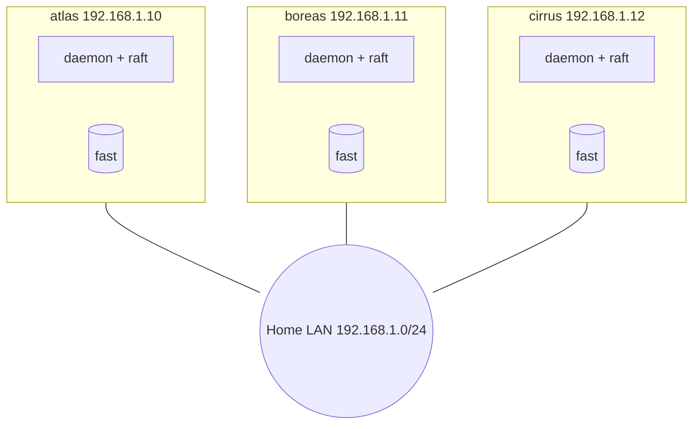

# Quick start: three machines on a LAN

In [quick start 1](/docs/quickstart/single-node) I ran everything on one machine. Now I'll do the thing Clouduler is actually for: three machines on my home network that look after each other. At the end I'll pull the power cord out of one of them and watch my app come back on another. It takes about an hour, most of it spent installing packages three times.

You can start from scratch here, or continue from quick start 1. If you already have a single node, skip steps 2 and 3 for that machine and treat it as the first node (<code><Var plain name="n1" fallback="atlas" /></code>). Everything else is identical, because adding nodes to a running cluster is exactly what step 4 does.

## What we'll build



Three managers that agree on one shared state, each holding a copy of the drive `fast`, with a stack that can run on any of them.

## Why three?

The managers keep the cluster's state (stacks, networks, secrets) in a small replicated database, and any change needs more than half of them to agree. That is the **quorum**: with three managers it is two, so one machine can disappear and the other two carry on, while with two managers losing either one stops everything. See [Failover](/docs/features/failover) for the full story, including what happens when the lost node was running something.

## Tell the page about your machines

If you filled this in for quick start 1, your values are already here.

<SetupForm fields={[
  {name: 'distro', label: 'Distribution', type: 'select', default: 'debian',
   options: [{value: 'arch', label: 'Arch Linux'}, {value: 'debian', label: 'Debian 13'}, {value: 'raspbian', label: 'Raspberry Pi OS (trixie)'}]},
  {name: 'user', label: 'Your SSH user', default: 'admin'},
  {name: 'n1', label: 'First node name', default: 'atlas'},
  {name: 'ip1', label: 'First node IP', default: '192.168.1.10'},
  {name: 'n2', label: 'Second node name', default: 'boreas'},
  {name: 'ip2', label: 'Second node IP', default: '192.168.1.11'},
  {name: 'n3', label: 'Third node name', default: 'cirrus'},
  {name: 'ip3', label: 'Third node IP', default: '192.168.1.12'},
  {name: 'iface', label: 'Network interface', default: 'eth0', help: 'Find it with: ip -br addr'},
  {name: 'subnet', label: 'LAN subnet', default: '192.168.1.0/24'},
  {name: 'cluster', label: 'Cluster name', default: 'homelab'},
  {name: 'domain', label: 'Internal domain', default: 'lan.example.com'},
]} />

## What you need

- Three 64-bit Linux machines with systemd (Debian 13, Raspberry Pi OS on trixie, or Arch), on the same LAN subnet, with fixed addresses. They can be a mix of x86_64 and aarch64, but every node should run the same Clouduler version.
- Root access on each.
- SSH between your laptop and each machine.

## 1. Open the ports between the nodes

Clouduler does not touch your host firewall. If you run `ufw` or `nftables`, the nodes cannot talk until you allow these. Only the LAN subnet needs the first five (the web UI listens on every interface, so the firewall is what keeps it on the LAN). Do not expose them to the internet. The ports can be changed with `--rpc-port` and `--web-port` at `init`; I use the defaults.

| Port | Protocol | Used for |
|---|---|---|
| 7373 | TCP | cluster control (raft), forwarded writes, the CLI between nodes |
| 7374 | TCP | drive replication |
| 7375 | TCP | relay for container connections |
| 4789 | UDP | the overlay network that joins stack networks across nodes |
| 8443 | TCP | web UI and API, and the join command |
| 80, 443 | TCP | the reverse proxy for apps |

If I use `ufw`, on every node:

<Cmd title="On every node (only if you run ufw)">{`sudo ufw allow in on {{iface}} from {{subnet}} to any port 7373:7375 proto tcp
sudo ufw allow in on {{iface}} from {{subnet}} to any port 4789 proto udp
sudo ufw allow in on {{iface}} from {{subnet}} to any port 8443 proto tcp
sudo ufw allow 80/tcp
sudo ufw allow 443/tcp`}</Cmd>

These rules are an example, so adapt the interface and subnet to yours. The ports are the ones a running node listens on: raft and drive sync on 7373 to 7375 over the tailnet or LAN address, VXLAN on 4789/udp, and the dashboard on 8443.

If you never installed a firewall, there is nothing to do. See [Ports and firewall](/docs/reference/ports-and-firewall) for the complete list.

## 2. Prepare all three machines

I repeat the preparation from [quick start 1](/docs/quickstart/single-node#1-prepare-the-machine) on each machine. Here it is in one block. I run it on <code><Var plain name="n1" fallback="atlas" /></code>, <code><Var plain name="n2" fallback="boreas" /></code> and <code><Var plain name="n3" fallback="cirrus" /></code>.

<Cmd title="On each of the three nodes">{`[debian,raspbian] sudo apt update
[debian,raspbian] sudo apt install -y docker.io iproute2 iptables ethtool restic
[arch] sudo pacman -S --needed docker iproute2 iptables ethtool restic
sudo systemctl enable --now docker
sudo modprobe vxlan
sudo groupadd -f clouduler
sudo mkdir -p /srv/clouduler/fast`}</Cmd>

{/* TODO verify: groupadd step, see single-node quick start (the code never creates the group, so the step stays) */}

Then I install the same binary on each (see [quick start 1, step 2](/docs/quickstart/single-node#2-install-clouduler)). As there, I can compile it myself or download the prebuilt binary from the [latest release](https://github.com/LiteApplication/clouduler/releases/latest). Then I check it.

<Cmd title="Copy and install, from my laptop">{`for h in {{ip1}} {{ip2}} {{ip3}}; do
  scp clouduler-x86_64-unknown-linux-gnu {{user}}@$h:/tmp/clouduler
  ssh {{user}}@$h 'sudo install -m 0755 /tmp/clouduler /usr/local/bin/clouduler && clouduler --version'
done`}</Cmd>

Use the `aarch64` file for any Raspberry Pi. **What I should see:** the same version printed three times.

### Names must resolve

The join command the web UI gives me contains the address <code>cloud.<Var plain name="domain" fallback="lan.example.com" />:8443</code>, not an IP. So <code>cloud.<Var plain name="domain" fallback="lan.example.com" /></code> must resolve to <code><Var plain name="n1" fallback="atlas" /></code> on <code><Var plain name="n2" fallback="boreas" /></code> and <code><Var plain name="n3" fallback="cirrus" /></code>. If I have no LAN DNS, I add this line to `/etc/hosts` on <code><Var plain name="n2" fallback="boreas" /></code>, <code><Var plain name="n3" fallback="cirrus" /></code> and on my laptop:

<Cmd lang="text" title="/etc/hosts">{`{{ip1}}   cloud.{{domain}}`}</Cmd>

:::warning If you see `error sending request for url` later
That is a node that could not resolve the name in the join command. Fix the name, or use the CLI form in step 4, which can take the IP directly.
:::

## 3. Create the cluster on the first node

If you already finished quick start 1, <code><Var plain name="n1" fallback="atlas" /></code> is ready and you can skip to step 4. Otherwise I run this on <code><Var plain name="n1" fallback="atlas" /></code>:

<Cmd title="On the first node">{`sudo clouduler init --yes \\
  --cluster-name {{cluster}} \\
  --subnet {{subnet}} \\
  --internal-domain {{domain}} \\
  --web-address cloud \\
  --ip {{ip1}} \\
  --node {{n1}} \\
  --drive fast=/srv/clouduler/fast`}</Cmd>

Every flag is explained in [quick start 1, step 3](/docs/quickstart/single-node#3-initialise-the-cluster). I leave `--drive-mode` at its default, `replicated`: every node keeps a full copy of the drive and containers read local disk. (The alternative, a [served drive](/docs/features/served-drives), changes how failover behaves.)

Then I do the three things from quick start 1 that I must not skip: confirm `sudo systemctl status clouduler` is `active (running)`, copy the first API key out of the journal (`sudo journalctl -u clouduler --no-pager | grep -o 'clk_[A-Za-z0-9]*_[A-Za-z0-9]*'`), and back up `/etc/clouduler/secrets.key`. Then I sign in to <code>https://cloud.<Var plain name="domain" fallback="lan.example.com" />:8443</code>.

## 4. Add the other two nodes

A new node needs to prove to the cluster that I allow it, and receive the cluster key without the key ever crossing the network in plain form. The web UI hides all of that behind one command.

<UiCli>
<UiCli.Ui>

1. In the web UI I open **Nodes** and click **Add node**.
2. In the sheet **Add a node** I type the **Node name** (<code><Var plain name="n2" fallback="boreas" /></code>) and choose the role chip **Manager**. The sheet's default is Worker, and workers do not count towards quorum, so I must pick Manager explicitly.
3. I fill **Address** with <code><Var plain name="ip2" fallback="192.168.1.11" /></code>. If I leave it empty, the node detects its own.
4. I press **Create join command**. The sheet changes to **Run this on the new node** and shows a command.
5. I press **Copy command**.

<UiScreen scenario="fresh-single-node" route="/nodes" caption="The Nodes page of a new cluster, with the Add node button." alt="Nodes page with one node and the Add node button" height={400} />

The command looks like this (the key and pin are real in your sheet):

```bash
clouduler init --yes --join cloud.lan.example.com:8443 --token clk_... --tls-fingerprint <sha256> --node boreas --role manager --ip 192.168.1.11
```

It has no `sudo` and no `--drive`, so on <code><Var plain name="n2" fallback="boreas" /></code> I run it as `sudo ... --drive fast=/srv/clouduler/fast`. Then I press **Done** on the sheet and repeat for <code><Var plain name="n3" fallback="cirrus" /></code>.

</UiCli.Ui>
<UiCli.Cli>

The CLI form does the same, without the web UI. I need an admin API key (the one from step 3 works) in a file that only root can read, then:

<Cmd title="On the joining node">{`sudo install -m 600 /dev/null /root/join.token
sudo sh -c 'printf "%s" "clk_PASTE_YOUR_KEY" > /root/join.token'

sudo clouduler init --yes \\
  --join {{ip1}} \\
  --token-file /root/join.token \\
  --tls-fingerprint PASTE_SHA256_PIN \\
  --role manager \\
  --node {{n2}} \\
  --ip {{ip2}} \\
  --drive fast=/srv/clouduler/fast

sudo shred -u /root/join.token`}</Cmd>

Using <code>--join <Var plain name="ip1" fallback="192.168.1.10" /></code> with the IP avoids the name resolution requirement. The pin is what protects me: with `--tls-fingerprint` the joining node checks the cluster's certificate against it before sending the key. Without it the certificate is accepted unchecked and the fingerprint is only printed afterwards. The UI's **Create join command** sheet shows the pin to paste.

I repeat with <code>--node <Var plain name="n3" fallback="cirrus" /> --ip <Var plain name="ip3" fallback="192.168.1.12" /></code>.

:::note Do not use `clouduler node add` to join
`clouduler node add` only writes an entry into the live roster by hand. It does not hand over the cluster key or pin a certificate. A node joins itself with `clouduler init --join`.
:::

</UiCli.Cli>
</UiCli>

**What I should see on the joining node:** `the cluster accepted this node`, `installed the cluster key (...)`, and finally `the daemon is running`. Files do not need to be copied by hand: the join fetches `cluster.yaml` from the cluster and receives the cluster key wrapped for the new node's own key pair.

The join key is an admin key and stays valid after the join. Once both nodes are in, I delete the one named <code>join <Var plain name="n2" fallback="boreas" /></code> (and <code>join <Var plain name="n3" fallback="cirrus" /></code>) under **Settings**, **API keys and AI clients**. Like every API key it has admin rights, so I do not leave it around.

:::warning If you see `the cluster rejected the api key`
The key is wrong, was deleted, or got a stray space. Generate a new command.
:::

:::warning If you see `the cluster has no leader right now`
<code><Var plain name="n1" fallback="atlas" /></code> is not in a quorum yet. Check `sudo systemctl status clouduler` on it, and try again.
:::

:::warning If you see `... is outside the internal subnet`
The `--ip` of the joining node is not inside <code><Var plain name="subnet" fallback="192.168.1.0/24" /></code>, the subnet chosen at `init`. Use an address in that subnet.
:::

:::warning If you see `the cluster already has a node called ...`
A node with that name is already registered. Pick another name, or add `--force` if you are deliberately replacing its entry.
:::

:::warning If you see `certificate fingerprint ... does not match the pinned ...`
The certificate changed between generating the command and running it, for example because a real certificate was issued meanwhile. Generate a fresh command.
:::

:::warning If you see `could not fetch the cluster key`
The node joined the roster but is half set up. Copy the key from <code><Var plain name="n1" fallback="atlas" /></code> over SSH and start the service:

```bash
sudo scp -p /etc/clouduler/secrets.key root@192.168.1.11:/etc/clouduler/secrets.key
# then on the joining node
sudo chmod 640 /etc/clouduler/secrets.key
sudo systemctl enable --now clouduler.service
```
:::

## 5. Verify quorum

<Cmd>{`sudo clouduler status`}</Cmd>

**What I should see:** a `raft:` line with `quorum=yes` and `voters=3/3`, three nodes marked `up` and `active`, a summary of the stacks, then `all clear: no unhealthy instances or cluster faults`. Each node line is tab-separated: name, role, reachability, availability, instance count and CPU architecture. The shape is:

```text
cluster home
  raft: leader=atlas quorum=yes voters=3/3 state_version=... (answered by atlas)
nodes
  atlas	Manager	up	active	instances=0	x86_64
  boreas	Manager	up	active	instances=0	x86_64
  cirrus	Manager	up	active	instances=0	x86_64
stacks 0 deployed, 0/0 instances assigned to run
all clear: no unhealthy instances or cluster faults
```

In the web UI, **Nodes** shows three healthy nodes:

<UiScreen scenario="lan-3-nodes" route="/nodes" caption="Three managers, all healthy." alt="Nodes page with atlas, boreas and cirrus" />

Because the config is replicated, `sudo clouduler check` on any node now reports all three nodes, and a change made in the UI reaches every one of them.

:::warning If a node shows as unreachable
Check from that node that the ports in step 1 are open, in particular 7373/tcp, and look at `sudo journalctl -u clouduler -f` on it.
:::

## 6. Check the replicated drive

The drive `fast` exists in the cluster, and each node that maps it holds a copy. Because I passed `--drive fast=/srv/clouduler/fast` on every node, all three do. A node can only pick a drive that already exists in the cluster, which is why I created it on <code><Var plain name="n1" fallback="atlas" /></code> first.

<Cmd>{`sudo ls -la /srv/clouduler/fast`}</Cmd>

On each node, this directory should exist (it will be empty until a stack uses it). In the web UI, **Storage** shows the drive `fast` as replicated, with its resync interval (every 15 minutes by default).

:::note Joined without --drive?
The web UI cannot add a drive mapping to a node after it has joined (a node's drives are shown read-only on its page). The drive has to be declared when the node is initialised, so I re-run the join with `--drive fast=/srv/clouduler/fast`. A node already in the roster needs `--force` for that.
:::

## 7. Deploy an app with a volume

I'll reuse Vaultwarden from quick start 1. Its volume `fast/vaultwarden` lives on the drive I just checked, so Clouduler keeps a copy on every node.

```yaml title="vaultwarden.yaml"
networks:
  internal: {}

services:
  vaultwarden:
    image: vaultwarden/server:latest
    restart: unless-stopped
    networks: [internal]
    volumes:
      - fast/vaultwarden:/data
    x-clouduler:
      proxy:
        - host: vault
          network: internal
          port: 80
```

<UiCli>
<UiCli.Ui>

I open **Stacks**, press **Deploy stack**, name it `vaultwarden`, paste the YAML, wait for **Spec is valid** and look at **Where it can run**: this time it lists all three nodes. Then I press **Deploy**.

</UiCli.Ui>
<UiCli.Cli>

```bash
sudo clouduler stack deploy vaultwarden.yaml
sudo clouduler stack unhealthy --placement --node
```

</UiCli.Cli>
</UiCli>

The scheduler picks one node. The stack page shows which. In **Storage** the volume appears with a **Primary** node (the one holding the newest copy) and **Replicas**, and a badge saying **in sync** once they agree. On a replicated drive a replica is refreshed on the drive's resync interval, so after a first deploy it may take a while for the other two to say **in sync**.

I reach the app the same way as in quick start 1: <code>https://vault.<Var plain name="domain" fallback="lan.example.com" /></code> once the name resolves to a node (any node answers, the proxy forwards to the right one).

I note which node it runs on. I'll call it <code><Var plain name="n2" fallback="boreas" /></code> below; yours may differ.

## 8. Pull the plug

This is the test. I'm going to power off the node that runs Vaultwarden, hard, the way a real failure happens. First I record the state:

<Cmd>{`sudo clouduler status`}</Cmd>

Then I pull the power on that node (or `sudo poweroff` if I'm squeamish). From another node I watch:

<Cmd>{`watch -n 2 sudo clouduler status`}</Cmd>

**What I should see**, with the default timers:

| After the power-off | What happens |
|---|---|
| a few seconds | nothing visible yet; the node just stops answering |
| about 30 s | the leader decides the node is unreachable (`failover.node_timeout` is 30 s) and `status` shows it as `UNREACHABLE` (the UI badge reads **Unreachable**) |
| a bit later | the scheduler places Vaultwarden on a surviving node, which pulls the image if it is not cached |
| a minute or so in total | `clouduler stack unhealthy` goes quiet and the app answers again |

The timings come from the default timers, so expect them to vary a little.

In the web UI the Overview shows the node as unreachable and the stack's container with its new node:

<UiScreen scenario="node-down-failover" route="/" caption="A node is down; its instances have been moved." alt="Overview during a node failure" />

My cluster is still working, with two of three managers. If I now lose a second node, the quorum is gone and the cluster can no longer change anything; the remaining node is read-only until a second one returns. That is by design.

:::warning What about my data?
A replicated drive is copied on a timer (every 15 minutes by default), not on every write. If the failed node had written data in the last interval that no other node received, that data is not on the survivors. Lower **Resync every** on the drive (Settings, Storage) for apps where that matters, and keep [backups](/docs/features/backups). If a surviving node holds only an older copy, the app is refused a start while any node with the current copy is reachable. It starts from the freshest older copy only when no current copy can be reached, and then the writes since that copy are gone.
:::

:::warning If the app does not move
Open the stack's **Placement** tab. It says, per node, why the stack cannot run there: a wrong pin, a missing drive on that node, not enough memory. Also remember that a stack on a `public` network needs a node with a public address for it. See [Placement](/docs/features/placement).
:::

## 9. Bring it back

I power the node on again. The service is enabled, so the daemon starts by itself and rejoins.

<Cmd>{`sudo journalctl -u clouduler -f`}</Cmd>

On the revived node I should see the daemon start and reconnect. From any node:

<Cmd>{`sudo clouduler status`}</Cmd>

**What I should see:** all three nodes `reachable` again. Vaultwarden stays where it was moved; the scheduler does not shuffle things back on its own. If I want the load spread evenly again, I press **Rebalance cluster** on the Nodes page, or run `sudo clouduler rebalance --yes`. Each move restarts that instance.

:::warning Do not remove a node you want to keep
Pulling the plug is a failure. **Removing** a node (Nodes, Retire this node, then Remove, or `clouduler node remove`) is a decision, and a removed node wipes its own keys the next time it boots and refuses to rejoin. See [Node lifecycle](/docs/features/node-lifecycle).
:::

## What happened under the hood

1. Every node probes its peers. When the leader's probes to the dead node went unanswered for `node_timeout`, it marked the node unreachable in the replicated state.
2. The dead node, had it still been alive but cut off, would have fenced itself: after `fence_timeout` without quorum a node stops its own containers, so nothing runs twice.
3. The scheduler, which runs on the leader, saw an instance whose node was unreachable and placed a new one on a node that could run it, using the replica of the volume held there.
4. The proxy on every node routes by the shared state, so the hostname kept working through whichever node answered.

All of it is in [Failover](/docs/features/failover), including the `emergency` command for losing two of three managers.

## Next steps

- Back up what matters: [Backups](/docs/features/backups).
- Put it on the internet with a real certificate: see step 8 of [quick start 1](/docs/quickstart/single-node#8-give-it-a-real-domain-with-https).
- Get notified when a node dies: [Alerts](/docs/features/alerts).
- Understand where things run: [Placement](/docs/features/placement) and [Drives and volumes](/docs/features/drives-and-volumes).
