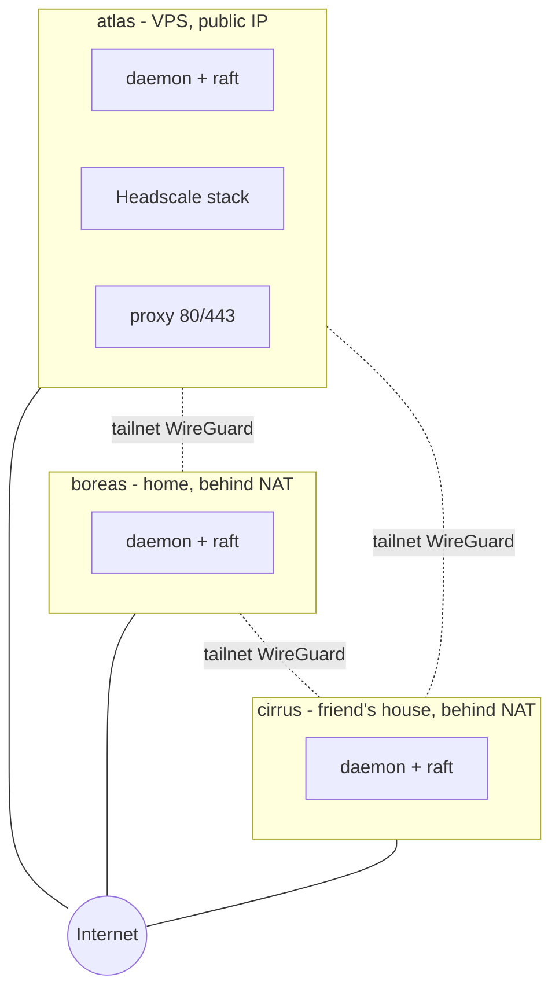
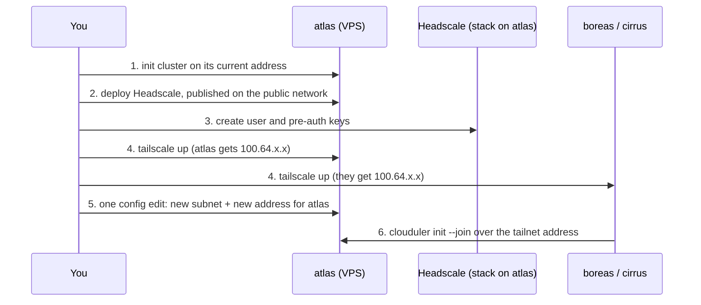
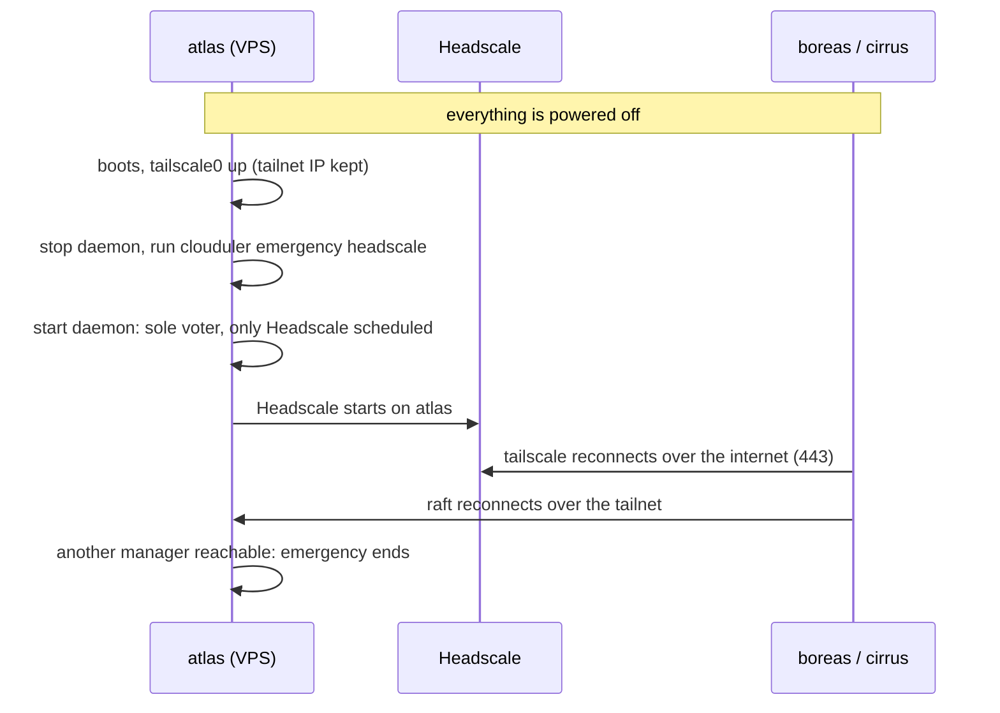

# Quick start: three sites over a Headscale tailnet

In [quick start 2](/docs/quickstart/lan-cluster) all your machines sat on one LAN. Real life is messier: one machine is a cheap VPS with a public IP, one is at home behind a router, and one is at a friend's house. They share no network. In this quick start you join them with a **tailnet**, a private network built from WireGuard tunnels, and make that tailnet Clouduler's internal network. The twist: the program that hands out tailnet addresses, **Headscale**, will itself run as a stack on the cluster. Count on two to three hours, and a lot of care in two places, step 5 (changing a node's address) and the section on blackouts at the end.

This page assumes you did [quick start 1](/docs/quickstart/single-node) and [quick start 2](/docs/quickstart/lan-cluster), or at least read them. it links to them instead of repeating their install steps.

## What you'll build



Solid lines are the ordinary internet connections. Dotted lines are the tailnet. Every cluster port (raft, drive sync, relay, the overlay) runs over the dotted lines, so the cluster's internal network is the tailnet. Only one thing is public: the Headscale address that every machine uses to log in, served by the proxy on the VPS.

## The chicken and the egg

Here is the problem to solve, because the order of the steps comes from it.

- The cluster wants its nodes to have tailnet addresses.
- The tailnet addresses come from Headscale.
- Headscale runs on the cluster.

The way out is to start the cluster on whatever address the first machine already has, run Headscale on it, and then **move** the first node onto its tailnet address. That last move is possible because Clouduler can change a node's internal address, and even the internal subnet, with one edit of the config. It is the new [re-addressing](#5-move-the-first-node-onto-the-tailnet) feature.



## Tell the page about your machines

Names and addresses below are the documentation examples (`example.com`, `203.0.113.5`). Replace them with yours. If you filled this form in for another quick start, the shared fields are already set.

<SetupForm fields={[
  {name: 'distro', label: 'Distribution', type: 'select', default: 'debian',
   options: [{value: 'arch', label: 'Arch Linux'}, {value: 'debian', label: 'Debian 13'}, {value: 'raspbian', label: 'Raspberry Pi OS (trixie)'}]},
  {name: 'user', label: 'Your SSH user', default: 'admin'},
  {name: 'cluster', label: 'Cluster name', default: 'homelab'},
  {name: 'n1', label: 'First node (the VPS)', default: 'atlas'},
  {name: 'ip1', label: 'First node address now', default: '203.0.113.5', help: 'The address configured on its network interface (ip -br addr). On most VPSes this is the public IP.'},
  {name: 'pubip', label: 'First node public IPv4', default: '203.0.113.5', help: 'The address the internet reaches it on. Often the same as above.'},
  {name: 'bootsubnet', label: 'Temporary subnet for init', default: '203.0.113.0/24', help: 'Must contain the first node address. Replaced in step 5.'},
  {name: 'n2', label: 'Second node (home)', default: 'boreas'},
  {name: 'n3', label: 'Third node (friend)', default: 'cirrus'},
  {name: 'zone', label: 'Public domain (Cloudflare zone)', default: 'example.com'},
  {name: 'hs', label: 'Headscale host name', default: 'headscale', help: 'Becomes headscale.<domain>.'},
  {name: 'intdomain', label: 'Internal domain', default: 'int.example.com'},
  {name: 'tailnet', label: 'Tailnet prefix', default: '100.64.0.0/10'},
  {name: 'ts1', label: 'Tailnet IP of first node', default: '100.64.0.1', help: 'Read it with tailscale ip -4 in step 4.'},
  {name: 'ts2', label: 'Tailnet IP of second node', default: '100.64.0.2'},
  {name: 'ts3', label: 'Tailnet IP of third node', default: '100.64.0.3'},
]} />

## What you need

- Three 64-bit Linux machines with systemd, root on each, SSH from your laptop. Mixed x86_64 and aarch64 is fine; run one Clouduler version everywhere.
- A domain on Cloudflare. Headscale must be reachable by name over HTTPS from everywhere, and Clouduler issues that certificate and DNS record through Cloudflare. See [Cloudflare API token](/docs/guides/cloudflare-api-token).
- Docker and the other prerequisites on every machine, exactly as in [quick start 1, step 1](/docs/quickstart/single-node#1-prepare-the-machine) and [quick start 2, step 2](/docs/quickstart/lan-cluster#2-prepare-all-three-machines).

### Which machine goes first?

The first node must be able to host the **public** route for Headscale, which means the internet has to reach its ports 80 and 443. Two honest options:

- **A cheap VPS.** It has a public IP from day one, nothing to configure at home, and it is always on. This is what this page uses: it is `atlas`.
- **Your home machine with port forwarding.** It works too: forward TCP 80 and 443 on the router to it and declare those ports under the node's `open_ports`. The downside is that your home connection, a dynamic IP and a power cut at home would now be able to take Headscale down, and with it every new login. If you do this, use the home machine as `atlas` below and give the public network an address that points at your router.

Everything after step 1 is the same in both cases. The rest of the page says "the VPS" for the first node.

## 1. Set up the first node on its current address

Prepare and install `atlas` like in quick start 1 (packages, `modprobe vxlan`, and the binary, which you either compile yourself or take from the [latest release](https://github.com/LiteApplication/clouduler/releases/latest)). Do not install tailscale yet. Do the other two machines later, in step 6.

Then initialise the cluster. `--ip` must sit inside `--subnet`, so you cannot hand it the tailnet range yet (the node has no tailnet address). Pick a small temporary subnet that contains the address the node has today. You'll throw it away in step 5.

<Cmd title="On the first node">{`sudo mkdir -p /srv/clouduler/fast

sudo clouduler init --yes \\
  --cluster-name {{cluster}} \\
  --subnet {{bootsubnet}} \\
  --internal-domain {{intdomain}} \\
  --web-address cloud \\
  --ip {{ip1}} \\
  --node {{n1}} \\
  --drive fast=/srv/clouduler/fast`}</Cmd>

The validator only checks that the node address is inside the subnet, so a publicly routable address and subnet are accepted. Overlay networks for stacks draw from their own pool (`10.244.0.0/16`), independent of this subnet, so the temporary range does not disturb them. If your LAN already uses `10.244.x.x`, keep that in mind.

Every flag is explained in [quick start 1, step 3](/docs/quickstart/single-node#3-initialise-the-cluster). Then, as in quick start 1, check `sudo systemctl status clouduler` is `active (running)`, copy the first API key out of the journal and **back up `/etc/clouduler/secrets.key`**.

:::danger Do not expose the web UI
The UI and API live on port 8443 of the internal network. Right now that network is a public address. Do not open 8443 in the VPS provider's firewall, and do not browse to it over the internet. The web listener binds every interface and Clouduler does not restrict it, so keeping it off the internet is the job of the provider firewall (and, once step 5 is done, the fact that the internal network is the tailnet). Until then, reach it through an SSH tunnel, which works because the listener also answers on localhost: `ssh -L 8443:localhost:8443 user@address`.
:::

## 2. Run Headscale as a stack

### Open the public side

Headscale must be reachable at `https://headscale.example.com` by every machine, before the tailnet exists. So it needs a **public** network. Follow [quick start 1, step 8](/docs/quickstart/single-node#8-give-it-a-real-domain-with-https) for the mechanics:

1. Create the Cloudflare token ([guide](/docs/guides/cloudflare-api-token)) and store it under **Settings**, **Network**, **Cloudflare DNS**.
2. Add a network named `public` of type public with the domain <code><Var plain name="zone" fallback="example.com" /></code> on the **Networks** page.
3. On the **Nodes** page give <code><Var plain name="n1" fallback="atlas" /></code> the address <code><Var plain name="pubip" fallback="203.0.113.5" /></code> on `public`.
4. Open TCP 80 and 443 in the VPS provider's firewall and in `ufw` if you use it. Port 80 only redirects to HTTPS; certificates are issued through DNS, so it is not needed for that.
5. Leave the ACME directory URL empty (Let's Encrypt production). The tailscale clients in step 4 need a certificate their system trusts, and a staging certificate would make `tailscale up` fail. Quick start 1 explains why switching from staging to production later is awkward.

Only the VPS lists `public`, so the DNS record for <code><Var plain name="hs" fallback="headscale" />.<Var plain name="zone" fallback="example.com" /></code> will point only at it. Settings apply at once (see [Live config](/docs/features/live-config)).

### The stack

Two config files, then the stack. Trim the example from [Headscale](/docs/examples/headscale) to the minimum: no Headplane admin UI (it needs the Docker socket and OIDC) and no OIDC. The command line is your admin path.

<Cmd lang="yaml" title="config/config.yaml (headscale_config)">{`server_url: https://{{hs}}.{{zone}}
listen_addr: 0.0.0.0:25725
metrics_listen_addr: 127.0.0.1:9090
grpc_listen_addr: 127.0.0.1:50443
grpc_allow_insecure: false

noise:
  private_key_path: /var/lib/headscale/noise_private.key

prefixes:
  v4: {{tailnet}}
  v6: ""
  allocation: sequential

derp:
  urls:
    - https://controlplane.tailscale.com/derpmap/default
  auto_update_enabled: true
  update_frequency: 3h
  server:
    enabled: false

database:
  type: sqlite
  sqlite:
    path: /var/lib/headscale/db.sqlite
    write_ahead_log: true

dns:
  magic_dns: true
  base_domain: ts.{{zone}}
  override_local_dns: false
  nameservers:
    global:
      - 1.1.1.1
      - 1.0.0.1

unix_socket: /var/run/headscale/headscale.sock
unix_socket_permission: "0770"

policy:
  mode: file
  path: /etc/headscale/policy.hujson`}</Cmd>

Three values matter. `server_url` is the address clients log in against. `base_domain` (the name space MagicDNS uses) **must be a different domain** from `server_url`, hence `ts.` here. `prefixes.v4` must stay inside `100.64.0.0/10`; Headscale hands out addresses sequentially from it, so the addresses you get are not ones you choose. `override_local_dns: false` keeps MagicDNS from rewriting the machine's resolver.

For the policy, start wide open, because all the machines are yours, and tighten it once everything works:

```json title="config/policy.hujson (headscale_policy)"
{
  "acls": [
    { "action": "accept", "src": ["*"], "dst": ["*:*"] }
  ]
}
```

{/* TODO verify: Headscale rejects a policy that names users or groups that do not exist; this minimal policy names none, so it should load */}

<Cmd lang="yaml" title="headscale.yaml">{`services:
  headscale:
    image: headscale/headscale:latest
    command: serve
    volumes:
      - fast/headscale-data:/var/lib/headscale
    networks: [public]
    configs:
      - source: headscale_config
        target: /etc/headscale/config.yaml
      - source: headscale_policy
        target: /etc/headscale/policy.hujson
    restart: unless-stopped
    deploy:
      replicas: 1
      resources:
        limits:
          memory: 256M
    x-clouduler:
      node: {{n1}}
      proxy:
        - host: {{hs}}
          network: public
          port: 25725

networks:
  public: {}

configs:
  headscale_config:
    file: ./config/config.yaml
  headscale_policy:
    file: ./config/policy.hujson`}</Cmd>

What each part is for:

- `x-clouduler.node` **pins** it to <code><Var plain name="n1" fallback="atlas" /></code>, the only node with a public address. See [Placement](/docs/features/placement).
- `proxy` with `network: public` publishes `https://headscale.example.com`. A route on a subnetted network answers 403 to anyone outside that subnet, so a route on the tailnet network would shut out the machines that are trying to join it. It must be on `public`.
- `fast/headscale-data` is the volume with the database (`db.sqlite`) and the Noise key. Losing it means losing the identity of every enrolled machine, see [the backup advice](#back-up-headscale).

<UiCli>
<UiCli.Ui>

Open **Stacks**, press **Deploy stack**, name it `headscale`, paste the YAML, add the two configs, wait for **Spec is valid** and press **Deploy**.

</UiCli.Ui>
<UiCli.Cli>

From the folder holding `headscale.yaml` and `config/`:

```bash
sudo clouduler stack deploy headscale.yaml
sudo clouduler stack unhealthy --placement --node
```

</UiCli.Cli>
</UiCli>

**What you should see:** the stack goes healthy within a minute or two, the **DNS** page shows the record and certificate for <code><Var plain name="hs" fallback="headscale" />.<Var plain name="zone" fallback="example.com" /></code>, and from your laptop:

<Cmd>{`curl -sS -o /dev/null -w '%{http_code}\\n' https://{{hs}}.{{zone}}/health`}</Cmd>

prints `200`. If the certificate is still being issued, wait a minute and retry rather than using `-k`.

:::warning If it does not start
`sudo clouduler stack unhealthy` and `clouduler stack logs headscale` tell you. The usual causes: the config file has a typo, the DERP map could not be downloaded (`public` must be allowed to reach the internet; see the [Headscale example](/docs/examples/headscale), which adds an egress network for it), or the Placement tab says the node has no address on `public`.
{/* TODO verify: whether a container on a public network can reach the internet to fetch the DERP map, (the command is `clouduler stack logs`) */}
:::

## 3. Create a user and pre-auth keys

The Headscale command line lives inside the container, and `clouduler exec` runs a command in an instance. The instance id is `stack.service.index`, so here `headscale.headscale.0`.

<Cmd>{`clouduler exec headscale.headscale.0 -- headscale users create cluster
clouduler exec headscale.headscale.0 -- headscale users list`}</Cmd>

**What you should see:** a table with the user `cluster` and its numeric ID. Then create **one key per machine**, with a short life:

<Cmd>{`clouduler exec headscale.headscale.0 -- headscale preauthkeys create --user 1 --expiration 1h`}</Cmd>

Replace `1` with the ID from the list. A key printed here is a secret: copy it straight to the machine that needs it, never put it in `cluster.yaml` or a stack file, and do not use `--reusable` (a reusable key is a standing invitation). A single-use key that a failed attempt consumed is gone; create another.

These flags match Headscale 0.29. They have changed between versions, so run `headscale preauthkeys create --help` in the container if yours differs.

## 4. Power on the network

Now every machine, including `atlas`, joins the tailnet. install tailscale on each ([install steps in the guide](/docs/guides/tailscale-headscale#install-the-tailscale-client)) and log in with the key made for that machine:

<Cmd title="On every machine, with its own key">{`sudo tailscale up \\
  --login-server https://{{hs}}.{{zone}} \\
  --auth-key=PASTE_THE_KEY \\
  --accept-dns=false`}</Cmd>

- `--login-server` points the client at Headscale instead of Tailscale's own service.
- `--auth-key` logs in without a browser. The flag is spelled `--auth-key`.
- `--accept-dns=false` stops MagicDNS from rewriting the resolver on a cluster node, which Clouduler's own DNS and the node rely on. That is a precaution, not something that was tested.

:::warning Flags are not remembered
Tailscale does not keep these flags. A later `tailscale up` without `--login-server` silently goes back to the default control server. Repeat all three flags every time, including in scripts. If a machine was logged into another control server before, add `--force-reauth`.
:::

**What you should see on each machine:**

<Cmd>{`tailscale status
tailscale ip -4`}</Cmd>

`tailscale status` lists the other machines and `tailscale ip -4` prints that machine's tailnet address, for example <code><Var plain name="ts1" fallback="100.64.0.1" /></code>. Write the three addresses into the form at the top. Do not guess them: Headscale hands them out in order, so the machine you enrol first gets `.1`. From each machine, check that the others answer:

<Cmd>{`ping -c 3 {{ts1}}
ping -c 3 {{ts2}}
ping -c 3 {{ts3}}`}</Cmd>

If the ping works only after a few seconds, tailscale is first using a relay and then finds a direct path. If it never works, see the firewall notes in [step 7](#7-mtu-and-firewall).

Important for step 5: **every node must reach every other node on its tailnet address**, not just reach `atlas`. The leader tests only from itself.

## 5. Move the first node onto the tailnet

So far the cluster still uses the temporary subnet. Now switch it to the tailnet, in one edit: the subnet of the internal network and the address of `atlas` on it. They must change together because a node's address has to be inside the subnet, so each half alone would be refused.

First make sure of the preconditions:

- Step 4 passed on all three machines (they ping each other on the tailnet).
- Your laptop is on the tailnet too (install tailscale on it and run the same `tailscale up`, with its own key), or you will do this over SSH on `atlas`. After the change the web UI lives at the tailnet address.
- You know the change is live and reversible: if the new address does not work, you can revert the config (the old address keeps being served for 120 seconds after it is dropped).

What happens when you apply it: the leader dials the new address, requires that the node answers as itself there, and only then commits a membership change that keeps the voters as they are. If the address is wrong or unreachable the membership is untouched. Other nodes move first and the leader last. The container overlay device, internal DNS, firewall rules and the drive and relay listeners are rebuilt live, with no restart.

<UiCli>
<UiCli.Ui>

1. Open **Settings**, **Network**, **Networks**. On the internal network change the **Address range** to <code><Var plain name="tailnet" fallback="100.64.0.0/10" /></code>.
2. On the **Nodes** page change <code><Var plain name="n1" fallback="atlas" /></code>'s address on the internal network to <code><Var plain name="ts1" fallback="100.64.0.1" /></code>.
3. Under **Changes to apply** press **Validate config**. Both edits are in the same draft.
4. Press **Apply changes**. The edit takes effect at once, so the page may lose its connection until you open the dashboard at the new address.

<UiScreen scenario="multisite-headscale" route="/nodes" caption="Nodes page of a multi-site cluster, with tailnet addresses." alt="Nodes page of a three-site cluster with tailnet addresses" />

</UiCli.Ui>
<UiCli.Cli>

On `atlas` edit the file (these two keys are the only changes), check it, and push it:

```yaml title="cluster.yaml (changed lines)"
networks:
  internal:
    type: internal
    subnet: 100.64.0.0/10
    domain: int.example.com

nodes:
  atlas:
    network:
      internal: 100.64.0.1
```

<Cmd>{`sudo nano /etc/clouduler/cluster.yaml
clouduler check
clouduler config reload`}</Cmd>

`config reload` prints `reloaded config into the cluster, generation N`. Nothing reverts it automatically, so keep a copy of the previous file.

</UiCli.Cli>
</UiCli>

The validator accepts a `/10` internal subnet, and a subnet change together with the node address changes in one edit. Changing only the subnet is refused with `outside the tailscale subnet`, so make both edits in the same draft.

**What you should see:** in the daemon log on the leader, one line per moved node:

<Cmd>{`sudo journalctl -u clouduler -f | grep -i "rpc address"`}</Cmd>

```text
moved a member to a new rpc address
```

With a single manager there is one line, for `atlas`. Then `sudo clouduler status` shows `atlas` reachable on the new address and `all clear`. In the UI, **Overview** is healthy again:

<UiScreen scenario="multisite-headscale" route="/" caption="Overview of the cluster once every node is on the tailnet." alt="Overview of the multi-site cluster" />

:::warning If the line never appears
The new address was not reachable from the leader, or something else answered there. Nothing in the membership changed. Put the previous values back in Settings, or put the previous file back and `clouduler config reload`. Then fix the tunnel and try again.
:::

:::warning The web address changes
The UI is now served at the tailnet address. If you used an `/etc/hosts` line or an SSH tunnel for <code>cloud.<Var plain name="intdomain" fallback="int.example.com" /></code>, update it to <code><Var plain name="ts1" fallback="100.64.0.1" /></code>. The join command in step 6 contains that name, so it has to resolve on the joining machine.
:::

Docker networks that already exist (the Headscale stack's) are kept as they are, including their MTU. Their subnets come from the overlay pool, not the internal subnet, so the move does not change them. {/* TODO verify: the running stack stays healthy after the move; check it live */}

## 6. Join the other nodes over the tailnet

The cluster now has a tailnet-addressed first node, so join the other two exactly as in [quick start 2, step 4](/docs/quickstart/lan-cluster#4-add-the-other-two-nodes), with their **tailnet** addresses. Before that, on each, install the prerequisites and the binary (quick start 2, step 2) and make sure <code>cloud.<Var plain name="intdomain" fallback="int.example.com" /></code> resolves to <code><Var plain name="ts1" fallback="100.64.0.1" /></code> (an `/etc/hosts` line is enough).

<UiCli>
<UiCli.Ui>

On **Nodes**, **Add node**: node name <code><Var plain name="n2" fallback="boreas" /></code>, role **Manager**, **Address** <code><Var plain name="ts2" fallback="100.64.0.2" /></code>. Press **Create join command**, copy it, run it on the new machine with `sudo` and `--drive fast=/srv/clouduler/fast` added. Repeat for <code><Var plain name="n3" fallback="cirrus" /></code> with <code><Var plain name="ts3" fallback="100.64.0.3" /></code>.

</UiCli.Ui>
<UiCli.Cli>

<Cmd title="On the joining node">{`sudo install -m 600 /dev/null /root/join.token
sudo sh -c 'printf "%s" "clk_PASTE_YOUR_KEY" > /root/join.token'

sudo clouduler init --yes \\
  --join {{ts1}} \\
  --token-file /root/join.token \\
  --tls-fingerprint PASTE_SHA256_PIN \\
  --role manager \\
  --node {{n2}} \\
  --ip {{ts2}} \\
  --drive fast=/srv/clouduler/fast

sudo shred -u /root/join.token`}</Cmd>

For the third node, use <code>--node <Var plain name="n3" fallback="cirrus" /> --ip <Var plain name="ts3" fallback="100.64.0.3" /></code>.

</UiCli.Cli>
</UiCli>

The `--ip` must be inside the internal subnet, which now is the tailnet. A join that cannot reach the cluster through the tailnet fails with `error sending request for url`, and the node disappears again. The errors and fixes of quick start 2 apply unchanged. delete the `join ...` API keys afterwards under **Settings**, **API keys and AI clients**.

Three managers give quorum for one loss. A fourth or fifth adds nothing if the tailnet is the weak link, so join further machines as workers.

**What you should see:** `sudo clouduler status` lists three managers, all reachable, and the Nodes page shows them with their tailnet addresses:

<UiScreen scenario="multisite-headscale" route="/nodes" caption="Three sites, three managers, one tailnet." alt="Nodes page with atlas, boreas and cirrus on tailnet addresses" />

You can now deploy apps as in the other quick starts. Headscale stays pinned to `atlas`.

## 7. MTU and firewall

### MTU, before the first overlay network

The overlay's MTU is the MTU of the link that holds the node's internal address, minus 50 bytes. On a tailnet node that link is `tailscale0`, which has an MTU of 1280 by default, so the overlay gets 1230. Docker overlay networks fix their MTU when they are **created**, so if you change the tailscale MTU later, existing networks keep the old value and break.

<Cmd>{`ip link show tailscale0`}</Cmd>

Check that it shows the MTU you want on every node, and change it, if you want to, before the first stack gets its own network. Both the node join in step 6 and the stacks you deploy afterwards create networks, so the best time is right after step 4. {/* TODO verify: how to change the tailscale0 MTU persistently; tailscale up and tailscaled have no MTU option, so it is a link setting outside tailscale */}

### Ports

Internal ports are on the tailnet address; only the proxy is public.

| Port | Protocol | Where | Why |
|---|---|---|---|
| 7373 | TCP | tailnet, all nodes | raft |
| 7374 | TCP | tailnet, nodes holding a drive copy | drive replication |
| 7375 | TCP | tailnet, all nodes | container relay |
| 4789 | UDP | tailnet, all nodes | the overlay |
| 8443 | TCP | tailnet (block it on the public interface) | web UI and API; the listener binds every interface, so the firewall must keep it off the internet |
| 80, 443 | TCP | the VPS, public | proxy, certificates, Headscale login |
| 41641 | UDP | outbound, all nodes | tailscale direct connections |
| 443 | TCP | outbound, all nodes | Headscale login, tailscale relays |

- The home and friend nodes need no forwarded ports. If direct connections fail, tailscale falls back to relays over outbound 443. {/* TODO verify: this is Tailscale's documented behaviour, not tested here */}
- Clouduler's firewall rules do not touch tailscale's own. A `ufw` on the nodes must allow the cluster ports **on `tailscale0`**: `sudo ufw allow in on tailscale0 to any port 7373:7375 proto tcp` and `sudo ufw allow in on tailscale0 to any port 4789 proto udp`.
- The tailnet policy (`policy.hujson`) must let the nodes reach each other on 7373 to 7375, 4789 and 8443. The open policy above does. Tighten it only after the cluster works.
- A tailnet outage is a cluster outage: after `failover.fence_timeout` without quorum a node stops its own containers. See [Failover](/docs/features/failover).

Full list: [Ports and firewall](/docs/reference/ports-and-firewall).

## 8. Turn on automatic updates

Point the cluster at the official releases so it knows when a new version is out. In the UI, open **Settings**, then **Updates**, enter `https://github.com/LiteApplication/clouduler` as the **Repository** and click **Save release**. This can be set once from the UI. Leave **Automatic checks** on.

Or put it in `cluster.yaml` (the same keys the UI writes):

```yaml title="cluster.yaml"
self_update:
  release_url: https://github.com/LiteApplication/clouduler
  check_updates: true
  check_interval: 24h
```

Clouduler then looks for a newer release every day and shows it in **Settings**, **Updates**. Nothing is installed by itself: you click **Start update** when you are ready, and the nodes restart one at a time. See [Updates](/docs/features/updates).

## After a blackout: recovering with clouduler emergency

Read this section now, not after the power cut. It is the price of running Headscale on the cluster it connects.

### The problem

After a total outage (every site loses power, or the VPS and the others reboot together) the loop closes:

1. Headscale is a stack. It runs only if the cluster schedules it, which needs a **quorum** of managers.
2. The managers talk to each other over the tailnet.
3. The tailnet addresses and peer lists come from Headscale.

No tailnet without Headscale, no Headscale without quorum, no quorum without the tailnet. If all the machines reboot and nobody can start Headscale, nothing restarts by itself.

### What should keep working

Two things reduce the problem, and make sure they hold:

- **Keep `/var/lib/tailscale` on every node.** It holds the machine's tailscale identity. Deleting it forces a new login with a new key and possibly a new address, which breaks the cluster config.
- **Keep the Headscale volume.** Its database holds every machine's keys and addresses, so after Headscale returns, the machines are recognised and keep the same tailnet IPs.

Also expect tailscale to keep working with the peers it already knows while the control server is down, and the rebooted machine to keep its address. **That is the one assumption that could not be confirmed from the documentation, and the whole recovery depends on it.** The VPS must come up with its tailnet address before the control server is reachable, because Clouduler's raft has to bind that address. If tailscale cannot do that after a reboot, the recovery below cannot start. {/* TODO verify: that tailscaled on a rebooted node recovers its tailnet address, and keeps existing peers connected, while the control server is unreachable; test with every machine powered off at once */}

One thing you can do to help: make sure the daemon starts after tailscale. The unit `init` writes orders itself only after `network-online.target` and `docker.service`, with nothing about tailscale, so a systemd drop-in with `After=tailscaled.service` and `Wants=tailscaled.service` is needed.

### The recovery

The idea: make `atlas` alone enough. `clouduler emergency` makes one surviving manager the only voter and brings back exactly one stack, Headscale. Headscale then answers on its public address, which does not need the tailnet, the other machines log in again and get their addresses back, the raft peers reconnect, and the emergency ends by itself.



On `atlas`, with its daemon stopped, because the command writes straight to the node's database:

<Cmd title="On the node you are rescuing">{`sudo systemctl stop clouduler.service
sudo clouduler --config /etc/clouduler/cluster.yaml emergency headscale --node {{n1}}
sudo systemctl start clouduler.service
clouduler status`}</Cmd>

- `headscale` is the stack to bring back. It must be known in this node's own local state, otherwise the command refuses. A stack deployed after this node last replicated is not known.
- `--node` names this node in the config; it defaults to the hostname. `--yes` skips the confirmation. There is no dry run.
- The command rewrites the node's raft membership so it is the **only voter**, marks every other node unreachable, and marks this node's copy of the volumes Headscale uses as the current one. Other stacks stay off.

**What you should see:** `clouduler status` prints `EMERGENCY MODE: only stack headscale is being scheduled`. A minute later Headscale answers at `https://headscale.example.com`, the other machines reappear in `tailscale status` and, when `boreas` or `cirrus` reconnects, `clouduler status` shows more than one reachable manager. Other stacks then resume from their own desired state; you do not restore anything by hand.

### How it ends

Emergency mode clears by itself when the leader sees another **voting manager** reachable again (log: `another manager is reachable again, ending emergency mode`). A worker coming back does not end it. If the other managers are gone for good, it stays on and every other stack stays held. Then add a new voting manager and, for dead ones, use `clouduler node remove`. The details and the warnings are in [Emergency mode](/docs/features/emergency-mode).

### Dangers

:::danger Read before you run it
- **Never run it while another manager might still be alive with its old state.** The two would conflict. Use it only when the others are truly down or unreachable and will come back through the normal path.
- **Recent writes can be lost.** `atlas`'s copy of each volume is trusted as current. If a replica elsewhere was newer, those writes are gone.
- **While it is on, no other stack is scheduled.** Containers of other stacks that are already running on the node are left running untouched.
- With one voter, one failure stops the cluster again. Get the other managers back quickly.
:::

If it is `atlas` itself that is lost for good (the VPS is gone), the same command can run on another manager, but Headscale is pinned to `atlas`, so it will not be scheduled elsewhere until the pin is changed, and its public name must be pointed at the new node. Plan for this before you need it. {/* TODO verify: how to change the pin and the public address while emergency mode is on, and whether Headscale can run from a replica on a home node */}

### Back up Headscale

<a id="back-up-headscale" />

Losing the Headscale database means every machine is unknown to the new server: new keys, new addresses, and the cluster config no longer matches. Back up at least `db.sqlite` and `noise_private.key` from the `headscale-data` volume (on `atlas` it lives under the drive folder, <code>/srv/clouduler/fast/headscale-data</code>), and keep them off the cluster. The cluster's own [Backups](/docs/features/backups) can include the drive, but a copy that needs the cluster to restore is not a blackout backup. A copy of the volume on a home node (the drive is replicated) helps only if the pin is changed (see above).

### A checklist to rehearse before you need it

Do this once, on a day when nothing depends on the cluster, and then again after each major change.

1. `/etc/clouduler/secrets.key` is backed up for every node, off the cluster.
2. `/var/lib/tailscale` exists on every node and is not touched by any script.
3. The Headscale `db.sqlite` and `noise_private.key` are copied off the cluster, and you have restored them once on a scratch Headscale.
4. `tailscale up` in your scripts always carries `--login-server`, `--auth-key` or none on re-run, and `--accept-dns=false`.
5. You know which node is the rescue node (<code><Var plain name="n1" fallback="atlas" /></code>) and can SSH to it without the tailnet (the provider's console, or the public address).
6. You wrote the exact command on paper: `sudo clouduler --config /etc/clouduler/cluster.yaml emergency headscale --node `<code><Var plain name="n1" fallback="atlas" /></code>.
7. **The drill:** power every machine off at once, power on only `atlas`, check that its tailnet address is back, run the recovery, power the others on, and watch the emergency end. If `atlas` does not get its tailnet address back without Headscale, you have learned the most important fact about this design, while it was cheap.

## What happened under the hood

1. `init` made the first node the only voter of a raft cluster on its starting address. The tailnet came from a stack running on that cluster.
2. Re-addressing committed a membership change with the same voters at a new address, after checking that the node answered as itself. That is why the order of the steps works and why a wrong address leaves the cluster alone.
3. Later nodes joined with tailnet addresses because the internal subnet was now the tailnet.
4. In a blackout, `emergency` skips the vote for exactly one stack so the tailnet can come back, and consensus is rebuilt when another manager returns.

## Next steps

- Tighten the tailnet policy, and add the Headplane admin UI: [Headscale example](/docs/examples/headscale).
- More on tailscale flags and troubleshooting: [Tailscale and Headscale](/docs/guides/tailscale-headscale).
- Get told when a node drops: [Alerts](/docs/features/alerts).
- Nodes that leave: [Node lifecycle](/docs/features/node-lifecycle). Failure timers: [Failover](/docs/features/failover).
