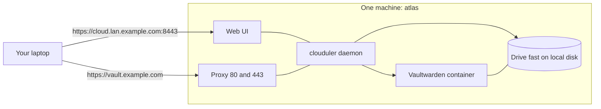

# Quick start: a single node

I'm going to take one ordinary machine (a mini PC, an old laptop or a Raspberry Pi 4/5) from a bare Linux install to a real app on a real HTTPS address. It takes about 30 minutes. I'll explain why each step exists, what you should see after it, and what to do when you don't see it.

One honest warning before we start: with a single node, if the machine dies your apps are down until it boots again. Nothing can take over. That is fine for learning and for many home setups, and [quick start 2](/docs/quickstart/lan-cluster) shows how to fix it by adding two more machines.

## What we'll build



By the end I'll have:

- the Clouduler daemon running as a systemd service,
- a one-node cluster called <code><Var plain name="cluster" fallback="homelab" /></code>,
- the web UI open in my browser,
- Vaultwarden (a password manager) running, reachable on my LAN, then on a real domain with a real certificate.

## Tell the page about your machine

Everything below is written with my example values. Fill this in once and every command on this page (and on [quick start 2](/docs/quickstart/lan-cluster)) uses yours. Your answers stay in your browser.

<SetupForm fields={[
  {name: 'distro', label: 'Distribution', type: 'select', default: 'debian',
   options: [{value: 'arch', label: 'Arch Linux'}, {value: 'debian', label: 'Debian 13'}, {value: 'raspbian', label: 'Raspberry Pi OS (trixie)'}]},
  {name: 'user', label: 'Your SSH user', default: 'admin'},
  {name: 'hostname', label: 'This node name', default: 'atlas'},
  {name: 'ip', label: 'This node IP', default: '192.168.1.10'},
  {name: 'iface', label: 'Network interface', default: 'eth0', help: 'Find it with: ip -br addr'},
  {name: 'subnet', label: 'LAN subnet', default: '192.168.1.0/24'},
  {name: 'cluster', label: 'Cluster name', default: 'homelab'},
  {name: 'domain', label: 'Internal domain', default: 'lan.example.com', help: 'Used for the web UI name on your LAN.'},
]} />

## What you need

- A 64-bit machine running Linux with systemd: Debian 13, Raspberry Pi OS based on Debian 13 (trixie), or Arch Linux. `uname -m` must print `x86_64` or `aarch64`, because those are the only two binaries the project releases.
- Root access (I'll use `sudo`) and a fixed IP address on your LAN. Give the machine a DHCP reservation in your router if it does not have one, because the cluster remembers this address.
- A few GB of free disk for Docker images and for the drive directory.
- Optional, for the last part: a domain on Cloudflare and ports 80 and 443 forwarded to this machine.

:::note Raspberry Pi OS on Debian 12 (bookworm)
I would not use it. The release binary is built on a recent glibc, and a binary built that way runs on Debian 13 but not on Debian 12. {/* TODO verify: exact glibc floor of the release binary; the release is built on the CI runner image, so the floor follows it. Check with objdump -T on a downloaded asset */}
:::

## 1. Prepare the machine

I connect to the machine and install what Clouduler leans on. Docker runs the containers. `iproute2`, `iptables` and `ethtool` are used to build the overlay networks between stacks. `restic` is only needed for backups, but I install it now so I don't forget.

<Cmd title="On the node">{`ssh {{user}}@{{ip}}
[debian,raspbian] sudo apt update
[debian,raspbian] sudo apt install -y docker.io iproute2 iptables ethtool restic
[arch] sudo pacman -S --needed docker iproute2 iptables ethtool restic
sudo systemctl enable --now docker`}</Cmd>

{/* TODO verify: package names per distro (docker.io on Debian, docker on Arch) */}

Why `enable --now`? Clouduler starts after Docker and needs its socket. If Docker is not up at boot, the daemon waits up to two minutes for it and keeps retrying, but nothing works until Docker answers.

Now I check that Docker is really up.

<Cmd>{`docker info | grep 'Server Version'`}</Cmd>

**What I should see:** a version number.

:::warning If you see `Cannot connect to the Docker daemon`
Docker is not running. Run `sudo systemctl status docker` to see why. On a Raspberry Pi, the usual cause of a Docker that starts but shows no memory limits is a missing kernel flag: add `cgroup_enable=memory cgroup_memory=1` to `/boot/firmware/cmdline.txt` and reboot. {/* TODO verify: Raspberry Pi cgroup flags */}
:::

Stacks that have their own network use a VXLAN device (on a single node, public networks do not), so I load that kernel module and check it. If I later serve a drive over NFS, the `nfsv4` module is needed too.

<Cmd>{`sudo modprobe vxlan
lsmod | grep -E 'vxlan|bridge'`}</Cmd>

Clouduler never loads this module for you and does not persist it across reboots. To persist it, I put `vxlan` on a line in `/etc/modules-load.d/clouduler.conf`.

Finally, the folder that will back my first replicated drive. I call the drive `fast`. A **drive** is a named pool of storage that Clouduler can copy between nodes (see [Drives and volumes](/docs/features/drives-and-volumes)). On one node there is nothing to copy to yet, but declaring it now means my app's data already lives where it will be replicated later.

<Cmd>{`sudo mkdir -p /srv/clouduler/fast`}</Cmd>

Pick a path on a disk with room. It does not have to be this one.

### The `clouduler` group

The systemd unit that `init` writes contains `Group=clouduler`, and as far as I can tell from the code nothing creates that group. On a clean machine the service may fail to start. Creating the group first is harmless:

<Cmd>{`sudo groupadd -f clouduler`}</Cmd>

{/* TODO verify: reproduce on a clean VM whether systemd really refuses to start the unit without the group (expected error: "Failed to determine group credentials", exit status 216/GROUP). Remove this step if the group is created automatically. */}

## 2. Install Clouduler

Clouduler is one static-ish binary that is both the CLI and the daemon. I find out which one I need.

<Cmd>{`echo "$(uname -m)-unknown-linux-gnu"`}</Cmd>

**What I should see:** `x86_64-unknown-linux-gnu` or `aarch64-unknown-linux-gnu`. Anything else means there is no prebuilt binary for this machine and I would have to build from source (see the repository README).

I have two ways to get it. I can compile Clouduler myself (see the repository README), or I can download the prebuilt binary from the [latest release](https://github.com/LiteApplication/clouduler/releases/latest). I take the prebuilt one: the release asset is the bare binary called `clouduler-` followed by that string, with no archive to unpack. I download it and copy it to the node. Then I install it.

<Cmd>{`# from my laptop, in the folder where I downloaded it
scp clouduler-x86_64-unknown-linux-gnu {{user}}@{{ip}}:/tmp/clouduler

# on the node
sudo install -m 0755 /tmp/clouduler /usr/local/bin/clouduler
clouduler --version`}</Cmd>

**What I should see:** `clouduler` and a version number. Once the cluster is running, I can also point its auto-update at `https://github.com/LiteApplication/clouduler` (the `self_update.release_url` key, set on the Updates page) so that new releases show up in Settings; see [Updates](/docs/features/updates). `clouduler --help` lists subcommands like `init`, `daemon`, `stack`, `status` and `check`.

:::note Two copies of the binary
`init` copies the running binary to `/usr/bin/clouduler`, and that is the copy the service runs. The one in `/usr/local/bin` stays. When I upgrade later, I replace both (or let the cluster do it, see [Updates](/docs/features/updates)). I do not re-run `init` for that: it refuses to run on a machine that already has a `cluster.yaml` unless I pass `--force`, which starts over. `which -a clouduler` shows both.
:::

## 3. Initialise the cluster

`init` is the one command that turns this machine into the first node of a new cluster. It writes `/etc/clouduler/cluster.yaml`, creates folders, installs the systemd unit and starts it. I give it every answer on the command line so I can copy it into my notes.

<Cmd title="Create the cluster">{`sudo clouduler init --yes \\
  --cluster-name {{cluster}} \\
  --subnet {{subnet}} \\
  --internal-domain {{domain}} \\
  --web-address cloud \\
  --ip {{ip}} \\
  --node {{hostname}} \\
  --drive fast=/srv/clouduler/fast`}</Cmd>

What each flag is for:

| Flag | Why |
|---|---|
| `--yes` | Take the default for every question instead of asking. |
| `--subnet` | The **internal** network. Every node's address must be inside it, and cluster traffic runs over it, so use a LAN you trust. |
| `--internal-domain` | The domain under which the web UI and LAN-only apps get names. It is not published to public DNS. |
| `--web-address cloud` | The UI hostname. With the domain above it becomes <code>cloud.<Var plain name="domain" fallback="lan.example.com" /></code>. |
| `--ip`, `--node` | This machine's address and name. Both are detected if omitted, but being explicit avoids surprises. |
| `--drive fast=...` | Declares the drive `fast` and says where it lives on this node. Without any `--drive`, volumes cannot be used. |

Leaving out `--internal-domain` makes the UI address default to a placeholder (`cloud.example.com`), and giving a bare `--web-address cloud` with no domain is refused.

**What I should see:** a block of progress lines, ending with something like:

```text
wrote /etc/clouduler/cluster.yaml
...
the daemon is running
== done
atlas is a manager in cluster homelab at 192.168.1.10
the web ui is at https://cloud.lan.example.com:8443
```

{/* TODO verify: exact init output; this is reconstructed from the code, not captured */}

It also prints a reminder that the daemon will generate the cluster key at `/etc/clouduler/secrets.key`. I'll come back to that key in a minute because it is the one thing I must back up.

:::warning If you see a warning that `ethtool` or `restic` is not on PATH
It is only a warning. Install the tool before you create stacks with their own network (`ethtool`) or set up backups (`restic`).
:::

:::warning If you see `this machine is not running systemd`
No unit was installed. I would have to start the daemon by hand, which this page does not cover.
:::

## 4. Start the service and check it

`init` already did `systemctl enable --now`. I confirm it.

<Cmd>{`sudo systemctl status clouduler.service --no-pager`}</Cmd>

**What I should see:** `Active: active (running)`.

:::warning If you see `Failed to determine group credentials` or `status=216/GROUP`
That is the `Group=clouduler` problem from step 1. Create the group and start the service again:

```bash
sudo groupadd -f clouduler
sudo systemctl enable --now clouduler.service
```

{/* TODO verify: not reproduced, see the note in step 1 */}
:::

:::warning If the service is `failed` for another reason
Read the log with `sudo journalctl -u clouduler -b --no-pager | tail -50`. The most common causes are Docker not running and another program already holding port 80 or 443 (`sudo ss -ltnp | grep -E ':(80|443) '`). If something else owns those ports, the proxy silently cannot bind them.
:::

Then I look at the log for the three lines that tell me it came up properly.

<Cmd>{`sudo journalctl -u clouduler -b --no-pager | grep -E 'starting|web ui listening|generated a new cluster key'`}</Cmd>

You should see `starting`, a warning that a new cluster key was generated, and `web ui listening`. A warning that the UI is served "with a self signed certificate" is normal for now.

### Back up the cluster key right now

Every secret Clouduler stores is encrypted with `/etc/clouduler/secrets.key`. If the machine's disk dies and I don't have a copy, those secrets are gone for good. So before anything else:

<Cmd>{`sudo cp -a /etc/clouduler/secrets.key /root/clouduler-secrets.key.backup
sudo chmod 600 /root/clouduler-secrets.key.backup`}</Cmd>

Then I copy that file off this machine, to a password manager attachment or an encrypted USB stick. Not a chat, not an email.

## 5. Open the web UI and sign in

### Get the first API key

On its first start with no keys at all, the daemon mints one admin API key and prints it in the log **once**. It stores only a hash of it, so if I lose it I cannot recover it, and there is no CLI command that creates a new one.

<Cmd>{`sudo journalctl -u clouduler --no-pager | grep -o 'clk_[A-Za-z0-9]*_[A-Za-z0-9]*'`}</Cmd>

**What I should see:** one line like `clk_xxxxxxxxxxxx_yyyyyyyy...`. I copy it into my password manager immediately.

:::warning If you see nothing
The key is only logged when the cluster has a leader and no keys exist. Wait ten seconds and try again, and make sure you are searching the whole journal (no `-b`) in case the node rebooted. If the key was already logged and you did not save it, the only way back in is a second sign-in method (OIDC) that I set up earlier; the emergency tools do not create or restore API keys. So I save the key now. A lost key with no OIDC configured has no documented recovery.
:::

### Make the name resolve

The UI lives at <code>https://cloud.<Var plain name="domain" fallback="lan.example.com" />:8443</code>. That name has to resolve on my laptop. Without a LAN DNS server, I add a line to `/etc/hosts` on my laptop:

<Cmd lang="text" title="/etc/hosts on my laptop">{`{{ip}}   cloud.{{domain}}`}</Cmd>

I expect the raw IP (<code>https://<Var plain name="ip" fallback="192.168.1.10" />:8443</code>) to work too. {/* TODO verify: sign in by IP when an internal domain is set (cookie scope not traced) */}

### Sign in

I open <code>https://cloud.<Var plain name="domain" fallback="lan.example.com" />:8443</code>. My browser warns about the certificate because Clouduler made a self-signed one. That is expected, and I accept it for this host; a real certificate comes in step 8.

The login page asks for an API key under "or use an API key". I paste the `clk_...` key into **API key** and press **Sign in with API key**.

<UiScreen scenario="fresh-single-node" route="/" caption="The Overview of a brand-new one-node cluster." alt="Overview of a new cluster with one node and no stacks" />

**What I should see:** the Overview with one node and "No stacks yet".

:::warning If you see "That key was not accepted"
The key was copied with a missing character or a space. Copy it again from the log. The session lasts 12 hours by default.
:::

:::warning If the page does not load at all
Check that the name resolves (<code>ping cloud.<Var plain name="domain" fallback="lan.example.com" /></code>) and that port 8443 is reachable (<code>curl -k https://<Var plain name="ip" fallback="192.168.1.10" />:8443</code>). A host firewall on the node must allow 8443/tcp.
:::

Before I deploy anything I run a health check on the node.

<Cmd>{`sudo clouduler status`}</Cmd>

**What I should see:** one node, <code><Var plain name="hostname" fallback="atlas" /></code>, as a manager, and a last line `all clear: no unhealthy instances or cluster faults`.

## 6. Deploy a first app: Vaultwarden

I'm going to use [Vaultwarden](https://github.com/dani-garcia/vaultwarden), a small Bitwarden-compatible password manager. It is a single container, and it uses a volume, so it shows the one thing that makes Clouduler different from plain Docker: where its data lives is a cluster decision, not a path on one disk.

This is the stack. Read it once; the next page, [Stacks](/docs/features/stacks), explains every key.

```yaml title="vaultwarden.yaml"
networks:
  internal: {}

services:
  vaultwarden:
    image: vaultwarden/server:latest
    restart: unless-stopped
    networks: [internal]
    volumes:
      - fast/vaultwarden:/data
    x-clouduler:
      proxy:
        - host: vault
          network: internal
          port: 80
```

- `networks: internal` attaches the container to the LAN-only network that `init` created.
- `fast/vaultwarden:/data` means "the volume `vaultwarden` on drive `fast`, mounted at `/data`". That is the folder I created in step 1.
- The `proxy` route says "publish container port 80 as `vault` on the internal network". The name gets the network's domain appended, so it becomes <code>vault.<Var plain name="domain" fallback="lan.example.com" /></code>.

<UiCli>
<UiCli.Ui>

1. In the sidebar I open **Stacks** and click **Deploy stack**.
2. I type `vaultwarden` as the stack name and paste the YAML above into the spec editor.
3. On the right I watch the panels. I want the banner **Spec is valid**, and under **Where it can run** I want to see <code><Var plain name="hostname" fallback="atlas" /></code> listed.
4. I click the **Deploy vaultwarden** button (it carries the stack name, and stays disabled until the spec is valid). I land on the stack page, where the container goes from "pending placement" to "running" while Docker pulls the image.

</UiCli.Ui>
<UiCli.Cli>

I save the YAML as `vaultwarden.yaml` on the node and deploy it. The stack takes the file's name.

```bash
sudo clouduler stack deploy vaultwarden.yaml
sudo clouduler stack unhealthy --placement
sudo clouduler status
```

`stack unhealthy` lists instances that are not running yet; once it prints nothing for vaultwarden, the container is up.

</UiCli.Cli>
</UiCli>

:::warning If you see a red "Not deployed" banner
Read the sentence after it. It names the step that failed. The usual first-time causes are a network or drive name in the YAML that does not exist in my cluster (the editor autocompletes the real ones), or a typo in the volume.
:::

:::warning If the container stays in "pending placement"
Open the stack's **Placement** tab. It lists each rule and which one failed for <code><Var plain name="hostname" fallback="atlas" /></code>. {/* TODO verify: how a first-time user sees the rejection reason */}
:::

## 7. Reach it on the LAN

The proxy routes by hostname, so my laptop needs to resolve <code>vault.<Var plain name="domain" fallback="lan.example.com" /></code> to the node, the same way I did for `cloud`. I add one more `/etc/hosts` line:

<Cmd lang="text" title="/etc/hosts on my laptop">{`{{ip}}   cloud.{{domain}} vault.{{domain}}`}</Cmd>

<Cmd>{`curl -k -I https://vault.{{domain}}/`}</Cmd>

**What I should see:** an `HTTP/2 200` (or similar). `-k` is there because the proxy serves a self-signed certificate until a real one exists.

:::warning If you see 403
Routes on a subnetted network only answer clients whose address is inside the subnet. My laptop must be in <code><Var plain name="subnet" fallback="192.168.1.0/24" /></code>. Anything outside, including a VPN, gets a 403. To publish something to the outside world I use a public network (next step). See [Proxy and TLS](/docs/features/proxy-and-tls).
:::

:::warning If the connection is refused or times out
Check that the proxy owns ports 80 and 443 (`sudo ss -ltnp | grep -E ':(80|443) '` should show `clouduler`) and that the host firewall allows them.
:::

Vaultwarden works in a browser over a self-signed certificate if I accept the warning, but its phone apps and browser extensions will refuse it. That is the reason for the next step.

## 8. Give it a real domain with HTTPS

To get a certificate that browsers trust, Clouduler needs to prove to Let's Encrypt that it controls the name. It does that through Cloudflare DNS, and it also creates the DNS records for me. This part needs a domain on Cloudflare and port 443 reachable from the internet. The certificate check goes through DNS, so port 80 is not needed for it. I'm using `example.com` here; use yours.

1. I create a Cloudflare API token with permission to edit DNS on my zone, following [Cloudflare API token](/docs/guides/cloudflare-api-token). The token is stored sealed inside the cluster, never in a file.
2. In the web UI I open **Settings**, then **Network**, and on the **Cloudflare DNS** page turn on **Manage DNS with Cloudflare**, set **DNS zones** to `example.com`, and use **Save token** to store the token.
3. On the **Reverse proxy** page I turn on **Issue certificates automatically**, set **Contact email**, and while I'm testing I set **ACME directory URL** to Let's Encrypt's staging address `https://acme-staging-v02.api.letsencrypt.org/directory`.
4. On the **Networks** page I add a network named `wan` of type public with the domain `example.com`.
5. On the **Nodes** page I give <code><Var plain name="hostname" fallback="atlas" /></code> its public IPv4 address for `wan`. A service on a public network can only be placed on a node that has a public address for it.

:::danger Set the staging URL first
If I leave **ACME directory URL** empty, Clouduler uses Let's Encrypt production, which rate-limits failures. Test on staging, and be aware that the ACME account Clouduler creates is remembered together with the directory it was created against. Clearing the field later does not re-point that account, so I would only use staging when I am ready to wipe the account file (`acme-account.json` in the data directory) before switching.
:::

Settings pages that affect networking ask me to **confirm** the change within a minute, or they roll back. That is a safety net so I can't lock myself out. See [Live config](/docs/features/live-config).

Then I point the stack at the new network. In the Deploy page for `vaultwarden` (or in the file) I change `internal` to `wan` in both places:

```yaml title="vaultwarden.yaml (changed lines)"
networks:
  wan: {}

services:
  vaultwarden:
    networks: [wan]
    x-clouduler:
      proxy:
        - host: vault
          network: wan
          port: 80
```

and redeploy (**Deploy vaultwarden** in the UI, or `sudo clouduler stack deploy vaultwarden.yaml`). The route is now `vault.example.com`.

**What I should see:** after a short wait the stack shows a certificate and DNS record in the **DNS** page, and `https://vault.example.com` opens with a (staging) certificate. Getting the trusted certificate afterwards means clearing the ACME URL and also removing the stored account, as described in the warning above; I have not tested that switch myself.

:::warning If the certificate stays pending or shows an error
`sudo clouduler status` lists certificate and DNS problems. The common causes are a token without DNS edit rights, a zone that is not listed under **DNS zones**, or port 443 not reaching the node. See [DNS publishing](/docs/features/dns-publishing).
:::

:::warning Public means public
A route on a public network is not restricted by source address. Anyone on the internet can reach Vaultwarden's login page. Pick a strong master password, and read the [Vaultwarden notes](/docs/examples/vaultwarden) before you rely on it.
:::

I open `https://vault.example.com`, create my account, and I have a password manager that I run.

## 9. Check that it's healthy

<Cmd>{`sudo clouduler status
sudo clouduler logs vaultwarden -f`}</Cmd>

`status` should end with `all clear: no unhealthy instances or cluster faults` and report `stacks 1 deployed, 1/1 instances assigned to run`. `logs` streams the container's output; Ctrl-C leaves it. In the UI, the **Overview** shows the same, and the **Nodes** page shows <code><Var plain name="hostname" fallback="atlas" /></code> as healthy.

The files that matter, if I ever need them: the config is `/etc/clouduler/cluster.yaml` (edit it in the UI, not by hand, because edits are replicated), the cluster key is `/etc/clouduler/secrets.key`, the data directory is `/var/lib/clouduler`, and the drive is `/srv/clouduler/fast`.

## What I just learned

- One binary, one command (`init`), and a node is a cluster.
- A **stack** is a YAML file. I deploy it from the UI or `clouduler stack deploy`.
- A **network** decides who can reach an app and under which domain: `internal` for the LAN, a public network for the internet.
- A **drive** is where volumes live, and Clouduler is the thing that decides where and how they are copied.
- The cluster key and the first API key are the two things I must keep.

## Next steps

- [Add two more machines](/docs/quickstart/lan-cluster) and watch an app survive a node failure.
- Set up [Backups](/docs/features/backups), because replication is not a backup.
- Learn how [placement](/docs/features/placement) decides where things run and how [proxy and TLS](/docs/features/proxy-and-tls) work.
- Skim the [stack spec reference](/docs/reference/stack-spec).
