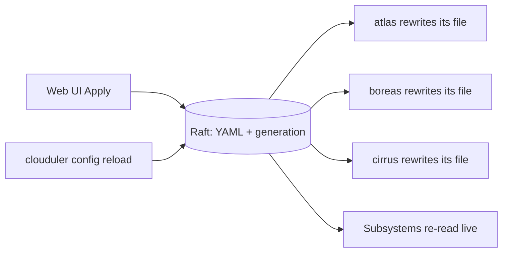

# cluster.yaml

`cluster.yaml` describes the whole cluster in one file: its networks, drives, nodes, dashboard, failover timers, sign-in, reverse proxy, Cloudflare DNS, self-update, git backup and AI access. Every node holds a copy at `/etc/clouduler/cluster.yaml`. A daemon refuses to start if the file does not parse or validate.

This page lists every key. Most keys apply live, without a restart. The **Reload** column in each table tells you which ones do not.

:::danger The file on disk is not the source of truth
Once a cluster exists, the authoritative copy of the config lives in the cluster's replicated state (raft). Every node rewrites its local `cluster.yaml` from that copy. If you edit the file by hand, the next sync reverts it, and a daemon restart does not help: your edit runs for a few seconds, then it is overwritten.

To apply a file edit, run `clouduler config reload`. Or skip the file and use the Settings pages in the web UI.
:::

## How the config is replicated



1. The config is stored in raft as one YAML string plus a generation number. The first stored config is generation 1.
2. The web UI (Apply), `clouduler config reload`, `clouduler node remove`, the self-update settings and the network and drive rename buttons all write to raft.
3. Every node watches raft. When the generation changes it parses the new YAML, hands it to the subsystems (proxy, DNS, drives, scheduler, auth) and rewrites its own file if the text differs. The check runs every `failover.probe_interval` (5 seconds by default).
4. At boot a daemon reads its local file first, then the first watcher tick overwrites the file with the raft copy if they differ.
5. A fresh cluster seeds raft from the founding node's file, but only while raft has no config at all.

<Quirk title="Saves strip comments and reorder keys" severity="warn">
Every write re-serialises the whole config. After the first UI or CLI save, comments, blank lines, your key order and any hand formatting are gone on **every** node, not just the one you edited. Maps are sorted by key. Keep your annotated master copy somewhere else, for example in a git repository, and use [git backup](/docs/features/git-backup) for a copy of the live one.
</Quirk>

<Quirk title="Last writer wins" severity="warn">
Two admins editing at the same time silently overwrite each other. Raft stores a generation number, but neither the UI nor `config reload` sends the generation the editor started from. The server reads the current generation just before it submits, so a stale browser draft is not detected. The guard only prevents a race inside those few milliseconds, in which case you see `cluster config was edited concurrently (stored generation N, edit was made against M)`.
</Quirk>

<Quirk title="Hand edits do nothing until you reload" severity="info">
`clouduler config reload` reads your file, validates it, and pushes it into raft. It always bumps the generation, even if nothing changed. `systemctl reload clouduler` does the opposite: it makes the node re-sync its file **from** raft, so a hand-edited file is reverted, not applied.
</Quirk>

See [Live config](/docs/features/live-config) for what takes effect immediately and what needs a restart.

## Editing the config

<UiCli>
<UiCli.Ui>

Open **Settings**. The tabs that edit `cluster.yaml` are **General**, **Network**, **Storage** and **Sign-in and backup**. **Updates** and **API keys and AI clients** are separate screens.

<UiScreen scenario="lan-3-nodes" route="/settings/general" caption="Settings, General: cluster name and failover timers." alt="Settings General tab" />

1. Change fields on any page. Changes are staged in a draft. The header button **Apply changes** stays disabled until the draft differs from the running config.
2. Open **Changes to apply** to see the diff. **Validate config** checks the draft without applying it, **Discard edits** throws it away.
3. Set **Confirm within (seconds)** (default 60, minimum 5).
4. Press **Apply changes**. The UI validates first, then submits.
5. If your edit touched `networks`, `nodes`, `web`, `proxy` or `cloudflare`, a rollback timer starts. The banner **Config change waiting for you** counts down and the header button turns into **Confirm config**. Press it once you can still reach the dashboard. **Roll back now** restores the previous config immediately.

Edits to `failover`, `secrets`, `auth`, `drives`, `self_update`, `backup`, `mcp` and `cluster.name` apply at once with no countdown.

Only admins can apply. Viewers can read.

<UiScreen scenario="lan-3-nodes" route="/settings/network" caption="Settings, Network: networks, dashboard, proxy and Cloudflare." alt="Settings Network tab" />

| Page | Where | Keys |
|---|---|---|
| Cluster | `/settings/general` | `cluster.name` |
| Failover | `/settings/general?page=failover` | `failover.*` |
| Networks | `/settings/network?page=networks` | `networks.*` and the rename button |
| Dashboard | `/settings/network?page=web` | `web.*` |
| Reverse proxy | `/settings/network?page=proxy` | `proxy.enabled`, ports, `proxy.acme.*`, `proxy.dns_server.*` |
| Cloudflare DNS | `/settings/network?page=cloudflare` | `cloudflare.zones` and the API token |
| Drives | `/settings/storage?page=drives` | `drives.*` |
| Sign-in | `/settings/security?page=auth` | `auth.*` |
| Service login | `/settings/security?page=service-login` | `proxy.auth.*` |
| Cluster key | `/settings/security?page=secrets` | `secrets.generate_if_missing` |
| AI access | `/settings/security?page=mcp` | `mcp.enabled` |
| Git backup | `/settings/security?page=git-backup` | `backup.*` |
| Updates | `/settings/self-update` | `self_update.*` |
| A node's page | `/nodes/<name>` | `nodes.<name>.*` (its Save button has its own **Rollback after (seconds)** field) |

</UiCli.Ui>
<UiCli.Cli>

Validate a file without contacting the cluster:

```bash
clouduler --config /etc/clouduler/cluster.yaml check
```

```text
cluster homelab
  3 nodes, 3 managers, quorum 2
  network internal (internal) 10.10.0.0/24 int.example.com
  network lan (private) 192.168.1.0/24 lan.example.com
  network wan (public)  example.com
  web https://cloud.int.example.com:8443
```

Push the on-disk file into the cluster so every node picks it up:

```bash
clouduler config reload
clouduler config reload --via boreas   # submit through a specific node
```

On success it prints `reloaded config into the cluster, generation N`. A rejection prints `cluster rejected the config: ...`.

<Quirk title="config reload has no rollback" severity="danger">
Unlike the UI, `config reload` applies immediately even if the change cuts you off, for example a wrong dashboard port. Keep a copy of the previous file and run `reload` again to undo it.
</Quirk>

Global flags: `--config <PATH>` (env `CLOUDULER_CONFIG`, default `/etc/clouduler/cluster.yaml`) and `--data-dir <PATH>` (env `CLOUDULER_DATA`).

`clouduler check` does not print the failover margin warning described [below](#failover). The UI shows it as a banner on the Failover page.

</UiCli.Cli>
</UiCli>

## Annotated example

A three-node cluster with an internal network, a home LAN, a public network and Cloudflare. The comments below are lost the first time you save through the UI or `config reload`, so treat this as a reading aid.

```yaml title="cluster.yaml"
cluster:
  name: homelab                     # shown in the UI and in alerts

networks:
  internal:                         # exactly one internal network, used for raft, drives, overlay
    type: internal
    subnet: 10.10.0.0/24
    domain: int.example.com         # names under it resolve to node addresses
  lan:                              # an extra subnetted LAN
    type: private
    subnet: 192.168.1.0/24
    domain: lan.example.com
    publish_dns: false              # keep these names out of Cloudflare
  wan:                              # reachable from the internet, no subnet
    type: public
    domain: example.com
  vpn:                              # outbound-only, kill-switched; no domain allowed
    type: egress

drives:
  fast:
    mode: replicated                # every implementing node keeps a copy
    sync_interval: 5m
  bulk:
    mode: served                    # one node serves it, others mount it over NFS
    served_by: [atlas]

nodes:
  atlas:
    id: 00000000-0000-4000-8000-000000000001   # minted by `clouduler init`
    role: manager
    network:
      internal: 10.10.0.1
      lan: 192.168.1.10
      wan:
        ipv4: 203.0.113.5           # publishes an A record
        open_ports:                 # ports the router forwards to this node
          - {port: 25, protocol: tcp}
      vpn: wg0                      # host interface the egress network leaves through
    drives:
      fast: /srv/clouduler/fast
      bulk: /srv/clouduler/bulk
    labels:
      disk: ssd
  boreas:
    id: 00000000-0000-4000-8000-000000000002
    role: manager
    network:
      internal: 10.10.0.2
      lan: 192.168.1.11
    drives:
      fast: /srv/clouduler/fast
  cirrus:
    id: 00000000-0000-4000-8000-000000000003
    role: manager
    last_resort: true               # only schedule here when nothing else fits
    network:
      internal: 10.10.0.3
      lan: 192.168.1.12
    drives:
      fast: /srv/clouduler/fast

data_dir: /var/lib/clouduler

web:
  address: cloud                    # becomes cloud.int.example.com
  network: internal
  port: 8443
  through_proxy: true
  backend_port: 8444

failover:
  node_timeout: 60s
  fence_timeout: 15s
  probe_interval: 5s
  stop_grace: 30s                   # 15s + 30s < 60s, so no margin warning

secrets:
  key_file: /etc/clouduler/secrets.key
  generate_if_missing: true
  node_key_file: /etc/clouduler/node.key

auth:
  api_keys: true
  session_ttl: 12h
  oidc:
    issuer: https://id.example.com/application/o/clouduler/
    client_id: clouduler
    scopes: [openid, profile, email, groups]
    admin_claim: groups
    admin_value: clouduler-admins
    username_claim: preferred_username

cloudflare:
  zones:
    - example.com                   # every network domain must sit inside a zone

proxy:
  enabled: true
  http_port: 80
  https_port: 443
  dns_publish: all-nodes            # or owning-node
  dns_server:
    enabled: false
  acme:
    enabled: true
    directory_url: https://acme-staging-v02.api.letsencrypt.org/directory   # staging while testing
    contact_email: admin@example.com
  auth:
    host: login
    networks: [lan]
    issuer: https://id.example.com/application/o/apps/
    client_id: clouduler-apps
    palette: grape

backup:
  repo_url: git@git.example.com:homelab/backup.git
  age_recipient: age1examplepublickeyexamplepublickeyexamplepublickeyexample00
  branch: main

mcp:
  enabled: true
```

`self_update` is not shown: it is written through the Updates page. Only `cluster`, `networks`, `nodes` and `web` are required. Everything else has a default.

<Quirk title="Unknown keys are an error" severity="info">
The file is parsed strictly. ``Error: cannot parse <path>: unknown field `bogus`, expected one of `cluster`, `networks`, ... at line N column 1``. A duplicated top-level key (two `drives:` blocks) fails with ``duplicate field `drives` ``. The only tolerated stale key is `backup.interval`.
</Quirk>

## Options

**Reload** is `live` when the value takes effect without restarting the daemon, and `restart` when it is read once at boot. See [Live config](/docs/features/live-config).

### cluster

<OptionTable rows={[
  {"key": "cluster.name", "type": "string", "reload": "live", "required": true, "description": "Cluster name shown in the UI and alert text. Trimmed, must not be empty.", "quirks": "Raft keeps the name it saw at boot; the UI and alerts read the new name live."},
]} />

### networks

Network names are referenced by nodes, `web.network`, `proxy.auth.networks` and the `networks:` lists of stacks. Use the rename button in **Settings > Network** instead of renaming a key by hand: it also rewrites deployed stacks and the redirect, static-route and WireGuard stores. See [Networking](/docs/features/networking).

<OptionTable rows={[
  {"key": "networks", "type": "map", "reload": "live", "required": true, "description": "Every network a node, stack or DNS record can use. Needs at least one, and exactly one of type internal.", "quirks": "Errors: exactly one internal network is required for node to node traffic; only one internal network is allowed, found NAMES."},
  {"key": "networks.<name>.type", "type": "enum", "reload": "live", "required": true, "description": "internal, private, public, egress, wireguard or nat. Internal is the node-to-node network (raft, drive sync, overlay). Private is an extra LAN with a subnet. Public has no subnet and resolves to the node's public address. Egress, wireguard and nat are outbound-only.", "quirks": "Unknown value: unknown variant, expected one of internal, private, public, egress, wireguard, nat."},
  {"key": "networks.<name>.subnet", "type": "CIDR", "reload": "live", "description": "Address range nodes get their IP from. Required for internal and private, forbidden for the other kinds.", "quirks": "The internal subnet and all node IPs can be changed in one edit, no restart (see [Changing a node's address](/docs/features/node-lifecycle#changing-a-nodes-address) and the [multi-site quick start](/docs/quickstart/multi-site-headscale)). Error text reads a internal network needs a subnet (the article is wrong for every kind)."},
  {"key": "networks.<name>.domain", "type": "bare domain", "reload": "live", "description": "Names under this domain resolve to node addresses on this network. Unique across networks. Not allowed on egress, wireguard or nat. Must sit under a cloudflare zone when cloudflare is set.", "quirks": "Errors: must be a bare domain name; DOMAIN is already claimed by another network; DOMAIN is not covered by any configured cloudflare zone."},
  {"key": "networks.<name>.publish_dns", "type": "bool", "default": "true", "reload": "live", "description": "When false, the network's names are not written to Cloudflare. Only proxy.dns_server answers them.", "quirks": "false is allowed only on internal and private networks. A public network is always published."},
]} />

### drives

<OptionTable rows={[
  {"key": "drives", "type": "map", "default": "{}", "reload": "live", "description": "Cluster-wide directory namespaces. Volumes live inside a drive."},
  {"key": "drives.<name>.sync_interval", "type": "duration", "default": "15m", "reload": "live", "description": "How often each copy syncs (replicated) or the active server pushes to standbys (served).", "quirks": "0s passes validation. What the sync loop does with it is not verified."},
  {"key": "drives.<name>.mode", "type": "enum", "default": "replicated", "reload": "live", "description": "replicated: every node that implements the drive keeps a copy. served: one active copy on one node, mounted elsewhere over the internal network."},
  {"key": "drives.<name>.served_by", "type": "list of node names", "default": "[]", "reload": "live", "description": "Candidate order for the active server of a served drive. The first reachable node serves.", "quirks": "Only valid with mode: served. Each name must exist, be listed once and map the drive."},
]} />

### nodes

<OptionTable rows={[
  {"key": "nodes", "type": "map", "reload": "live", "required": true, "description": "The machines. Needs at least one, and at least one with role manager.", "quirks": "With 2 managers the quorum is 2, so losing either loses quorum."},
  {"key": "nodes.<name>.id", "type": "UUID", "reload": "live", "required": true, "description": "Identity for raft membership and the removed-node tombstone. Minted by clouduler init.", "quirks": "Missing: nodes.NAME: missing field id."},
  {"key": "nodes.<name>.role", "type": "enum", "reload": "live", "required": true, "description": "manager votes in raft and can lead. worker only runs stacks.", "quirks": "Unknown value: expected manager or worker."},
  {"key": "nodes.<name>.network", "type": "map", "default": "{}", "reload": "live", "description": "The node's address on each network it sits on. The internal network is mandatory.", "quirks": "Error: every node must have an address on the internal network NAME."},
  {"key": "nodes.<name>.network.<net> (internal, private)", "type": "IP address", "reload": "live", "description": "Bare IP inside the network's subnet. On the internal network it is also the node's RPC address.", "quirks": "Errors: IP is outside the NET subnet SUBNET; IP is used by another node. Changing it on a running node, managers included, is supported: see [Changing a node's address](/docs/features/node-lifecycle#changing-a-nodes-address)."},
  {"key": "nodes.<name>.network.<net> (public)", "type": "map", "reload": "live", "description": "Block with ipv4, ipv6, domain and open_ports. ipv4 publishes an A record, ipv6 an AAAA, domain a CNAME.", "quirks": "A bare IP is an error: a public network takes an ipv4, ipv6 and/or domain block. An empty block: set at least one of ipv4, ipv6 or domain."},
  {"key": "nodes.<name>.network.<net>.open_ports", "type": "list of {port, protocol}", "default": "[]", "reload": "live", "description": "Ports the router forwards to this node. A raw x-clouduler.expose port on this network is placed only on a node that lists it. protocol is tcp (default) or udp."},
  {"key": "nodes.<name>.network.<net> (egress, wireguard)", "type": "interface name or map", "reload": "live", "description": "Bare host interface name, or a map with interface, open_ports and fallback ({interface, health_check_ip}). Letters, digits, _ . - and at most 15 bytes.", "quirks": "fallback must name a different interface than the primary. Wireguard blocks are created by the config import in the UI."},
  {"key": "nodes.<name>.network.<net> (nat)", "type": "none", "reload": "n/a", "description": "Must not be set. Every node implements a nat network the same way."},
  {"key": "nodes.<name>.drives", "type": "map drive to absolute path", "default": "{}", "reload": "live", "description": "Drives this node implements, with the local directory that backs each.", "quirks": "Errors: no drive named DRIVE is declared under drives; must be an absolute path."},
  {"key": "nodes.<name>.labels", "type": "map string to string", "default": "{}", "reload": "live", "description": "Labels matched by deploy.placement.constraints as node.labels.KEY.", "quirks": "No UI editor; tags are shown read-only. A change takes up to one probe interval to reach the scheduler."},
  {"key": "nodes.<name>.last_resort", "type": "bool", "default": "false", "reload": "live", "description": "Place work here only when no other node fits."},
  {"key": "nodes.<name>.rpc_port", "type": "port", "default": "7373", "reload": "restart", "description": "Port other nodes dial for raft. The drive transport uses rpc_port+1 and the container relay rpc_port+2, so a node occupies three consecutive ports.", "quirks": "Peers learn a new port live but the node keeps listening on the old one until restart."},
  {"key": "nodes.<name>.data_dir", "type": "absolute path", "default": "cluster data_dir", "reload": "restart", "description": "Overrides the cluster data dir for this node.", "quirks": "Clouduler does not move existing data for you."},
  {"key": "nodes.<name>.docker_data_dir", "type": "path", "default": "docker default", "reload": "n/a", "description": "Records dockerd's data-root for this node. Only clouduler init writes /etc/docker/daemon.json.", "quirks": "Changing it later does not change docker. The UI help text suggests a docker restart is enough; it is not."},
  {"key": "nodes.<name>.generate_secret_key", "type": "bool", "default": "inherits secrets.generate_if_missing", "reload": "restart", "description": "Whether this node may create the cluster key when it is missing. clouduler init --join sets false.", "quirks": "Creating a second key makes secrets sealed by the first unreadable."},
]} />

### data_dir and web

<OptionTable rows={[
  {"key": "data_dir", "type": "absolute path", "default": "/var/lib/clouduler", "reload": "restart", "description": "Default data dir for every node. Holds raft state, drive copies and the database."},
  {"key": "web", "type": "object", "reload": "n/a", "required": true, "description": "The admin dashboard."},
  {"key": "web.address", "type": "string", "reload": "restart", "required": true, "description": "Hostname the dashboard is served on, always over HTTPS. A bare label gets the domain of web.network appended; a trailing dot is used verbatim; @ names the apex.", "quirks": "DNS and the proxy route follow a change live, but the direct listener's certificate is built at boot, so restart for that listener."},
  {"key": "web.network", "type": "network name", "reload": "live", "required": true, "description": "Network whose node address the dashboard record points at and whose domain qualifies a bare address.", "quirks": "Error: no network named NAME."},
  {"key": "web.port", "type": "port", "default": "8443", "reload": "restart", "description": "Direct HTTPS listener. Stays up even when the dashboard is also proxied.", "quirks": "Must differ from web.backend_port and the proxy ports."},
  {"key": "web.through_proxy", "type": "bool", "default": "true", "reload": "live", "description": "Also publish the dashboard through the reverse proxy on the standard HTTPS port."},
  {"key": "web.backend_port", "type": "port", "default": "8444", "reload": "restart", "description": "Loopback-only plain HTTP port the proxy forwards dashboard traffic to.", "quirks": "If changed, the proxy route follows live but nothing listens on the new port until restart."},
]} />

### failover

<OptionTable rows={[
  {"key": "failover", "type": "object", "default": "all defaults", "reload": "n/a", "description": "Failure handling. See Failover for how the timers interact."},
  {"key": "failover.node_timeout", "type": "duration", "default": "30s", "reload": "restart", "description": "How long a node may be unreachable before the leader reschedules its work.", "quirks": "The UI shows no restart notice."},
  {"key": "failover.fence_timeout", "type": "duration", "default": "15s", "reload": "restart", "description": "How long a node may lack raft quorum before it stops its own containers.", "quirks": "Must be shorter than node_timeout and longer than probe_interval."},
  {"key": "failover.probe_interval", "type": "duration", "default": "5s", "reload": "restart", "description": "How often the leader probes nodes. Also the cadence of the config watcher and the roster pass.", "quirks": "Must be shorter than fence_timeout and not zero."},
  {"key": "failover.stop_grace", "type": "duration", "default": "30s", "reload": "live", "description": "How long a container gets to stop cleanly before it is killed, unless the service sets stop_grace_period. Maximum 600s, not zero.", "quirks": "fence_timeout + stop_grace must stay below node_timeout, otherwise the daemon logs a warning. The defaults trigger it."},
]} />


<Quirk title="Failover margin warning" severity="warn">
`fence_timeout + stop_grace` must stay below `node_timeout`. If it does not, a fence may still be stopping containers when the leader reschedules them, which can give one volume two writers. The daemon logs: `failover.fence_timeout (15s) plus the default stop grace (30s) reaches node_timeout (30s): a fence may still be stopping containers when the leader reschedules them, giving one volume two writers. Raise node_timeout or lower fence_timeout or the stop grace`. The defaults trigger this warning. Setting `node_timeout: 60s` clears it. It is a warning, not an error. A second warning naming the "longest service stop_grace_period" is logged when a service's own `stop_grace_period` exceeds `failover.stop_grace` and breaks the same margin.
</Quirk>

### secrets

<OptionTable rows={[
  {"key": "secrets.key_file", "type": "absolute path", "default": "/etc/clouduler/secrets.key", "reload": "restart", "description": "Cluster key used to decrypt stored secrets. Not editable in the UI, on purpose.", "quirks": "Mode must be owner read/write with at most group read."},
  {"key": "secrets.generate_if_missing", "type": "bool", "default": "true", "reload": "restart", "description": "Cluster-wide default for whether a node may create the key when the file is missing.", "quirks": "Per-node override is nodes.<name>.generate_secret_key."},
  {"key": "secrets.node_key_file", "type": "absolute path", "default": "/etc/clouduler/node.key", "reload": "restart", "description": "This node's own keypair. Its public half lets another key holder wrap the cluster key for it. Not editable in the UI."},
]} />

### auth

The OIDC client secret is not in the file. Set it under **Settings > Sign-in and backup > Sign-in**. See [Access and login](/docs/features/access-and-login).

<OptionTable rows={[
  {"key": "auth", "type": "object", "default": "{api_keys: true, session_ttl: 12h}", "reload": "n/a", "description": "Sign-in to the dashboard and API."},
  {"key": "auth.api_keys", "type": "bool", "default": "true", "reload": "live", "description": "Intended switch for API key sign-in.", "quirks": "false is rejected unless auth.oidc is set. The research found that the flag is not enforced at runtime today: keys keep working even when false."},
  {"key": "auth.session_ttl", "type": "duration", "default": "12h", "reload": "live", "description": "How long a dashboard session lasts from login. No sliding renewal.", "quirks": "Existing sessions keep their original expiry."},
  {"key": "auth.oidc", "type": "object", "default": "absent", "reload": "live", "description": "OIDC identity provider for people who operate the cluster. Absent means OIDC is off. The client secret is a sealed secret, not in this file."},
  {"key": "auth.oidc.issuer", "type": "https URL", "reload": "live", "description": "Base URL. Discovery is read from ISSUER/.well-known/openid-configuration.", "quirks": "Required when oidc is set. Error: must be an https url. Trailing slashes matter."},
  {"key": "auth.oidc.client_id", "type": "string", "reload": "live", "description": "OIDC client ID.", "quirks": "Required when oidc is set."},
  {"key": "auth.oidc.scopes", "type": "list", "default": "[openid, profile, email]", "reload": "live", "description": "Scopes requested at login. Must include openid.", "quirks": "No UI control. Add groups here if your provider releases groups only by scope."},
  {"key": "auth.oidc.admin_claim", "type": "string", "default": "groups", "reload": "live", "description": "ID token claim (string or array) checked for admin_value."},
  {"key": "auth.oidc.admin_value", "type": "string", "default": "none", "reload": "live", "description": "Value in the admin claim that grants admin. Blank means nobody becomes admin through OIDC; everyone else is a viewer.", "quirks": "Matching is exact and case-sensitive."},
  {"key": "auth.oidc.username_claim", "type": "string", "default": "preferred_username", "reload": "live", "description": "Claim shown as the signed-in user's name. Falls back to sub."},
]} />

### cloudflare

The API token is a sealed secret set from **Settings > Network > Cloudflare DNS**. See [Proxy and TLS](/docs/features/proxy-and-tls) and [DNS publishing](/docs/features/dns-publishing).

<OptionTable rows={[
  {"key": "cloudflare", "type": "object", "default": "absent", "reload": "live", "description": "Enables Cloudflare DNS management. The API token is a sealed cluster secret set from the UI.", "quirks": "When present, zones must be non-empty."},
  {"key": "cloudflare.zones", "type": "list of zone names", "reload": "live", "description": "Zones Clouduler may write records into. The longest matching zone wins.", "quirks": "Required when cloudflare is set. Every network domain and the dashboard hostname must sit inside one."},
]} />

### proxy

<OptionTable rows={[
  {"key": "proxy.enabled", "type": "bool", "default": "true", "reload": "live", "description": "Runs the reverse proxy on every node."},
  {"key": "proxy.http_port", "type": "port", "default": "80", "reload": "live", "description": "Plain HTTP listener. Serves tls: false routes, ACME HTTP-01 challenges and redirects everything else to HTTPS. Below 1024 needs root.", "quirks": "Must differ from https_port, web.port and web.backend_port."},
  {"key": "proxy.https_port", "type": "port", "default": "443", "reload": "live", "description": "TLS listener for routes.", "quirks": "Error if equal to the dashboard port: proxy.https_port: web.port already listens on PORT."},
  {"key": "proxy.dns_publish", "type": "enum", "default": "all-nodes", "reload": "live", "description": "all-nodes: every node's address is published for every proxied hostname. owning-node: only the nodes running the containers are published, stale records are deleted and the scheduler co-locates containers that share a hostname.", "quirks": "No UI control; edit the file. See DNS publishing."},
  {"key": "proxy.dns_server.enabled", "type": "bool", "default": "false", "reload": "live", "description": "Turns on the cluster DNS server that answers by the client's network.", "quirks": "Re-read every 5 seconds."},
  {"key": "proxy.dns_server.networks", "type": "list of network names", "default": "[] (every subnetted network the node has an address on)", "reload": "live", "description": "Networks to listen on, at the node's address on each. A public network is served only when listed.", "quirks": "Errors: no network named NAME; NAME has no node address to listen on."},
  {"key": "proxy.dns_server.port", "type": "port", "default": "53", "reload": "live", "description": "UDP and TCP port of the cluster DNS server. Below 1024 needs root.", "quirks": "Must not be 0."},
  {"key": "proxy.acme.enabled", "type": "bool", "default": "false", "reload": "live", "description": "Issue and renew certificates through ACME. Issuance is DNS-01 through Cloudflare.", "quirks": "Needs a cloudflare section: proxy.acme.enabled: certificate issuance is DNS-01 only, so it needs a cloudflare section."},
  {"key": "proxy.acme.directory_url", "type": "URL", "default": "Let's Encrypt production", "reload": "live", "description": "ACME directory. Point at staging while testing.", "quirks": "Not validated; a malformed URL is found only when a certificate is requested."},
  {"key": "proxy.acme.contact_email", "type": "string", "default": "none", "reload": "live", "description": "Address registered with the CA for expiry warnings.", "quirks": "Not validated."},
]} />

### proxy.auth

<OptionTable rows={[
  {"key": "proxy.auth", "type": "object", "default": "absent", "reload": "live", "description": "Service login: a portal that stands in front of apps whose routes use the authenticated middleware. A separate OIDC client from auth.oidc."},
  {"key": "proxy.auth.host", "type": "label or FQDN", "reload": "live", "description": "Portal hostname. A bare label gets each listed network's domain appended.", "quirks": "Required when proxy.auth is set. Must differ from the dashboard hostname."},
  {"key": "proxy.auth.networks", "type": "list of network names", "reload": "live", "description": "Networks that offer the login. Each needs a domain. A route can require login only on a listed network.", "quirks": "Required, at least one."},
  {"key": "proxy.auth.issuer", "type": "https URL", "reload": "live", "description": "Identity provider for the portal.", "quirks": "Required."},
  {"key": "proxy.auth.client_id", "type": "string", "reload": "live", "description": "Client ID for the portal. Its secret is sealed separately.", "quirks": "Required."},
  {"key": "proxy.auth.scopes", "type": "list", "default": "[openid, profile, email, groups]", "reload": "live", "description": "OIDC scopes. Must include openid.", "quirks": "The UI takes space- or comma-separated text."},
  {"key": "proxy.auth.groups_claim", "type": "string", "default": "groups", "reload": "live", "description": "Claim listing the visitor's groups. Routes restrict by group name."},
  {"key": "proxy.auth.username_claim", "type": "string", "default": "preferred_username", "reload": "live", "description": "Claim shown as the user's name on the portal. Falls back to sub.", "quirks": "It is not passed to apps."},
  {"key": "proxy.auth.session_ttl", "type": "duration", "default": "12h", "reload": "live", "description": "Lifetime of a portal login and of each app cookie it issues. Must be greater than zero."},
  {"key": "proxy.auth.title", "type": "string", "default": "Sign in to continue", "reload": "live", "description": "Heading of the login page."},
  {"key": "proxy.auth.palette", "type": "enum", "default": "grape", "reload": "live", "description": "Colour set of the login page: grape, sunset, ocean or forest."},
  {"key": "proxy.auth.accent", "type": "hex colour", "default": "none", "reload": "live", "description": "Overrides the palette's main colour. The server accepts #rgb or #rrggbb.", "quirks": "The UI accepts only six digits; a three-digit accent set in the file shows as unset in the UI."},
  {"key": "proxy.auth.remember_ip", "type": "list of network names", "default": "[]", "reload": "live", "description": "Networks whose login page offers remember this IP address. Each must be listed in proxy.auth.networks and be internal, private or public."},
  {"key": "proxy.auth.remember_ip_ttl", "type": "duration", "default": "30d", "reload": "live", "description": "How long a remembered IP skips login, counted from the login that saved it. Must be greater than zero."},
]} />

### self_update

<OptionTable rows={[
  {"key": "self_update", "type": "object", "default": "absent", "reload": "live", "description": "Git-based cluster self-update. Written through the Updates page, not the config editor.", "quirks": "Once release_url is set it cannot be changed through the API; edit the file and run config reload."},
  {"key": "self_update.release_url", "type": "URL", "reload": "live", "description": "A repository URL (tracks the latest release) or a release tag URL (pins it).", "quirks": "Required when self_update is set."},
  {"key": "self_update.check_updates", "type": "bool", "default": "true", "reload": "live", "description": "Whether the leader looks up the latest release on an interval."},
  {"key": "self_update.check_interval", "type": "duration", "default": "24h", "reload": "live", "description": "How often the lookup runs.", "quirks": "The API enforces at least 1h; the file does not."},
]} />

### backup

<OptionTable rows={[
  {"key": "backup", "type": "object", "default": "absent (off)", "reload": "live", "description": "Mirrors cluster.yaml, stacks, configs and re-encrypted secrets into an admin-owned git repo."},
  {"key": "backup.repo_url", "type": "SSH URL", "reload": "live", "description": "Repository to push to. Clouduler generates its own deploy key for it.", "quirks": "Required when backup is set. Only ssh URLs: only ssh urls are supported (e.g. git@host:org/repo.git), not http(s)."},
  {"key": "backup.age_recipient", "type": "age1... public key", "reload": "live", "description": "Public key that secrets are re-encrypted to for the export. The private key stays outside Clouduler.", "quirks": "Required. Error: must be an age X25519 recipient, starting with age1."},
  {"key": "backup.branch", "type": "string", "default": "main", "reload": "live", "description": "Branch to push.", "quirks": "Must not be empty."},
  {"key": "backup.interval", "type": "legacy", "default": "n/a", "reload": "n/a", "description": "Removed field kept so older files still load. It is accepted and discarded.", "quirks": "A UI save drops it."},
]} />

### mcp

<OptionTable rows={[
  {"key": "mcp.enabled", "type": "bool", "default": "true", "reload": "live", "description": "Turns the MCP endpoint and its OAuth pages on or off. Off makes them answer 404.", "quirks": "clouduler init writes false into a new cluster."},
]} />

## Validation errors you may see

Validation stops at the first failure, so you see exactly one error, printed as `Error: invalid config at <path>: <message>`.

| Error | Meaning |
|---|---|
| `cluster.name: must not be empty` | Give the cluster a name. |
| `networks.internal: a internal network needs a subnet` | Subnetted kinds need `subnet`. The article is wrong in the message for every kind. |
| `networks.vpn.domain: a egress network is not addressable and must not declare a domain` | Remove `domain` from egress, wireguard and nat networks. |
| `networks.wan: a public network is always published to dns; publish_dns can only be turned off on internal and private networks` | Use a private network for names you want to hide. |
| `nodes.n1.network.internal: 10.20.0.1 is outside the internal subnet 10.10.0.0/24` | Node IP not inside the network's subnet. |
| `nodes.n1.network.wan: a public network takes an ipv4, ipv6 and/or domain block` | A public network needs a block, not a bare IP. |
| `web.backend_port: must differ from web.port` | Pick two different ports. |
| `proxy.https_port: web.port already listens on 8443` | Proxy and dashboard ports clash. |
| `web.network: no network named nope` | Reference to a network that does not exist. |
| `failover.fence_timeout: must be shorter than node_timeout (10s), or a container can run on two nodes at once` | Fix the timers. |
| `failover.probe_interval: must be shorter than fence_timeout (15s), or a node cannot be missed before it fences` | Fix the timers. |
| `failover.stop_grace: must be at most 600s` | Also rejected: zero. |
| `auth.api_keys: cannot be disabled without an oidc provider, that would lock everyone out` | Configure OIDC first. |
| `drives.fast.served_by: only a served drive has a serving node, set mode: served` | Add `mode: served`. |
| `networks.internal.domain: int.example.com is not covered by any configured cloudflare zone` | Add the parent zone to `cloudflare.zones`. |
| `proxy.acme.enabled: certificate issuance is DNS-01 only, so it needs a cloudflare section` | Add `cloudflare`. |
| `backup.repo_url: only ssh urls are supported (e.g. git@host:org/repo.git), not http(s)` | Use an SSH URL. |
| `backup.age_recipient: must be an age X25519 recipient, starting with age1` | Paste an `age1...` public key. |
| `data_dir: must be an absolute path` | Same for `secrets.key_file`, `nodes.<name>.drives.<drive>` and friends. |

An edit that would make two deployed stacks share an overlay network is refused with `this config would make stacks A and B share the overlay network OVERLAY: rename one of the stacks or networks`. Two network names whose derived bridge subnet or routing table collide are also refused; rename one of them.

## Quirks and gotchas

<Quirk title="Failover timers, dashboard ports and rpc_port need a restart" severity="warn">
These are read once at boot: `failover.node_timeout`, `fence_timeout`, `probe_interval`, `web.port`, `web.backend_port`, the certificate built from `web.address`, `nodes.<name>.rpc_port`, `data_dir`, and the `secrets` key paths. The UI does not warn you. After changing them run `systemctl restart clouduler` on each node, one at a time.
</Quirk>

<Quirk title="A pending rollback lives in one process" severity="info">
The rollback timer is held in memory on the node that took your edit, not in raft. If that node restarts before the deadline, the edit simply stays. A `PUT` to a follower is not forwarded: it gets `503`. So an edit is always armed on the leader, and a confirm sent to any other node also gets `503`. `no config edit is pending` is returned only by the leader when no edit is armed.
</Quirk>

<Quirk title="Two managers means quorum 2" severity="warn">
Quorum is `managers / 2 + 1`, rounded down. With two managers, losing either loses quorum. Three managers is the usual minimum to survive one failure.
</Quirk>

<Quirk title="Sign-in edits have no safety net" severity="danger">
Edits to `auth` are not connection-sensitive, so no rollback starts. A wrong `auth.oidc.issuer` takes effect immediately. Keep a working API key.
</Quirk>

<Quirk title="Docker data root" severity="info">
`nodes.<name>.docker_data_dir` is only a record. Only `clouduler init` writes `/etc/docker/daemon.json`. To move Docker's data later, set `"data-root"` there yourself and restart Docker.
</Quirk>

<Quirk title="Renaming by hand breaks stacks" severity="danger">
Use the rename buttons for networks and drives. A hand-renamed key leaves deployed stacks pointing at a name that no longer exists.
</Quirk>

<Quirk title="The example file is incomplete" severity="info">
`examples/cluster.yaml` says that every key is shown there. That is not true: it omits `data_dir`, `secrets`, `auth`, `mcp`, `self_update`, `backup`, `proxy.dns_publish`, `proxy.auth`, `failover.stop_grace`, drive `mode` and `served_by`, node `labels`, `last_resort` and more. This page is complete.
</Quirk>

## Related

- [Live config](/docs/features/live-config)
- [File locations](/docs/reference/file-locations)
- [Ports and firewall](/docs/reference/ports-and-firewall)
- [CLI reference](/docs/reference/cli)
- [Networking](/docs/features/networking)
- [Failover](/docs/features/failover)
- [Glossary](/docs/intro/glossary)
